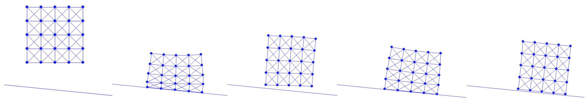

## 从地面到斜面

[方块下落](../filter-line-search/square_drop.md)案例研究中针对水平地面的实现，相较于一般半空间（公式 {{eqref: eq:lec7:half_space_dist}}）给出了简化的距离与距离梯度（公式 {{eqref: eq:lec8:dist_ground}}）：
$$
    d(\mathbf{x}) = \mathbf{n}^T (\mathbf{x} - \bm{o}), \quad
    \nabla d(\mathbf{x}) = \mathbf{n}, \quad \text{and} \quad 
    \nabla^2 d(\mathbf{x}) = \bm{0}.
    {{numeq}}{eq:lec10:half_space_dist}
$$
这正是实现斜面所需的全部内容。定义法向方向与斜面上的一点

{{imp}}{imp:lec10:slope}[斜面设置，simulator.py]
```python
{{#include ../../solid-sim-tutorial/4_friction/simulator.py:slope_setup}}
```
并将其传入时间积分器与障碍能量，就可以按如下方式修改斜面的障碍能量值、梯度与海森矩阵的计算

{{imp}}{imp:lec10:slope_barrier}[斜面接触障碍函数，BarrierEnergy.py]
```python
{{#include ../../solid-sim-tutorial/4_friction/BarrierEnergy.py:slope_barrier}}
```

随后，对于连续碰撞检测，我们同样修改实现，利用 $\mathbf{n}$ 与 $\bm{o}$ 计算线搜索所用的较大可行初始步长：

{{imp}}{imp:lec10:slope_ccd}[斜面 CCD，BarrierEnergy.py]
```python
{{#include ../../solid-sim-tutorial/4_friction/BarrierEnergy.py:init_step_size}}
```
这里每个节点的搜索方向都被投影到法向方向 $\mathbf{n}$ 上，以便在计算首次使距离变为 $0$ 的最小步长时除以当前距离。

最后，把斜面绘制成从 $\bm{o} - 3\hat{n}$ 到 $\bm{o} + 3\hat{n}$ 的线段，其中 $\hat{n} = [\mathbf{n}_y, -\mathbf{n}_x]$ 指向倾斜方向，

{{imp}}{imp:lec10:slope_vis}[斜面可视化，simulator.py]
```python
{{#include ../../solid-sim-tutorial/4_friction/simulator.py:slope_vis}}
```
现在我们就可以仿真落在无摩擦斜面上的弹性方块（{{ref: fig:lec10:slope_mu0}}）。
<figure>
    <center>
    
    </center>
    <figcaption><b>{{fig}}{fig:lec10:slope_mu0}</b> 一个弹性方块落在无摩擦斜面上，一边下滑一边弹跳。 </figcaption>
</figure>
