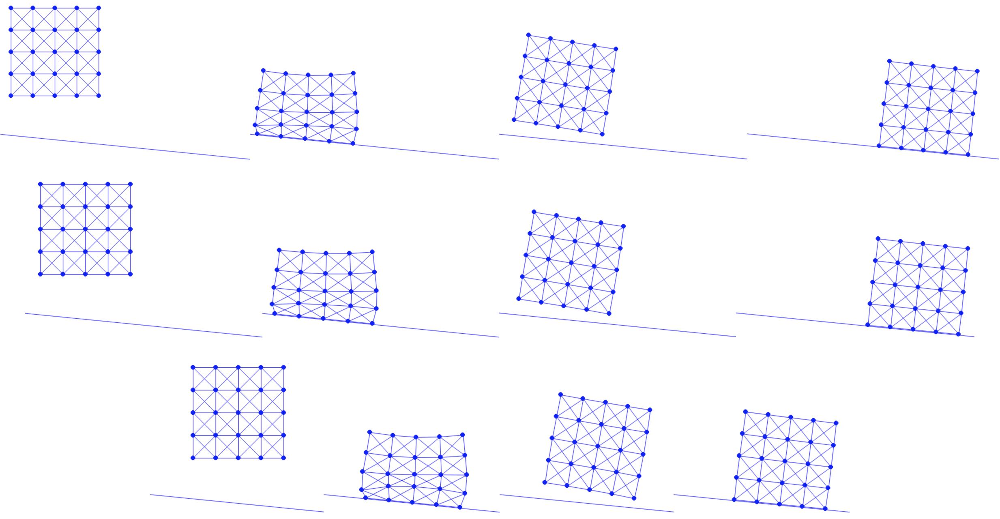

## 斜面摩擦

现在为斜面实现摩擦。我们首先按照公式 {{eqref: eq:lec9:f0}}、公式 {{eqref: eq:lec9:f1_term}} 和公式 {{eqref: eq:lec9:hess_term}}，分别实现计算 $f_0(\| \bar{v}_k \| \hat{h})$、$f_1(\| \bar{v}_k \|)/\| \bar{v}_k \|$ 与 $(f'_1(\|\bar{\mathbf{v}}_k\|)\|\bar{\mathbf{v}}_k\| - f_1(\|\bar{\mathbf{v}}_k\|))/\|\bar{\mathbf{v}}_k\|^2$ 的函数。

{{imp}}{imp:lec10:f_terms}[摩擦辅助函数，FrictionEnergy.py]
```python
{{#include ../../solid-sim-tutorial/4_friction/FrictionEnergy.py:f_terms}}
```

有了这些项，我们就可以按照公式 {{eqref: eq:lec9:fric_potential}}、公式 {{eqref: eq:lec9:fric_grad}} 和公式 {{eqref: eq:lec9:fric_hess}}，分别实现半隐式摩擦能量的值、梯度与海森矩阵的计算。

{{imp}}{imp:lec10:friction_val_grad_hess}[摩擦的值、梯度与海森矩阵，FrictionEnergy.py]
```python
{{#include ../../solid-sim-tutorial/4_friction/FrictionEnergy.py:val_grad_hess}}
```

注意，在 Numpy 中矩阵-矩阵与矩阵-向量乘积通过 `dot()` 函数实现。
对于隐式欧拉，$v = (x - x^n) / h$，因此 $\hat{h}= h$。
这里 `mu_lambda` 为每个节点存储 $\mu \lambda_k^n$，其中法向力大小 $\lambda_k^n$ 在每个时间步开始时用 $x^n$ 计算。

{{imp}}{imp:lec10:use_mu_lambda}[使用 mu 与 lambda，time_integrator.py]
```python
{{#include ../../solid-sim-tutorial/4_friction/time_integrator.py:mu_lambda}}
```

{{imp}}{imp:lec10:compute_mu_lambda}[计算 mu 与 lambda，BarrierEnergy.py]
```python
{{#include ../../solid-sim-tutorial/4_friction/BarrierEnergy.py:compute_mu_lambda}}
```

由于斜面是静止的，且法向方向处处相同，$T$ 为常数，因而可以被精确离散。

最后，我们设置摩擦系数 $\mu$ 并将其传入时间积分器，在那里加入摩擦能量以建模斜面上的半隐式摩擦。

```python
{{#include ../../solid-sim-tutorial/4_friction/simulator.py:set_mu}}
```

现在可以测试不同摩擦系数下的仿真了。由于斜面倾角 $\theta$ 满足 $\tan(\theta) = 0.1$，我们测试 $\mu=0.1$、$0.11$ 与 $0.2$（{{ref: fig:lec10:diff_mu_exp}}）。可以看到，当 $\mu=0.1$ 时，这一临界值恰好使动摩擦力与重力沿斜面的分量大小相同，方块在获得初始动量后持续下滑（{{ref: fig:lec10:diff_mu_exp}} 上）。当取略高于临界值的 $\mu=0.11$ 时，方块下滑一段后停下，说明静摩擦得到了正确的求解（{{ref: fig:lec10:diff_mu_exp}} 中）。当 $\mu=0.2$ 时，方块更早停下（{{ref: fig:lec10:diff_mu_exp}} 下）。

<figure>
    <center>
    
    </center>
    <figcaption><b>{{fig}}{fig:lec10:diff_mu_exp}</b> 在摩擦系数 $\mu = 0.1$（上）、$0.11$（中）与 $0.2$（下）下，我们仿真一个落在斜面上的弹性方块。除了保持下滑的上图之外，$\mu$ 较大的下两图最终都达到静力平衡。 </figcaption>
</figure>
