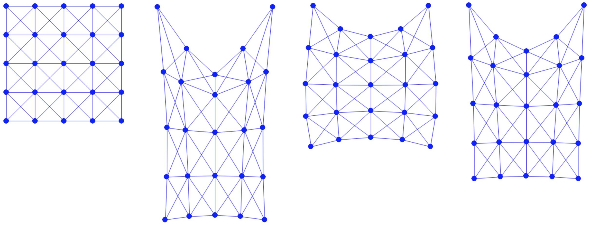

## 案例研究：悬挂方块*
我们用一个简单的案例研究来结束本讲。基于前一节中建立的[质点-弹簧系统](../../simulation-with-optimization/case-study-2d-mass-spring/2d_mass_spring.md)，我们实现重力势能与粘着狄利克雷边界条件，以仿真一个悬挂的方块。
本节可执行的 Python 工程见 [https://github.com/phys-sim-book/solid-sim-tutorial](https://github.com/phys-sim-book/solid-sim-tutorial) 中的 `2_dirichlet` 文件夹。 
[MUDA](https://github.com/MuGdxy/muda) GPU 实现见 [https://github.com/phys-sim-book/solid-sim-tutorial-gpu](https://github.com/phys-sim-book/solid-sim-tutorial-gpu) 中的 `simulators/2_dirichlet` 文件夹。

重力势能具有
$$
    P(x) = -x^T Mg, \quad \nabla P(x) = -Mg, \quad \text{and} \quad \nabla^2 P(x) = 0,
$$
它的实现很直接：

{{imp}}{imp:lec5:GravityEnergy}[GravityEnergy.py]
```python
{{#include ../../solid-sim-tutorial/2_dirichlet/GravityEnergy.py}}
```
然后我们只需确保重力势能被加入增量势能（IP）：

{{imp}}{imp:lec5:time_integrator_1}[把重力加入 IP，time_integrator.py]
```python
{{#include ../../solid-sim-tutorial/2_dirichlet/time_integrator.py:ADDING_GRAVITY}}
```

对于粘着狄利克雷边界条件，我们在计算搜索方向时相应地修改系统：

{{imp}}{imp:lec5:time_integrator_2}[自由度消元，time_integrator.py]
```python
{{#include ../../solid-sim-tutorial/2_dirichlet/time_integrator.py:search_dir}}
```
这里 `is_DBC` 是一个标记节点是否为狄利克雷节点的数组，因为我们把狄利克雷节点索引存放在 `DBC` 中：

{{imp}}{imp:lec5:time_simulator_1}[DBC 定义，simulator.py]
```python
{{#include ../../solid-sim-tutorial/2_dirichlet/simulator.py:DBC_def}}

# ...

{{#include ../../solid-sim-tutorial/2_dirichlet/simulator.py:DBC_mask}}
```

最后，在确保 `is_DBC` 被传入时间积分器之后，我们就可以用较小的弹簧刚度 `k=1e3`、帧率时间步长 `h=0.02` 仿真一个有能量的悬挂方块（无初始拉伸）（{{ref: fig:lec5:hanging_square_sim}}）。

<figure>
    <center>
    
    </center>
    <figcaption><b>{{fig}}{fig:lec5:hanging_square_sim}</b> 从左到右：悬挂方块仿真的初始帧、中间帧与最终静止帧。 </figcaption>
</figure>
