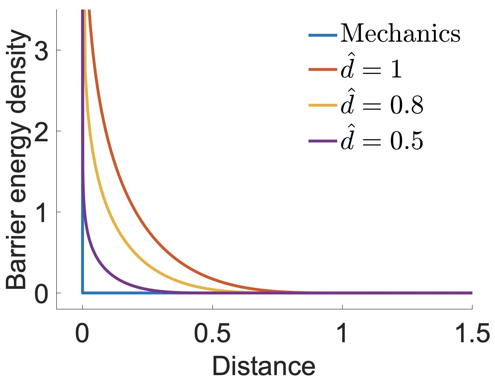

## 距离障碍函数

### 约束优化

在固体与平面地面相互作用这类场景中，若障碍物外部的有符号距离函数 \\( d(\mathbf{x}) \\) 是光滑的，我们就可以通过引入非穿透约束来处理接触建模。这些约束用 \\( d(\mathbf{x}) \\) 表达，同时我们仍希望最小化系统的增量势能（Incremental Potential）。

假设固体由节点 \\(\mathbf{x}\\) 稠密采样，我们便在节点自由度（Degree of Freedom，DOF）的层面上，针对障碍物施加这些约束：

$$
    \min_{\mathbf{x}} E(\mathbf{x}) \quad \text{s.t.} \quad d_{ij} \geq 0 \ \ \forall \ \text{node} \ i \ \text{and} \ \text{obstacle} \ j.
    {{numeq}}{eq:lec7:constrained_IP}
$$

式中 \\( d_{ij} \\) 表示节点 \\( i \\) 与障碍物 \\( j \\) 之间的有符号距离。只要保证 \\( d_{ij} \\) 非负，就能有效地防止固体与障碍物相交[^1]。

### 接触建模中的对数障碍势能

为了处理接触建模中的不等式约束，我们引入障碍势能 \\( P_b(\mathbf{x}) \\)。该势能将式 {{eqref: eq:lec7:constrained_IP}} 描述的约束问题转化为一个“无约束”优化问题：

$$
    \min_{\mathbf{x}} E(\mathbf{x}) + h^2 P_b(\mathbf{x}).
    {{numeq}}{eq:lec7:barrier_IPC}
$$

障碍势能的定义如下：

$$
    P_b(\mathbf{x}) = \sum_{i,j} A_i \hat{d} b(d_{ij}(\mathbf{x})) \quad \text{and} \quad
    b(d_{ij}(\mathbf{x})) = 
    \begin{cases}
        \frac{\kappa}{2} \left(\frac{d_{ij}}{\hat{d}} - 1\right) \ln \frac{d_{ij}}{\hat{d}} & d_{ij} < \hat{d} \\
        0 & d_{ij} \geq \hat{d}.
    \end{cases}
    {{numeq}}{eq:lec7:barrier_func}
$$

在该形式中，\\( b() \\) 表示障碍能量密度函数。当距离趋近于零时，该函数趋于无穷，从而提供强大的排斥力以防止相互穿透（参见 {{ref: fig:lec7:barrier_func}}）。超过该距离便不再施加接触力的距离阈值 \\( \hat{d} \\)、控制接触力随距离变化速率的接触刚度 \\( \kappa \\)，以及节点 \\( i \\) 的接触面积 \\( A_i \\)，都是这一设定中的关键参数。通过在固体边界上对能量密度进行积分，障碍函数形式有效地建模出一个厚度为 \\( \hat{d} \\) 的势能场。

<figure>
    

    
    

    <figcaption><b>{{fig}}{fig:lec7:barrier_func}</b> 取不同 $\hat{d}$ 时绘制的障碍能量密度函数。随着 $\hat{d}$ 减小，其结果渐近地逼近接触条件的不连续定义。 </figcaption>
</figure>

> **{{rem}}{rm:lec7:contact_layer}[接触层解释]**
> 可以把障碍势能 \\( P_b(\mathbf{x}) \\) 想象成紧贴固体边界外侧的一层极薄虚拟材料所提供的弹性。该虚拟层的有效厚度为 \\( \hat{d} \\)，与障碍函数中的距离阈值相对应。
>
> 因此，计算 \\( P_b(\mathbf{x}) \\) 时所用的积分或求和以体积元 \\( w_i = A_i \hat{d} \\) 加权，其中 \\( A_i \\) 表示每个节点的接触面积。当固体接近并开始压缩这层虚拟弹性层时，接触力便会产生。这些力类似于一种特殊的弹性力，只要固体彼此靠得过近，就通过排斥作用来防止相互穿透。该模型使我们能够在固体不发生实际穿透的前提下仿真接触的物理响应。

以距离为中间变量应用链式法则，可以推导出 \\(P_b(\mathbf{x})\\) 的梯度与海森矩阵为
$$
    \nabla P_b(\mathbf{x}) = \sum_{i,j} w_i \frac{\partial b}{\partial d}(d_{ij}(\mathbf{x})) \nabla d_{ij}(\mathbf{x})
    {{numeq}}{eq:lec7:barrier_grad}
$$
以及
$$
    \nabla^2 P_b(\mathbf{x}) = \sum_{i,j} w_i \left( \frac{\partial^2 b}{\partial d^2}(d_{ij}(\mathbf{x})) \nabla d_{ij}(\mathbf{x}) \nabla d_{ij}(\mathbf{x})^T + \frac{\partial b}{\partial d}(d_{ij}(\mathbf{x})) \nabla^2 d_{ij}(\mathbf{x}) \right).
    {{numeq}}{eq:lec7:barrier_hess}
$$

[^1]: 由于此处使用的是有符号距离，不等式约束的定义无需像无符号距离那样引入 \\(\epsilon\\)（参见式 {{eqref: eq:lec2:IC}}）。
