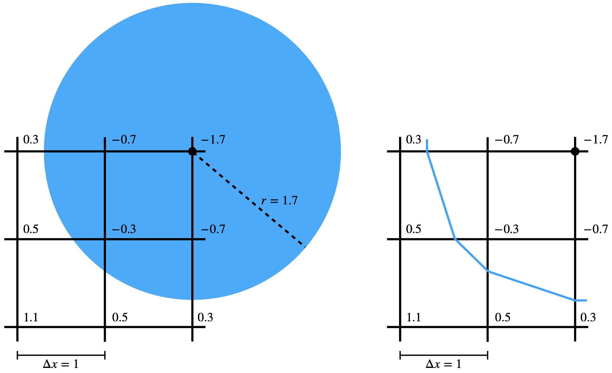

## 有符号距离

增量势能接触（Incremental Potential Contact，IPC）方法旨在通过在运动全程中保持固体边界之间的*无符号*距离大于零，来确保任意余维数的固体都不发生相互穿透。该方法的鲁棒性在于其普遍适用，与固体的具体特征无关。

然而，当能够获取*有符号*距离时，IPC 的应用不仅直接，而且更加简洁。有符号距离把无符号距离的概念推广到具有闭合边界的固体几何。由于 IPC 强制满足非穿透，固体内部出现负距离的可能性被排除。因此，在有符号距离保持非负（包括恰好为零的状态）的场景中，就表明非穿透得到了成功保证。

> **{{def}}{def:lec7:codimension}[余维数]**
> 若 \\(W\\) 是有限维向量空间 \\(V\\) 的线性子空间，则 \\(W\\) 在 \\(V\\) 中的余维数是二者维数之差：
$$
    \text{codim}(W) = \text{dim}(V) - \text{dim}(W).
$$
> 例如在三维空间中，曲面的余维数为 \\(1\\)，直线的余维数为 \\(2\\)。
> 在计算机图形学中，仿真布料与毛发时，为提升效率通常分别采用余维数为 1 和 2 的几何表示。然而，这类表示的有符号距离并没有良好定义。这也解释了为何无符号距离在固体接触建模中更具一般性。

在之前的[小节](../../simulation-with-optimization/discrete-space-and-time/solid_rep.md)中，我们探讨了表示固体几何的各种方法。其中一种值得注意的方法是解析表示。例如，以 \\( \mathbf{c} \\) 为球心、半径为 \\( r \\) 的三维球体可用如下参数化形式解析地描述：

$$
\{ \mathbf{x} \in \mathbb{R}^{3} \ | \ \|\mathbf{x} - \mathbf{c}\| \le r, \ \mathbf{c} \in \mathbb{R}^{3}, \ r > 0 \}.
$$

这种定义固体几何的思路并不局限于简单的球体。许多其他形状，如半空间、长方体、椭球体和圆环面，都可以类似地参数化。这些参数化的关键在于定义这些对象的“内部”，而这往往可以通过有符号距离一类的函数来实现。这类函数提供了一种通用的工具，能够以简洁而数学化的方式描述从简单到复杂的各种形状。

> **{{exp}}{exp:lec7:ball_sdf}[球体的有符号距离函数]**
> 以 \\(\mathbf{c}\\) 为球心、半径为 \\(r\\) 的球体的有符号距离函数 \\(d(\mathbf{x})\\) 及其导数可定义为
$$
\begin{aligned}
  &  d(\mathbf{x}) = \| \mathbf{x} - \mathbf{c} \| - r, \quad \nabla d(\mathbf{x}) = \frac{ \mathbf{x} - \mathbf{c}}{\| \mathbf{x} - \mathbf{c} \|}, \quad  \nonumber \\ 
    &\text{and} \quad \nabla^2 d(\mathbf{x}) = \frac{\|\mathbf{x} - \mathbf{c}\|^2 I - (\mathbf{x} - \mathbf{c}) (\mathbf{x} - \mathbf{c})^T}{\|\mathbf{x} - \mathbf{c}\|^3}.
\end{aligned}
$$

> **{{exp}}{exp:lec7:half_space_sdf}[半空间的有符号距离函数]**
> 法向为 \\(\mathbf{n}\\) 且满足 \\(d(\mathbf{o}) = 0\\) 的半空间，其有符号距离函数 \\(d(\mathbf{x})\\) 及其导数可定义为
$$
    d(\mathbf{x}) = \mathbf{n}^T (\mathbf{x} - \mathbf{o}), \quad
    \nabla d(\mathbf{x}) = \mathbf{n}, \quad \text{and} \quad 
    \nabla^2 d(\mathbf{x}) = \mathbf{0}.
    {{numeq}}{eq:lec7:half_space_dist}
$$

现实生活中常见的更复杂几何形状往往因其复杂性而难以表示。除复杂的参数化之外，一种有效的替代方案是使用均匀欧氏网格。该网格用于存储固体对象的有符号距离，这些距离在每个网格节点处预先计算。当需要固体内部任意点处的距离时，可对网格数据做插值。

> **{{exp}}{exp:lec7:grid_sdf}[网格有符号距离场]**
> 对于存储在间距为 \\(\Delta x\\) 的均匀欧氏网格上的有符号距离场，若要在任意位置 \\(\mathbf{x} = (x,y)\\) 处查询距离，其中 \\(x = x_i + \alpha \Delta x\\)、\\(y = y_i + \beta \Delta x\\)（\\(\mathbf{x}_{i,j} = (x_i, y_j)\\) 为网格节点的位置，\\(0 \leq \alpha,\beta \leq 1\\)），则采用双线性插值（{{ref: fig:lec7:VDB_exp}} 右图）可得
$$
    d(\mathbf{x}) = (1-\beta)((1-\alpha)d(\mathbf{x}_{i,i}) + \alpha d(\mathbf{x}_{i+1,i})) + \beta((1-\alpha)d(\mathbf{x}_{i,i+1}) + \alpha d(\mathbf{x}_{i+1,i+1})).
$$
> 从 {{ref: fig:lec7:VDB_exp}} 中我们还可以看到，要在此设定下光滑地近似固体边界，需要采用更高阶的插值格式，例如二次 B 样条插值。 <figure>
    

    
    

    <figcaption><b>{{fig}}{fig:lec7:VDB_exp}</b> 网格节点到球体边界的有符号距离经过预计算并被存储（左图）。采用双线性插值后，球体边界的一部分被近似为蓝色折线（右图）。 </figcaption>
</figure>
