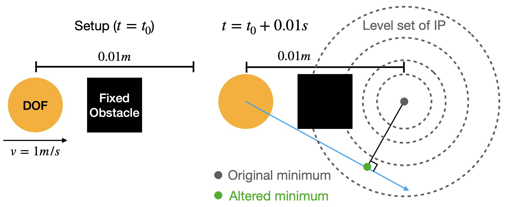
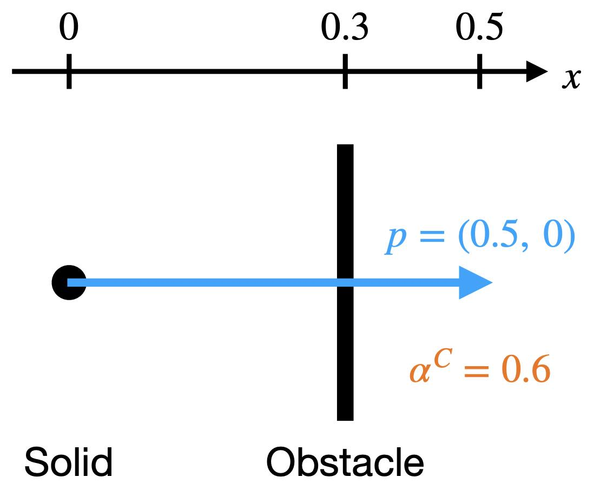
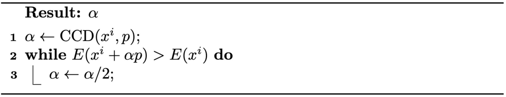
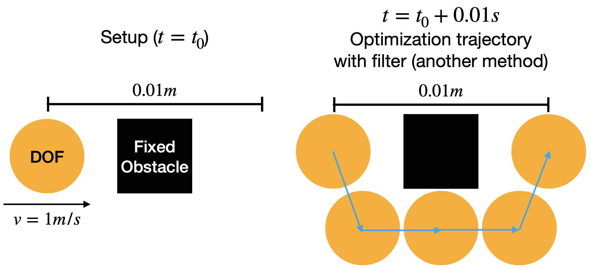

## 无穿透轨迹

要定义分别位于时刻 \\(t^n\\) 与 \\(t^{n+1}\\) 的构型 \\(x^n\\) 与 \\(x^{n+1}\\) 之间的运动轨迹，最直接的方式是取连接这两个构型的高维线段。然而，尽管在该轨迹上强制有符号距离非负可以避免 {{ref: exp:lec8:tunneling}} 中的隧穿问题，这一策略却会以非物理的方式改变最小化问题（式 {{eqref: eq:lec7:constrained_IP}}）的局部最优解，从而可能产生不符合实际的行为（{{ref: fig:lec8:altered_min}}）。

<figure>
    

    
    

    <figcaption><b>{{fig}}{fig:lec8:altered_min}</b> 对于隧穿示例中的设置，在以 $x^n$ 与 $x^{n+1}$ 之间的线段近似的运动轨迹上强制有符号距离非负，会得到非物理的仿真结果。 </figcaption>
</figure>

对 \\(x^n\\) 与 \\(x^{n+1}\\) 之间运动轨迹更严格的定义可以是
$$
    \left\{ \text{arg}\min_{x} \left. \left( \frac{1}{2}\|x - (x^n+hv^n)\|_M^2 + h^2 \sum P(x) \right) \right| \ h \in [0, t^{n+1} - t^n] \right\}.
$$
然而，计算该轨迹上的构型需要额外求解优化问题，这可能使时间积分显著复杂化。

作为替代，增量势能接触（Incremental Potential Contact，IPC）将优化路径视为运动轨迹的近似。具体而言，对于从 \\(x^n\\) 求解到 \\(x^{n+1}\\) 的时间步，若优化过程进行了 \\(l\\) 次迭代，且每次迭代经过线搜索后得到迭代点 \\(x^i\\)，那么优化路径就是一条高维折线
$$
    \{ (1 - \beta) x^i + \beta x^{i+1} \ | \ \beta \in [0, 1], \ i = 0, 1, 2, ..., l \}.
$$
于是，第 \\(n\\) 个时间步的时间积分问题便成为：寻找这样的优化路径 \\(x^0, x^1, ..., x^l\\)，使得 \\(x^l\\) 在满足下述条件的约束下局部最小化增量势能（式 {{eqref: eq:lec7:barrier_IPC}}）：
$$
    d_{jk}((1 - \beta) x^i + \beta x^{i+1}) > 0 \\ \forall \ \text{node} \ j, \ \text{obstacle} \ k, \ \beta \in [0, 1], \text{and} \ i = 0, 1, 2, ..., l.
$$
这使得我们可以在每次优化迭代中，在 \\(x^i\\) 与 \\(x^{i+1}\\) 之间的线段上强制非负距离约束；这样做不会改变时间积分问题的局部最优解，而且这一处理可以高效地完成。

回顾 {{ref: alg:lec3:line_search}} 可知，线搜索方案按下式更新迭代点 \\(x^{i+1} \leftarrow x^i + \alpha p\\)，即 \\(x^{i+1} - x^{i} = \alpha p\\)。因此，给定无相互穿透的 \\(x^i\\)，要确保 \\(x^i\\) 与 \\(x^{i+1}\\) 之间线段上的所有构型都无相互穿透，我们只需找到一个 \\(\alpha\\)，使得
$$
d_{jk}(x^i + \beta p) \geq 0 \quad \forall \ \text{node} \ j, \ \text{obstacle} \ k, \ \text{and} \ \beta \in [0, \alpha].
$$
基于“足够小的 \\(\alpha\\) 必定能实现这一点”的直觉，我们只需在每次迭代中计算此类 \\(\alpha\\) 的一个上界，并确保回溯线搜索得到的步长小于该上界。该上界可以借助连续碰撞检测（Continuous Collision Detection，CCD）方便地算出。

> **{{def}}{def:lec8:ccd}[连续碰撞检测（CCD）]**
> 对于由固体与障碍物的初始无穿透构型 \\(x\\)、其预期位移 \\(p\\) 以及步长 \\(\alpha\\) 所定义的距离函数 \\(d_{jk}(x + \alpha p)\\)，CCD 在给定 \\(x\\) 与 \\(p\\) 的条件下算出步长 \\(\alpha^C_{jk}\\)，使得
$$
    d_{jk}(x + \alpha p) > 0 \quad \forall \ \alpha \in [0, \alpha^C_{jk}).
    {{numeq}}{eq:lec8:alpha_CCD}
$$
> 注意，该问题的定义隐含要求 \\(d_{jk}(x) > 0\\)。在此设定下，若记 \\(d^a_{jk}(\alpha) = d_{jk}(x + \alpha p)\\)，则 \\(\alpha^C_{jk}\\) 就是 \\(d^a_{jk}(\alpha)\\) 的最小正实根（示例见 {{ref: fig:lec8:CCD}}）；若 \\(d^a_{jk}(\alpha)\\) 没有任何正实根，则 \\(\alpha^C_{jk} = \infty\\)。获取 \\(\alpha^C_{jk}\\) 的精确值或保守估计有许多方法，我们将在本章的案例研究中看到一个具体示例。在对所有节点 \\(j\\) 与障碍物 \\(k\\) 计算 \\(\alpha^C_{jk}\\) 之后，线搜索的步长上界 \\(\alpha^C\\) 即可由下式得到
$$
    \alpha^C = \min(1, \min_{j,k} \alpha^C_{jk})
$$ <figure>
    

    
    

    <figcaption><b>{{fig}}{fig:lec8:CCD}</b> CCD 示意图：位于 $(0, 0)$ 的固体粒子撞击 $x=0.3$ 处的固定竖直平面。当预期位移为 $\mathbf{p}=(0.5, 0)$ 时，可得 $\alpha^C = 0.6$。 </figcaption>
</figure>

现在，我们可以介绍过滤线搜索方法（{{ref: alg:lec8:filter_line_search}}），它专门用于在整条近似的运动轨迹上强制非穿透约束。这种策略性的强制是防止隧穿问题的关键，而隧穿问题在约束处理不充分的仿真中十分常见。

这一新方案与传统的回溯线搜索方法在一个关键方面不同：步长的初始化方式。过滤线搜索方法不再从步长 \\(1\\) 出发，而是从 \\(\alpha^C\\) 开始。这一改动看似细微，却意义重大。

<figure>
    

    <b><figcaption>{{alg}}{alg:lec8:filter_line_search}[过滤回溯线搜索]</figcaption></b>
    
    

</figure>

> **{{rem}}{rm:lec8:algorithm_dependency}[算法依赖问题]**
> 用优化路径近似运动轨迹仍然不够完美，因为它依赖于具体算法。除投影牛顿（Projected Newton，PN）法之外，可能存在某种算法绕过障碍物、最终落在另一侧的构型上，仍然给出隧穿的解（{{ref: fig:lec8:still_tunnel}}）。 
> 即便采用投影牛顿法，尽管实践中它总能生成直接且物理上合理的轨迹，也没有理论保证它绝不会遇到隧穿问题。 
> 一种直觉是：PN 每次迭代的搜索方向总是显著降低增量势能（Incremental Potential，IP），因此它不太可能绕过任何接触——绕过接触往往会导致迭代无法充分降低 IP。
> 事实上，这类问题在没有接触的弹性动力学仿真中也会出现。弹性势能本身也是非凸的，这可能导致 IP 存在多个局部最优解。获得符合物理行为的关键在于**局部最小化** IP，换言之，即找到附近的局部极小点作为解。 <figure>
    

    
    

    <figcaption><b>{{fig}}{fig:lec8:still_tunnel}</b> 对于隧穿示例中的设置，即使采用过滤线搜索方案，若使用投影牛顿法之外的优化方法，仍可能导致隧穿问题。 </figcaption>
</figure>
