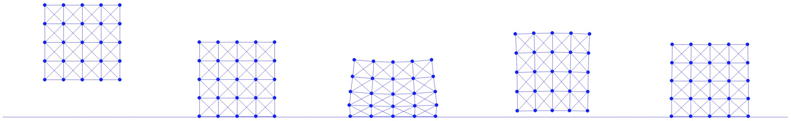

## 案例研究：方块下落

最后，我们来看一个案例研究：仿真一个落到固定平面地面上的方块。在之前用于弹性方块的质点-弹簧模型基础上，我们在其增量势能中加入障碍势能，并应用过滤线搜索方案来处理方块自由度（degree of freedom，DOF）与地面之间的接触。

本节的可执行 Python 工程位于 [https://github.com/phys-sim-book/solid-sim-tutorial](https://github.com/phys-sim-book/solid-sim-tutorial) 的 `3_contact` 文件夹下。
[MUDA](https://github.com/MuGdxy/muda) GPU 实现位于 [https://github.com/phys-sim-book/solid-sim-tutorial-gpu](https://github.com/phys-sim-book/solid-sim-tutorial-gpu) 的 `simulators/3_contact` 文件夹下。

若进一步限定平面地面为水平面，例如位于 \\(y=y_0\\) 处，其有符号距离函数可以比式 {{eqref: eq:lec7:half_space_dist}} 更简单：
$$
    d(\mathbf{x}) = \mathbf{x}_y - y_0, \quad 
    \nabla d(\mathbf{x}) = 
        \begin{bmatrix}
            0 \\
            1
        \end{bmatrix}, \quad
    \nabla^2 d(\mathbf{x}) = \mathbf{0}.
    {{numeq}}{eq:lec8:dist_ground}
$$
将其与式 {{eqref: eq:lec7:barrier_grad}} 及式 {{eqref: eq:lec7:barrier_hess}} 结合，即可方便地实现水平地面障碍势能的梯度与海森矩阵计算：

{{imp}}{imp:lec8:barrier_val_grad_hess}[障碍能量值、梯度与海森矩阵，BarrierEnergy.py]
```python
{{#include ../../solid-sim-tutorial/3_contact/BarrierEnergy.py:val_grad_hess}}
```

对于过滤线搜索，设上一次迭代中的位置为 \\(\mathbf{x}\\)、某个节点的搜索方向为 \\(\mathbf{p}\\)，则有符号距离函数可简单写为
\\[
    d(\mathbf{x} + \alpha \mathbf{p}) = \mathbf{x}_y + \alpha \mathbf{p}_y - y_0,
\\]
其中 \\(\alpha\\) 为步长；由于 \\(\mathbf{x}_y > y_0\\)（当前迭代为止尚未发生互穿），当 \\(\mathbf{p}_y < 0\\) 时只有一个正实根 \\(\alpha = (y_0 - \mathbf{x}_y) / \mathbf{p}_y\\)。对每个节点取该正实根的最小值，便得到式 {{eqref: eq:lec8:alpha_CCD}} 中定义的步长上界 \\(\alpha_C\\)：

{{imp}}{imp:lec8:ground_CCD}[地面 CCD，BarrierEnergy.py]
```python
{{#include ../../solid-sim-tutorial/3_contact/BarrierEnergy.py:init_step_size}}
```
这里将上界乘以 \\(0.9\times\\) 进行缩放，以避免出现 \\(d=0\\)、\\(b = \infty\\)（浮点数溢出）的恰好接触状态。

随后，只要确保用该步长上界初始化线搜索

{{imp}}{imp:lec8:filter_ls}[过滤线搜索，time_integrator.py]
```python
{{#include ../../solid-sim-tutorial/3_contact/time_integrator.py:filter_ls}}
```
并确保所有节点的接触面积权重都已计算

{{imp}}{imp:lec8:contact_area}[接触面积，simulator.py]
```python
{{#include ../../solid-sim-tutorial/3_contact/simulator.py:contact_area}}
```
且被传入仿真器，我们便能以质点-弹簧刚度 `k=2e4`、时间步长 `h=0.01` 仿真方块下落，如图 {{ref: fig:lec8:square_drop}} 所示。

<figure>
    <center>
    
    </center>
    <figcaption><b>{{fig}}{fig:lec8:square_drop}</b> 一个质点-弹簧弹性方块在重力作用下以 $0$ 初速度落向地面。这里展示了方块处于以下状态时的帧：刚被释放、首次接触地面、在本次仿真中被压缩至最大程度，以及最终变为静止。 </figcaption>
</figure>

> **{{rem}}{rm:lec8:contact_layer_integration}[接触层的积分]**
> 由于实际中接触力只作用在固体的边界上，障碍势能也应当只在边界上积分。 
> 这也解释了为何在本案例研究中，每个节点的接触面积权重简单地取为方块直径均分到各边界节点上的结果。
> 不过，由于质点-弹簧弹性无法保证所有内部节点始终位于固体边界之内，我们干脆对方块的所有节点自由度施加障碍势能。
