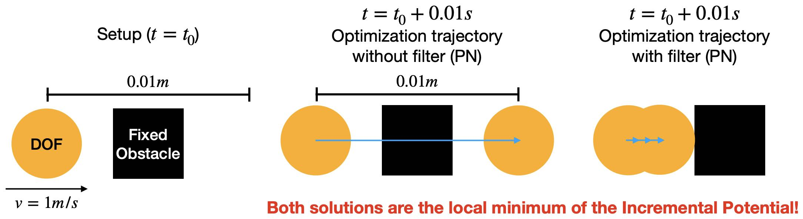

## 隧穿问题

> **{{exp}}{exp:lec8:tunneling}[隧穿]**
> 考虑一个简单的示例。在不施加重力等外力的情况下，一个位于 \\(\mathbf{x}_0 = (0, 0)\\)、质量为 \\(m\\)、初速度为 \\(\mathbf{v}_0 = (1, 0)\\) 的粒子（无弹性）撞向中心位于 \\((0.005, 0) \\) 的固定方形障碍物，第一时间步的增量势能最小化问题为
$$
    \min_{\mathbf{x}} \left( \frac{m}{2}\|\mathbf{x} - (\mathbf{x}_0 + h \mathbf{v}_0) \|^2 + h^2 P_b(\mathbf{x}) \right).
    {{numeq}}{eq:lec8:ip_particle_hit_square}
$$
> 由于 \\(\hat{d}\\) 通常取得足够小（本例中为 \\(10^{-4}m\\)），而粒子尚未接触障碍物，障碍势能 \\(P_b(\mathbf{x})\\) 在 \\(\mathbf{x}_0\\) 处还未被激活。这使得式 {{eqref: eq:lec8:ip_particle_hit_square}} 中的问题成为二次问题，于是我们的投影牛顿法（projected Newton，PN）（{{ref: alg:lec3:PN_method_IE}}）将在第一次迭代时产生搜索方向
$$
    \mathbf{p} = h \mathbf{v}_0
$$
> 该方向在第一次迭代时经线搜索后直接指向增量势能在 \\(\mathbf{x}_0 + h\mathbf{v}_0\\) 处的全局极小点。取 \\(h=0.01s\\)（{{ref: fig:lec8:filter_ls}}）时，粒子便会穿过障碍物。 
> 然而，因时间步长过大而使粒子穿过障碍物的情形显然不符合实际，因为预期的物理行为是粒子与障碍物碰撞后停下或反弹。 
 
<figure>
    

    
    

    <figcaption><b>{{fig}}{fig:lec8:filter_ls}</b> 隧穿问题的示意。采用前面介绍的投影牛顿法时，可能出现中间所示的隧穿伪影；而采用过滤线搜索方案则可得到右侧所示符合物理的结果。蓝色箭头表示优化路径。 </figcaption>
</figure>

由 {{ref: exp:lec8:tunneling}} 可知，仅仅保证最终解处的有符号距离非负是不够的，在大时间步长、高速撞击或薄障碍物等情形下尤其如此。这些情况会导致仿真出现不准确、不符合实际的结果。

增量势能接触（Incremental Potential Contact，IPC）方法通过保证距离在固体的整个运动轨迹上始终非零来解决这一问题。这一做法对于保持仿真的物理准确性与真实感至关重要。

但在离散时间积分的语境下，“运动轨迹”究竟指什么？下面我们对此加以说明。
