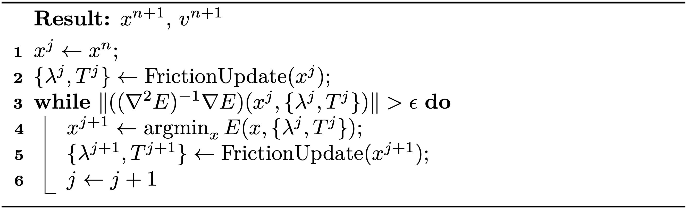

## 不动点迭代

为获得完全隐式摩擦的解，我们可以迭代地交替执行以下两步：一是固定 $\lambda$ 与 $T$ 的非线性优化
$$
\begin{align}
   & \min_{x}: E(x, \{\lambda, T\}) = \frac{1}{2} \|x - \tilde{x}^{n}\|^2_M +  \Delta t^2 \left( P_e(x) + P_b(x) + P_f(x, \{\lambda, T\}) \right) \nonumber\\ &\text{s.t.} \quad Ax = b,
    {{numeq}}{eq:lec9:discretized_IP_withBandD}
\end{align}
$$
二是摩擦更新，如此反复直至收敛（{{ref: alg:lec9:friction_iter}}）。
<figure>
    

    <b><figcaption>{{alg}}{alg:lec9:friction_iter}[完全隐式摩擦的不动点迭代]</figcaption></b>
    
    

</figure>

若记
$$
\begin{aligned}
    & f_m(\{ \lambda, T \}) = \text{arg}\min_x E(x, \{ \lambda, T\}) \\
    & f_u(x) = \text{FrictionUpdate}(x),
\end{aligned}
$$
则 {{ref: alg:lec9:friction_iter}} 本质上是一个不动点迭代，用于求如下函数的不动点：
$$
    (f_m \cdot f_u) (x) \equiv f_m( f_u (x)).
$$

> **{{def}}{def:lec9:fixed_point_iterations}**
> $x$ 是函数 $f()$ 的不动点，当且仅当
$$
    x = f(x).
$$
> 不动点迭代则从 $x^0$ 出发，通过反复更新估计值
$$
    x^{i+1} \leftarrow f(x^i)
$$
> 来求函数 $f()$ 的不动点，直至收敛。

由于不动点迭代只有在初始猜测足够接近最终解时才能收敛，{{ref: alg:lec9:friction_iter}} 的收敛同样要求较小的时间步长。但要注意，在固定 $\{ \lambda, T \}$ 时，每次最小化（{{ref: alg:lec9:friction_iter}} 第 4 行）在任意大的时间步长下仍然保证收敛。

> **{{rem}}{rm:lec9:friction_visual_quality}**
> 实践中，取帧率级时间步长的半隐式摩擦已经能产生视觉质量很高的结果。若需要更高精度，对摩擦运行 2 到 3 次不动点迭代通常就足够了。
