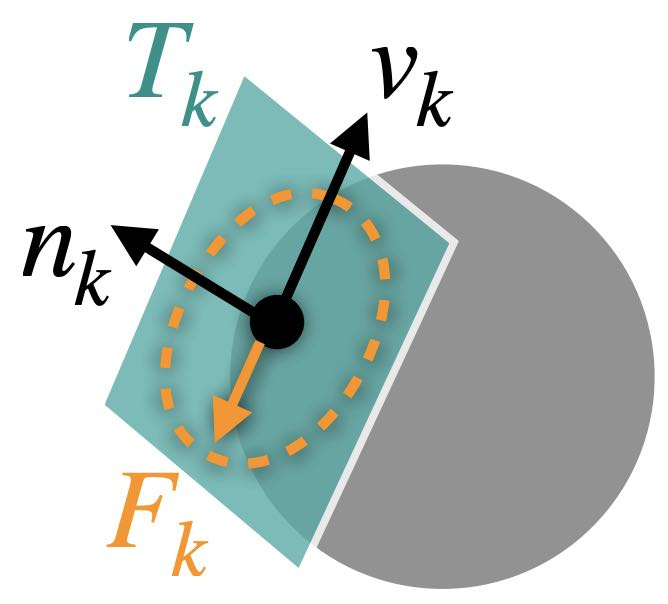
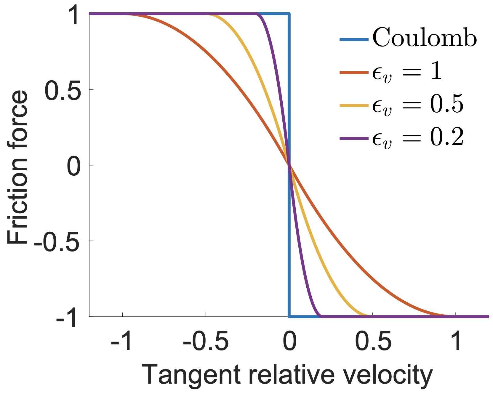

## 平滑的动-静摩擦转换

为对摩擦接触建模，可为每个活跃的接触点对 $k$ 添加局部摩擦力 $F_k$。
对每个这样的点对 $k$，在当前状态 $\{x, v\}$ 下可构造一个方向一致的滑动基 $T_k(x) \in \mathbb{R}^{d m\times d}$，其中 $m$ 为被仿真节点的总数、$d$ 为空间维数，使得 $\mathbf{v}_k = T_k(x)^T v \in \mathbb{R}^{d}$ 给出局部相对滑动速度，且该速度与沿法向 $\mathbf{n}_k(x)$ 的距离梯度正交。

> **{{exp}}{exp:lec9:particle_sphere_contact}[粒子在球面上滑动]**
> 对于一个以速度 $\mathbf{v}_p \in \mathbb{R}^3$ 在球面上运动的粒子，若球体的速度为 $\mathbf{v}_s \in \mathbb{R}^3$（无旋转），此处的相对滑动速度 $\mathbf{v}_k$ 可计算为 
$$
    \mathbf{v}_k = (\mathbf{v}_p - \mathbf{v}_s) - \mathbf{n}_k \cdot (\mathbf{v}_p - \mathbf{v}_s) \mathbf{n}_k = (\mathbf{I}_3 - \mathbf{n}_k \mathbf{n}_k^T) (\mathbf{v}_p - \mathbf{v}_s).
$$
> 若将该系统中粒子与球体的速度堆叠得到 $v = [\mathbf{v}_p^T, \mathbf{v}_s^T]^T \in \mathbb{R}^6$，则可知 $T_k$ 就是
$$
    T_k(x) = 
    \begin{bmatrix}
        \mathbf{I}_3 - \mathbf{n}_k(x) \mathbf{n}_k(x)^T \\
        \mathbf{n}_k(x) \mathbf{n}_k(x)^T - \mathbf{I}_3
    \end{bmatrix} \in \mathbb{R}^{6 \times 3}.
$$
> 对于网格-网格接触等更一般的情形，$T_k$ 的形式只在接触点对 $k$ 处的相对速度如何与被仿真节点的速度相关联这一点上有所不同。

在库仑约束下最大化耗散率，可给出摩擦力的变分定义
$$
    F_k(x) = T_k(x) \ \text{arg}\min_{\boldsymbol{\beta} \in \mathbb{R}^{d}} \boldsymbol{\beta}^T \mathbf{v}_k \quad \text{s.t.} \quad  \|\boldsymbol{\beta}\| \leq \mu \lambda_k \ \ \text{and} \ \ \boldsymbol{\beta} \cdot \mathbf{n}_k = 0,
    {{numeq}}{eq:frictionForceDef}
$$
其中 $\lambda_k = -w_k\frac{\partial b}{\partial d_k}$ 为接触力大小，
$\mu$ 为局部摩擦系数。这等价于
$$
    F_k(x) = - \mu \lambda_k T_k(x) f(\|\mathbf{v}_k\|) \mathbf{s}(\mathbf{v}_k),
    {{numeq}}{eqref: eq:smooth-frict}
$$
其中当 $\|\mathbf{v}_k\|> 0$ 时 $\mathbf{s}(\mathbf{v}_k) = \frac{\mathbf{v}_k}{\|\mathbf{v}_k\|}$，而当 $\|\mathbf{v}_k\| = 0$ 时 $\mathbf{s}(\mathbf{v}_k)$ 取任意与 $\mathbf{n}_k$ 正交的单位向量。此外，摩擦缩放函数 $f$ 关于 $\mathbf{v}_k$ 也是非光滑的：当 $\|\mathbf{v}_k\|> 0$ 时 $f(\|\mathbf{v}_k\|) = 1$，当 $\|\mathbf{v}_k\| = 0$ 时 $f(\|\mathbf{v}_k\|) \in [0,1]$。这种非光滑性会严重拖慢、甚至破坏基于梯度的优化的收敛。

<figure>
    

    
    

    <figcaption><b>{{fig}}{fig:lec9:friction_illustration}</b> 点在一个球面上滑动时 $T_k$、$\mathbf{v}_k$、$\mathbf{n}_k$ 与 $F_k$ 的示意。 </figcaption>
</figure>

> **{{rem}}{rm:lec9:contact_force_magnitude}[接触力大小]**
> $\lambda_k = -w_k\frac{\partial b}{\partial d_k}$ 之所以是接触力大小，是因为在节点 $k$ 处接触力为 $-w_k \nabla_{\mathbf{x}_k} b(d_k(x)) = -w_k\frac{\partial b}{\partial d_k} \nabla_{\mathbf{x}_k} d_k(x)$。因此，由于 $\frac{\partial b}{\partial d_k} < 0$ 且 $\|\nabla_{\mathbf{x}_k} d_k(x)\| = 1$，有 $\lambda_k = \| -w_k \frac{\partial b}{\partial d_k} \nabla_{\mathbf{x}_k} d_k(x) \| = -w_k\frac{\partial b}{\partial d_k}$。

为使优化高效而稳定，向静摩擦过渡时的摩擦力-速度关系可以通过将 $f$ 替换为光滑近似函数来加以光滑化。参照 IPC，我们采用
$$
\begin{align}
f_1(y) =
\begin{cases}
 	-\frac{y^2}{\epsilon_v^2 } + \frac{2y}{\epsilon_v}, & y \in[0, \epsilon_v)\\
 	1, & y \geq  \epsilon_v,
 \end{cases}
 {{numeq}}{eqref: eq:fric_mollifier}
\end{align}
$$
其中 $f_1'(\epsilon_v) = 0$；为使近似误差有界，还定义了一个速度大小上界 $\epsilon_v$（单位为 $m/s$），低于该值的滑动速度 $\mathbf{v}_k$ 即被视为静摩擦（{{ref: fig:lec9:friction_plot}}）。

<figure>
    

    
    

    <figcaption><b>{{fig}}{fig:lec9:friction_plot}</b> 摩擦力与滑动速度之间光滑化关系的一维示意。减小 $\epsilon_v$ 可渐近逼近不连续的库仑摩擦模型。 </figcaption>
</figure>
