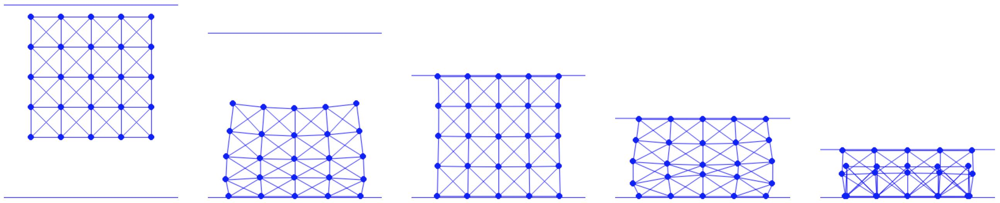

## 案例研究：压缩方块

本节仿真用一块天花板压缩一个弹性方块的过程。
本节对应的可执行 Python 工程见 [https://github.com/phys-sim-book/solid-sim-tutorial](https://github.com/phys-sim-book/solid-sim-tutorial) 中的 `5_mov_dirichlet` 文件夹。
[MUDA](https://github.com/MuGdxy/muda) 的 GPU 实现见 [https://github.com/phys-sim-book/solid-sim-tutorial-gpu](https://github.com/phys-sim-book/solid-sim-tutorial-gpu) 中的 `simulators/5_mov_dirichlet` 文件夹。

本节仿真中的天花板被建模为法向朝下的半空间，其法向量为 $\mathbf{n}=(0,-1)$。天花板到其他仿真自由度（Degrees of Freedom，DOF）的距离可用式 {{eqref: eq:lec7:half_space_dist}} 计算。为有效施加惩罚方法，天花板的高度也必须作为一个自由度。

参照[斜面上的方块](../case-study-square-on-slope/square_on_slope.md)工程的做法，我们选取天花板上的原点 $\bm{o}$ 作为该自由度，并把它并入变量 $x$：

{{imp}}{imp:lec11:ceiling_dof}[天花板的自由度设置，simulator.py]
```python
{{#include ../../solid-sim-tutorial/5_mov_dirichlet/simulator.py:ceiling_dof}}
```

天花板初始位于弹性方块的正上方，如 {{ref: fig:lec11:compress_square}} 的左图所示。这样一来，按照我们的实现，这个新增自由度的节点质量便与方块上其他仿真节点保持一致。

有了这个额外的自由度，我们就能直接为天花板与方块之间的接触建模。具体做法是扩展现有函数，使其计算障碍能量值、梯度、海森矩阵以及初始步长：

{{imp}}{imp:lec11:barrier_val}[障碍能量值，BarrierEnergy.py]
```python
{{#include ../../solid-sim-tutorial/5_mov_dirichlet/BarrierEnergy.py:ceiling_val}}
```
{{imp}}{imp:lec11:barrier_grad}[障碍能量梯度，BarrierEnergy.py]
```python
{{#include ../../solid-sim-tutorial/5_mov_dirichlet/BarrierEnergy.py:ceiling_grad}}
```
{{imp}}{imp:lec11:barrier_hess}[障碍能量海森矩阵，BarrierEnergy.py]
```python
{{#include ../../solid-sim-tutorial/5_mov_dirichlet/BarrierEnergy.py:ceiling_hess}}
```
{{imp}}{imp:lec11:barrier_ccd}[初始步长计算，BarrierEnergy.py]
```python
{{#include ../../solid-sim-tutorial/5_mov_dirichlet/BarrierEnergy.py:ceiling_ccd}}
```
此处，对于天花板 $\bm{o}$ 与节点 $\mathbf{x}$ 之间的距离，我们在局部得到如下堆叠量：
$$
    d(\mathbf{x}, \bm{o}) = \mathbf{n}^T (\mathbf{x} - \bm{o}), \quad 
    \nabla d(\mathbf{x}, \bm{o}) = 
    \begin{bmatrix}
        \mathbf{n} \\ 
        -\mathbf{n}
    \end{bmatrix}, \quad
    \nabla^2 d(\mathbf{x}, \bm{o}) = \bm{0}.
$$

现在我们对天花板施加移动边界条件来压缩弹性方块。我们把由节点索引 `(n_seg+1)*(n_seg+1)` 标识的天花板自由度设为本场景中唯一的狄利克雷边界条件（Dirichlet Boundary Condition，DBC），并赋予其向下的速度 $(0, -0.5)$。当天花板到达高度 $-0.6$ 时运动停止：

{{imp}}{imp:lec11:dbc_setup}[DBC 设置，simulator.py]
```python
{{#include ../../solid-sim-tutorial/5_mov_dirichlet/simulator.py:ceiling_dbc_setup}}
```

随后我们按照式 {{eqref: eq:lec11:DBC_penalty}} 实现惩罚项，它本质上是一个用于控制天花板运动的二次弹簧能量：

{{imp}}{imp:lec11:spring_energy}[弹簧能量计算，SpringEnergy.py]
```python
{{#include ../../solid-sim-tutorial/5_mov_dirichlet/SpringEnergy.py}}
```

接下来，我们专注于在计入弹簧能量的情况下进行优化，同时妥善处理收敛性检查与惩罚刚度调整。在每个时间步开始时，先计算各 DBC 节点的目标位置，并把惩罚刚度 $k_\text{M}$ 初始化为 $10$。若某些节点已到达其预设限度，我们便把它们的当前位置设为目标位置：

{{imp}}{imp:lec11:dbc_initialization}[DBC 初始化，time_integrator.py]
```python
{{#include ../../solid-sim-tutorial/5_mov_dirichlet/time_integrator.py:dbc_initialization}}
```

进入牛顿迭代循环后，在每次迭代中、计算搜索方向之前，我们先评估有多少 DBC 节点已足够接近其目标位置，并把结果存入变量 `DBC_satisfied`：

{{imp}}{imp:lec11:dbc_check}[DBC 满足情况检查，time_integrator.py]
```python
{{#include ../../solid-sim-tutorial/5_mov_dirichlet/time_integrator.py:dbc_check}}
```
然后我们只对已经满足边界条件的那些 DBC 节点消去自由度：

{{imp}}{imp:lec11:dof_elimination}[自由度消元，time_integrator.py]
```python
{{#include ../../solid-sim-tutorial/5_mov_dirichlet/time_integrator.py:dof_elimination}}
```
存于 `DBC_satisfied` 中的边界条件满足情况还用于检查收敛性，并在需要时更新 $k_\text{M}$：

{{imp}}{imp:lec11:convergence_criteria}[收敛判据，time_integrator.py]
```python
{{#include ../../solid-sim-tutorial/5_mov_dirichlet/time_integrator.py:convergence_criteria}}
```

现在我们运行仿真，即对下落到地面的弹性方块进行严重压缩，如 ({{ref: fig:lec11:compress_square}}) 所示。从最终的静态帧可以看到，由于受到极度压缩，边上的弹性弹簧发生了翻转。这一伪影是质点-弹簧弹性模型的典型现象。在后续章节中，我们将探讨如何把有限元离散应用于障碍型弹性模型（例如新胡克（neo-Hookean）模型）以避免此类问题。那种做法类似于当前仿真中对非穿透的强制实现。

<figure>
    <center>
    
    </center>
    <figcaption><b>{{fig}}{fig:lec11:compress_square}</b> 方块下落至地面，并被天花板压缩直至发生翻转。 </figcaption>
</figure>
