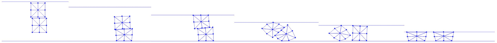

## 摩擦能量及其导数

在预先计算出每个摩擦点-边对的 $\lambda$、$r$ 与 $\mathbf{n}$ 之后，我们便可以方便地计算摩擦势能的值（{{ref: imp:lec22:fric_val}}）、梯度（{{ref: imp:lec22:fric_grad}}）与海森矩阵（{{ref: imp:lec22:fric_hess}}），并把它们加入优化之中。

{{imp}}{imp:lec22:fric_val}[摩擦能量值，FrictionEnergy.py]
```python
{{#include ../../solid-sim-tutorial/8_self_friction/FrictionEnergy.py:val}}
```

在计算梯度与海森矩阵时，我们使用相对速度 $\hat{\mathbf{v}}_k$ 作为中间变量，使实现更有条理。这种思路给出：
$$
\nabla P_f(x) = \sum_k \bigg(\frac{\partial \hat{\mathbf{v}}_k}{\partial x}\bigg)^T \frac{\partial D_k(x)}{\partial \hat{\mathbf{v}}_k}, \quad 
\nabla^2 P_f(x) = \sum_k \bigg(\frac{\partial \hat{\mathbf{v}}_k}{\partial x}\bigg)^T \frac{\partial^2 D_k(x)}{\partial \hat{\mathbf{v}}_k^2} \frac{\partial \hat{\mathbf{v}}_k}{\partial x},
$$
其中 $D_k$ 关于 $\hat{\mathbf{v}}_k$ 的导数与[摩擦接触](../3d-frictional-self-contact/friction.md)中的形式完全相同。


{{imp}}{imp:lec22:fric_grad}[摩擦能量梯度，FrictionEnergy.py]
```python
{{#include ../../solid-sim-tutorial/8_self_friction/FrictionEnergy.py:grad}}
```

{{imp}}{imp:lec22:fric_hess}[摩擦能量海森矩阵，FrictionEnergy.py]
```python
{{#include ../../solid-sim-tutorial/8_self_friction/FrictionEnergy.py:hess}}
```

完成这些实现后，我们终于可以运行带摩擦自接触的压缩方块示例（参见：{{ref: fig:lec22:compress_2_squares_fric}}）。从图中可以看到，两个方块一旦接触，它们之间以及它们与地面之间的大摩擦力便限制了任何滑动。于是在天花板压缩它们时，方块会发生逆时针旋转。


<figure>
    <center>
    
    </center>
    <figcaption><b>{{fig}}{fig:lec22:compress_2_squares_fric}</b> 两个方块落到地面上并被天花板压缩。任意接触面之间的摩擦系数为 $0.4$，这在该场景中限制了任何滑动，并使两个方块在压缩下发生逆时针旋转。当它们的交界面变得近乎竖直时，方块最终分离。</figcaption>
</figure>
