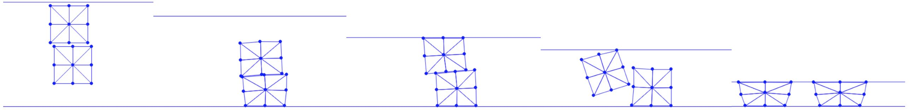

## 连续碰撞检测

至此，求解带自接触仿真的搜索方向所需的全部要素都已具备。在得到搜索方向之后，我们对点-边对执行线搜索过滤。

{{imp}}{imp:lec21:BarrierEnergy_CCD}[线搜索过滤，BarrierEnergy.py]
```python
{{#include ../../solid-sim-tutorial/7_self_contact/BarrierEnergy.py:line_search_filtering}}
```

这里我们先对点与边的跨度（span）的包围盒做重叠检查，以缩小需要计算碰撞时间的点-边对数量：

{{imp}}{imp:lec21:CCD_broad}[包围盒重叠检查，CCD.py]
```python
{{#include ../../solid-sim-tutorial/7_self_contact/distance/CCD.py:broad_phase}}
```

为计算出足够大的、保守的碰撞时间（time of impact，TOI）估计，我们不能像在[过滤线搜索](../../hyperelasticity/case-study-inversion-free-elasticity/filter_line_search.md)中处理点-地面接触那样直接算出 TOI 再取其一部分。对接触图元对直接计算 TOI 需要在二维和三维中求解二次或三次方程求根问题，这类问题容易产生数值误差，尤其是当距离极小、构型在数值上退化时（例如三维中近乎平行的边-边对）。

因此，我们实现了加性连续碰撞检测方法（additive CCD，ACCD）{{#cite li2021codimensional}}：它沿搜索方向迭代地移动接触对，直到达到最小间隔距离，从而稳健地估计 TOI。

以点-边对为例，ACCD 的关键思想是：给定当前位置 $\mathbf{p}$、$\mathbf{e}_0$、$\mathbf{e}_1$ 以及搜索方向 $\mathbf{d}_p$、$\mathbf{d}_{e0}$、$\mathbf{d}_{e1}$，其 TOI 可计算为

$$
\alpha_\text{TOI} = \frac{\| \mathbf{p} - ((1-\lambda)\mathbf{e}_{0} + \lambda \mathbf{e}_{1}) \|}{\| \mathbf{d}_p - ((1-\lambda)\mathbf{d}_{e0} + \lambda \mathbf{d}_{e1}) \|}
$$

这里假设 $(1-\lambda)\mathbf{e}_0 + \lambda \mathbf{e}_1$ 是边上的、$\mathbf{p}$ 将首先与之碰撞的点。
问题在于我们无法预先知道 $\lambda$。不过，我们可以推导出 $\alpha_\text{TOI}$ 的一个下界：

$$
\begin{align}
    \alpha_\text{TOI} &\geq 
    \frac{\min_{\lambda\in[0,1]} \| \mathbf{p} - ((1-\lambda)\mathbf{e}_{0} + \lambda \mathbf{e}_{1}) \|}{ \| \mathbf{d}_p \| + \| (1-\lambda)\mathbf{d}_{e0} + \lambda \mathbf{d}_{e1} \|} \nonumber\\ 
    &\geq 
    \frac{d^\text{PE}(\mathbf{p}, \mathbf{e}_0, \mathbf{e}_1)}{ \| \mathbf{d}_p \| + \max(\| \mathbf{d}_{e0} \|,  \| \mathbf{d}_{e1} \|)}
    = \alpha_l
\end{align}
$$

按这个下界 $\alpha_l$ 前进一步，就能保证该点-边对不发生互穿。然而，$\alpha_l$ 虽然计算简单，却可能远小于 $\alpha_\text{TOI}$。因此我们迭代地计算 $\alpha_l$，并让参与节点的副本前进相应的量，把所有 $\alpha_l$ 累加起来，从而单调地改进对 $\alpha_\text{TOI}$ 的估计，直到该点-边对的距离小于最小间隔，例如原始距离的 $0.1\times$。实现如下，其中我们先把搜索方向中的公共分量剔除，使其幅值更小，从而让算法更早终止。

{{imp}}{imp:lec21:CCD}[ACCD 方法实现，CCD.py]
```python
{{#include ../../solid-sim-tutorial/7_self_contact/distance/CCD.py:accd}}
```

最终的仿真结果展示于 {{ref: fig:lec21:compress_2_squares}}。

<figure>
    <center>
    
    </center>
    <figcaption><b>{{fig}}{fig:lec21:compress_2_squares}</b> 两个方块落到地面上并被一块顶板压缩。地面的摩擦系数为 $0.4$，但两个方块之间没有摩擦，因此上方方块下滑到地面时几乎不改变下方方块的位置。 </figcaption>
</figure>
