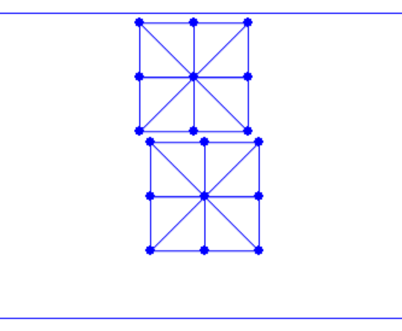

## 场景设置与边界单元收集

首先，我们搭建一个新的场景：两个方块落到地面上，并被天花板压紧，于是这两个方块之间会发生自接触。

{{imp}}{imp:lec21:sim_setup}[仿真设置，simulator.py]
```python
{{#include ../../solid-sim-tutorial/7_self_contact/simulator.py:sim_setup}}
```
在第 17 行，我们把天花板的自由度索引从 $(n\_seg + 1) * (n\_seg + 1)$ 调整为 $(n\_seg + 1) * (n\_seg + 1) * 2$，因为现在有两个方块。第 26 行在顶部生成第一个方块，而第 27、28 行通过创建副本并施加偏移，在底部生成第二个方块。

初始帧如图 {{ref: fig:lec21:initial_frame}} 所示，至此场景已经建立。不过，如果不处理自接触，这两个方块目前还无法相互作用。

<figure>
    <center>
    
    <figcaption><b>{{fig}}{fig:lec21:initial_frame}</b> 含两个待下落方块的新场景设置。</figcaption>
    </center>
</figure>

为了处理接触，我们首先需要收集所有边界单元。在二维情形下，这包括找出边界上的节点与边——接触力将施加到所有彼此靠近但非关联的点-边对上。下面的函数在给定一个三角形网格后，找出全部边界节点与边：

{{imp}}{imp:lec21:find_boundary}[收集边界单元，square_mesh.py]
```python
{{#include ../../solid-sim-tutorial/7_self_contact/square_mesh.py:find_boundary}}
```

该函数在 `simulator.py` 中被调用，随后边界单元被传入时间积分器，用于能量、梯度和海森矩阵的计算，以及线搜索过滤。
