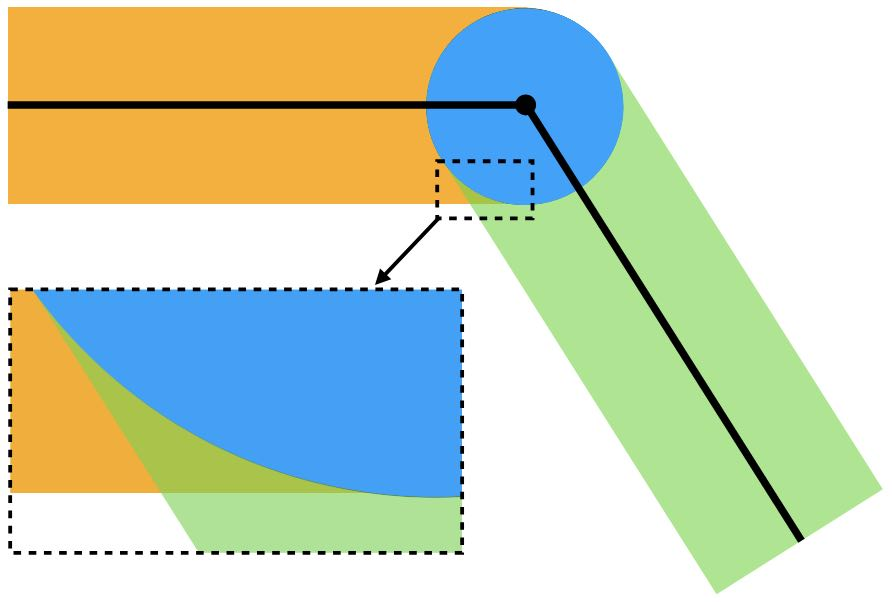

## 自接触

采用三角形离散时，区域的边界被近似为一条由若干边构成的折线。记这些边界边的集合为 $\mathcal{E}$，则障碍势能变为：

$$
\begin{aligned}
    & \int_{\Gamma_C} \frac{1}{2} b\left(\min_{\mathbf{X}_2 \in \Gamma_C - \mathcal{N}(\mathbf{X})} \| \mathbf{x}(\mathbf{X}, t) - \mathbf{x}(\mathbf{X}_2, t)\|, \hat{d}\right) ds(\mathbf{X}) \\
    \approx & \int_{\Gamma_C} \frac{1}{2} b\left(\min_{e \in \mathcal{E} - I(\mathbf{X})} \min_{\mathbf{X}_2 \in e} \| \mathbf{x}(\mathbf{X}, t) - \mathbf{x}(\mathbf{X}_2, t)\|, \hat{d}\right) ds(\mathbf{X}) \\
    = & \int_{\Gamma_C} \frac{1}{2} b\left(\min_{e \in \mathcal{E} - I(\mathbf{X})} d^\text{PE}(\mathbf{x}(\mathbf{X}, t), e), \hat{d}\right) ds(\mathbf{X}).
\end{aligned}
$$

这里，$I(\mathbf{X})$ 是包含 $\mathbf{X}$ 的那些边的集合。完全忽略这些边是当前离散化下对 $\mathcal{N}(\mathbf{X})$ 的一种具体选择。项 $\min_{\mathbf{X}_2 \in e} \| \mathbf{x}(\mathbf{X}, t) - \mathbf{x}(\mathbf{X}_2, t)\|$ 正是点-边距离 $d^\text{PE}(\mathbf{x}(\mathbf{X}, t), e)$，根据点与边的相对位置，它可以按点-点距离或点-直线距离来计算。

众所周知，障碍能量密度函数 $b$ 已经是对阻止两个碰撞点相互穿透的非连续法向接触力的光滑近似。然而，在考虑离散曲面（此处为分段线性曲面）之间的自接触时，对点-边距离取 $\min$ 的非光滑算子是不可避免的。这种非光滑性仍然会给优化时间积分器带来挑战。

为了在分段线性边界的情形下仍得到光滑的障碍势能，我们先把 $\min$ 算子转换为 $\max$ 算子，因为能量密度函数 $b$ 在整个区域内都是非增函数。由此得到：

$$
\int_{\Gamma_C} \frac{1}{2} \max_{e \in \mathcal{E} - I(\mathbf{X})} b( d^\text{PE}(\mathbf{x}(\mathbf{X}, t), e), \hat{d}) \, ds(\mathbf{X}).
$$

接下来，我们需要对 $\max$ 算子做光滑近似。一个直接的选择是使用光滑 max 函数，例如 $p$-范数函数：

$$
\max(a_1, a_2, ..., a_n) \approx \left(a_1^p + a_2^p + \ldots + a_n^p\right)^\frac{1}{p},
$$

其中 $p > 0$ 充分大。然而，指数 $\frac{1}{p}$ 会把多个输入耦合在一起，增大模板尺寸并使海森矩阵的稀疏性变差，从而使仿真的计算开销更高。

幸运的是，由于 $b$ 具有局部支撑——接触力只存在于距离小于 $\hat{d}$ 的情形——取 $p = 1$ 就足够了。当 $\hat{d}$ 相对较小时，只会在边界单元的交接处出现一些冗余的接触力（{{ref: fig:lec20:corner}}）。

<figure>
    

    
    

    <figcaption><b>{{fig}}{fig:lec20:corner}</b> 在这个简单的双边形示意中，黄色与绿色区域在求和时只被计入一次，而蓝色区域以及黄绿重叠的部分被计入了两次。若把蓝色区域减去一次，那么对于右上边界（凸）来说结果就完美了，但对于左下边界（凹）来说，仍能看到一些被重复计入两次的重叠。</figcaption>
</figure>

由于来自多个边界单元的 $b$ 的重叠支撑可以被清楚地识别出来，也可以把这些区域中冗余的障碍势能减去，详见 {{#cite li2023convergent}}。在本书中，我们保持简单：取 $p = 1$ 使用 $p$-范数形式，也就是直接求和：

$$
\begin{aligned}
   & \int_{\Gamma_C} \frac{1}{2} \max_{e \in \mathcal{E} - I(\mathbf{X})} b( d^\text{PE}(\mathbf{x}(\mathbf{X}, t), e), \hat{d}) \, ds(\mathbf{X}) \nonumber \\ 
   &\approx \int_{\Gamma_C} \frac{1}{2} \sum_{e \in \mathcal{E} - I(\mathbf{X})} b( d^\text{PE}(\mathbf{x}(\mathbf{X}, t), e), \hat{d}) \, ds(\mathbf{X}).
\end{aligned}
$$

在三角形离散下近似该积分，并取每条边界边的端点作为求积点，得到完全离散的形式：

$$
\begin{aligned}
    & \int_{\Gamma_C} \frac{1}{2} \sum_{e \in \mathcal{E} - I(\mathbf{X})} b( d^\text{PE}(\mathbf{x}(\mathbf{X}, t), e), \hat{d}) \, ds(\mathbf{X}) \\
    \approx &
    \sum_{\hat{a}} \frac{\|\mathbf{X}_{\hat{a}} - \mathbf{X}_{\hat{a} - 1} \| + \|\mathbf{X}_{\hat{a}} - \mathbf{X}_{\hat{a} + 1} \|}{4} \sum_{e \in \mathcal{E} - I(\mathbf{X}_{\hat{a}})} b( d^\text{PE}(\mathbf{x}_{\hat{a}}, e), \hat{d}).
\end{aligned}
{{numeq}}{eq:lec20:barrier_discrete}
$$

与固体-障碍物接触的情形类似，$\mathbf{T}_C$ 可以通过对整个接触势能关于节点自由度（DOFs）求导得到。
