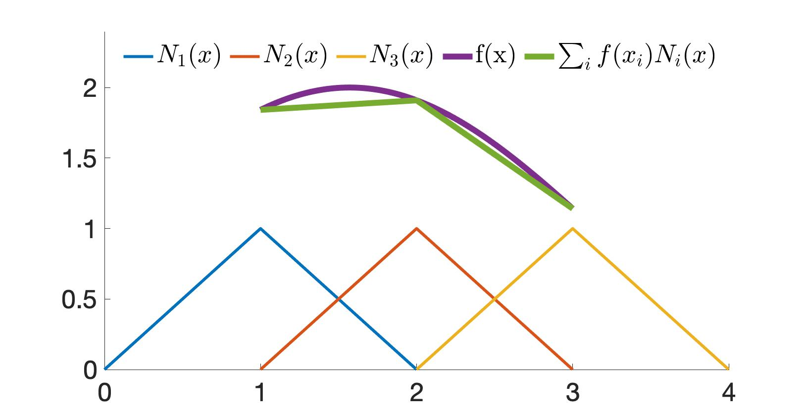

## 离散空间

为使弱形式中的积分可以数值求值，第一步是离散化光滑向量场 $\mathbf{x}$ 与 $\mathbf{Q}$。这样它们就能用有限个采样点以及相应的插值函数来表示。

> **{{exp}}{exp:lec17:1d_interpolation}[一维函数插值]**
> 在一维情形下，若要用三个采样点 $x_1 = 1$、$x_2 = 2$、$x_3 = 3$ 来近似函数 $f(x)$（{{ref: fig:lec17:1d_interpolation}}），我们可以使用插值函数 $N_i(x) = 1 - |x - x_i|$，并构造 $f(x) \approx \sum_i f(x_i) N_i(x)$。 <figure>
    

    
    

    <figcaption><b>{{fig}}{fig:lec17:1d_interpolation}</b> 借助插值函数 $N_1(x)$、$N_2(x)$、$N_3(x)$ 与采样点 $x_1 = 1$、$x_2 = 2$、$x_3 = 3$，函数 $f(x)$ 可近似为 $\sum_i f(x_i) N_i(x)$。 </figcaption>
</figure>

给定仿真域中一组以 $a$ 或 $b$ 编号的采样点，我们可以把测试函数 $\mathbf{Q}$ 与自由度 $\mathbf{x}$ 近似为：
$$
\begin{aligned}
Q_i(\mathbf{X}, t^n) &\approx \sum_a Q_{a|i}(t^n) N_a(\mathbf{X}) = \sum_a Q^n_{a|i} N_a(\mathbf{X}), \\
\mathbf{x}_i(\mathbf{X}, t^n) &\approx \sum_b \mathbf{x}_{b|i}(t^n) N_b(\mathbf{X}) = \sum_b \mathbf{x}^n_{b|i} N_b(\mathbf{X}),
\end{aligned}
$$
其中 $Q^n_{a|i} = Q_{a|i}(t^n)$ 表示 $\mathbf{Q}$ 的第 $i$ 个分量在时刻 $t^n$ 于采样点 $a$ 处的取值，而 $N_a(\mathbf{X}): \Omega^0 \rightarrow \mathbb{R}$ 是采样点 $a$ 处的插值函数。同样地，我们还有：
$$
A_i(\mathbf{X}, t^n) \approx \sum_b A_{b|i}(t^n) N_b(\mathbf{X}) = \sum_b A^n_{b|i} N_b(\mathbf{X}).
{{numeq}}{eq:lec17:spatial_discretization}
$$
把这些离散化代入弱形式（公式 {{eqref: eq:lec17:weakform_lagrangian_tn}}），并用指标记法表示求和，可得：
$$
\begin{aligned}
& \int_{\Omega^0} R(\mathbf{X}, 0) Q^n_{a|i} N_a(\mathbf{X}) A^n_{b|i} N_b(\mathbf{X}) d\mathbf{X} \\
&= \int_{\partial\Omega^0} Q^n_{a|i} N_a(\mathbf{X}) T_i(\mathbf{X}, t^n) ds(\mathbf{X}) - \int_{\Omega^0} Q^n_{a|i} N_{a,j}(\mathbf{X}) P_{ij}(\mathbf{X}, t^n) d\mathbf{X}.
\end{aligned}
$$
在左端，我们看到采样值 $Q^n_{a|i}$ 与 $A^n_{b|i}$ 实际上与 $\mathbf{X}$ 无关，因此可以把它们移到积分号外，得到：
$$
\begin{aligned}
& M_{ab} Q^n_{a|i} A^n_{b|i} \\
&= \int_{\partial\Omega^0} Q^n_{a|i} N_a(\mathbf{X}) T_i(\mathbf{X}, t^n) ds(\mathbf{X}) - \int_{\Omega^0} Q^n_{a|i} N_{a,j}(\mathbf{X}) P_{ij}(\mathbf{X}, t^n) d\mathbf{X}
\end{aligned}
$$
其中
$$
M_{ab} = \int_{\Omega^0} R(\mathbf{X}, 0) N_a(\mathbf{X}) N_b(\mathbf{X}) d\mathbf{X}
{{numeq}}{eq:lec17:mass_matrix}
$$
即质量矩阵。

> **{{rem}}{rem:lec17:mass_matrix}[质量矩阵的性质]**
> 质量矩阵 $M$（公式 {{eqref: eq:lec17:mass_matrix}}）是对称且半正定的，因为它可以写成：
$$
\int_{\Omega^0} BB^T d\mathbf{X},
$$
> 其中 $B_i = \sqrt{R(\mathbf{X}, 0)} N_i(\mathbf{X})$。于是，对任意向量 $z$，
$$
z^T M z = \int_{\Omega^0} (z^T B)^2 d\mathbf{X} \geq 0.
$$
> 在实践中，该质量矩阵可能是奇异的。为解决这一问题，我们通常采用“质量集中”策略，用对角且正定的形式近似质量矩阵。具体做法是对每一行求和并定义：
$$
M^{\text{lump}}_{ab} = \delta_{ab} \sum_c M_{ac}.
$$

经过空间离散后，弱形式（公式 {{eqref: eq:lec17:weakform_lagrangian_tn}}）的解被限制在 $d$ 个 $n$ 维函数空间中，其中 $n$ 表示采样点的数目（假定所有插值函数两两正交）。这意味着弱形式可能存在位于我们解空间之外的连续解。在这种情况下，我们只能基于所选的采样点与插值函数给出近似解。

> **{{def}}{def:lec17:orthogonal_functions}[正交函数]**
> 类似于两个向量 $\mathbf{a}$ 与 $\mathbf{b}$ 的正交性（定义为 $\mathbf{a}^T \mathbf{b} = 0$），两个函数 $f(x)$ 与 $g(x)$ 的正交性定义为：
$$
\int f(x) g(x) \, dx = 0.
$$
> 正如一组基向量可以张成一个有限维空间，正交函数也可以构成函数空间的一组无穷基。从概念上讲，上述积分类似于向量的点积。

话虽如此，为了生成可求解未知量的方程，任意的测试函数 $\mathbf{Q}$ 并不需要取遍所有可能情况以产生无穷多个方程。相反，我们只需产生一个张成整个解空间的有限方程组。因此，令 $\hat{a}$ 遍历所有采样点，并取 $\hat{i} = 1, 2, \ldots, d$，我们可以指定测试函数为：
$$
Q_{a|i}^n = \left\{
    \begin{array}{lc}
        1, & a = \hat{a} \text{ and } i = \hat{i} \\
        0, & \text{otherwise}
    \end{array}
\right.
$$
从而得到 $nd$ 个方程：
$$
M_{\hat{a}b} A^n_{b|\hat{i}} = \int_{\partial \Omega^0} N_{\hat{a}}(\mathbf{X}) T_{\hat{i}}(\mathbf{X}, t^n) ds(\mathbf{X}) - \int_{\Omega^0} N_{\hat{a},j}(\mathbf{X}) P_{\hat{i}j}(\mathbf{X}, t^n) d\mathbf{X},
{{numeq}}{eq:lec17:test_func_chosen}
$$
即得到 $nd$ 个未知量与 $nd$ 个方程，使我们离离散形式又近了一步。

公式 {{eqref: eq:lec17:test_func_chosen}} 右端的两个积分既可以解析求值，也可以使用求积规则求值，取决于插值函数的具体选择。我们将在后续课程中详细讨论这些内容。
