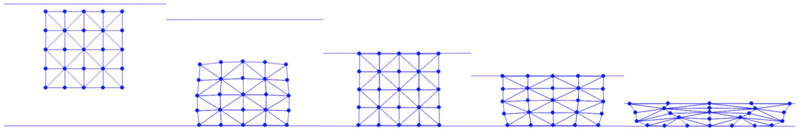

## 针对无翻转的过滤线搜索

为保证仿真过程中的无翻转（正如非穿透那样，参见[过滤线搜索](filter_line_search.md)），我们可以类似地用一个临界步长 $\alpha^I$ 来过滤线搜索的初始步长，该步长首次使任意三角形的体积变为 $0$。这可以通过对每个三角形求解一个一维方程得到：
$$
V(\mathbf{x}_i + \alpha^I \mathbf{p}_i) = 0,
{{numeq}}{eq:lec15:V_eq_0}
$$
然后取所解得的各步长中的最小值。这里 $\mathbf{p}_i$ 是节点 $i$ 的搜索方向，而在二维情形下，式 {{eqref:eq:lec15:V_eq_0}} 等价于：
$$
\det([\mathbf{x}^\alpha_{21}, \mathbf{x}^\alpha_{31}]) \equiv \mathbf{x}^\alpha_{21,1} \mathbf{x}^\alpha_{31,2} - \mathbf{x}^\alpha_{21,2} \mathbf{x}^\alpha_{31,1} = 0
{{numeq}}{eq:lec15:det_tri_equals_0}
$$
其中 $\mathbf{x}^\alpha_{ij} = \mathbf{x}_{ij} + \alpha^I \mathbf{p}_{ij}$，$\mathbf{x}_{ij} = \mathbf{x}_i - \mathbf{x}_j$，$\mathbf{p}_{ij} = \mathbf{p}_i - \mathbf{p}_j$。展开式 {{eqref:eq:lec15:det_tri_equals_0}} 可得：
$$
(\mathbf{x}_{21,1} + \alpha^I \mathbf{p}_{21,1}) (\mathbf{x}_{31,2} + \alpha^I \mathbf{p}_{31,2}) - (\mathbf{x}_{21,2} + \alpha^I \mathbf{p}_{21,2}) (\mathbf{x}_{31,1} + \alpha^I \mathbf{p}_{31,1}) = 0,
$$
该式可整理为关于 $\alpha^I$ 的二次方程：
$$
\det([\mathbf{p}_{21}, \mathbf{p}_{31}]) (\alpha^I)^2 +
(\det([\mathbf{x}_{21}, \mathbf{p}_{31}]) + \det([\mathbf{p}_{21}, \mathbf{x}_{31}])) \alpha^I +
\det([\mathbf{x}_{21}, \mathbf{x}_{31}]) = 0.
$$
注意，当节点运动幅度很小、或其运动几乎不改变当前时间步的三角形面积时，$\det([\mathbf{p}_{21}, \mathbf{p}_{31}])$ 可能非常小，于是该方程会退化为线性方程。为了稳健地检测这种退化情形，我们不能直接检查 $\det([\mathbf{p}_{21}, \mathbf{p}_{31}])$ 是否为 $0$，因为这会受数值误差影响。事实上，检查 $\det([\mathbf{p}_{21}, \mathbf{p}_{31}])$ 是否低于某个 epsilon 仍然很棘手，因为 $\det([\mathbf{p}_{21}, \mathbf{p}_{31}])$ 的量级严重依赖于场景尺度以及仿真过程中节点的速度。因此，我们以 $\det([\mathbf{x}_{21}, \mathbf{x}_{31}]) $ 作为缩放，得到一个缩放但等价的方程：
$$
\frac{\det([\mathbf{p}_{21}, \mathbf{p}_{31}])}{\det([\mathbf{x}_{21}, \mathbf{x}_{31}])} (\alpha^I)^2 +
\frac{\det([\mathbf{x}_{21}, \mathbf{p}_{31}]) + \det([\mathbf{p}_{21}, \mathbf{x}_{31}])}{\det([\mathbf{x}_{21}, \mathbf{x}_{31}]) } \alpha^I + 1 = 0,
{{numeq}}{eq:lec15:scaled_quad_eq_of_alphaI}
$$
其中可以对任意系数用无量纲阈值安全地进行量级检查。

在实践中，我们还需要留出一些松弛量，使所取的步长不会导致体积恰好为 $0$。因此，我们求解 $\alpha^I$，使其首次将任意三角形的体积减少 $90\%$，这可以通过把式 {{eqref: eq:lec15:scaled_quad_eq_of_alphaI}} 中的常数项系数由 $1$ 改为 $0.9$ 来实现：


{{imp}}{imp:lec15:filter_line_search}[过滤线搜索，NeoHookeanEnergy.py]
```python
{{#include ../../solid-sim-tutorial/6_inv_free/NeoHookeanEnergy.py:filter_line_search}}
```
这里，如果该方程没有正实根，则意味着对于这个特定三角形，步长可以任意大，也不会触发翻转。

该二次方程可按如下方式求解：

{{imp}}{imp:lec15:find_positive_real_root}[求解二次方程，utils.py]
```python
{{#include ../../solid-sim-tutorial/6_inv_free/utils.py:find_positive_real_root}}
```
在使用缩放后的系数时，我们只需用一个无量纲阈值（例如 `1e-6`）来检查退化情形。若未找到正实根，函数直接返回 `-1`。

现在，我们在非穿透之外再对初始步长进行过滤：

{{imp}}{imp:lec15:apply_filter}[应用过滤，time_integrator.py]
```python
{{#include ../../solid-sim-tutorial/6_inv_free/time_integrator.py:apply_filter}}
```
在确保所有新增的数据结构与修改过的函数都在时间积分器中得到反映之后，我们最终就可以仿真[移动边界条件](../../boundary-treatments/moving-boundary-conditions/mov_DBC.md)中的压缩方块示例，并保证无翻转（参见 {{ref: fig:lec15:compress_square_inv_free}}）。

<figure>
    <center>
    
    </center>
    <figcaption><b>{{fig}}{fig:lec15:compress_square_inv_free}</b> 一个方块落到地面上，并被天花板严重压缩，同时在整个仿真过程中保持无翻转。地面的摩擦系数为 $0.11$，因此方块底部的滑动量小于顶部，而天花板没有摩擦。</figcaption>
</figure>
