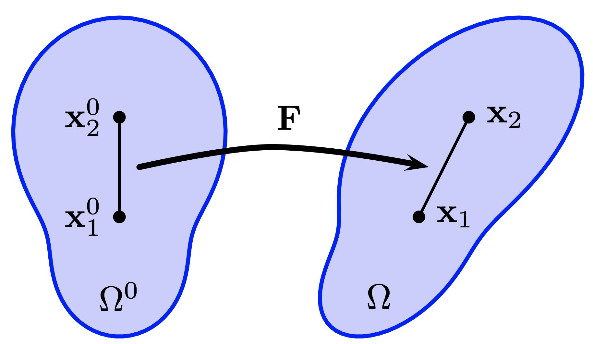

## 变形

我们有材料坐标 $\mathbf{X}$ 与世界坐标 $\mathbf{x}$，它们分别对应区域 $\Omega_0$ 与 $\Omega_t$。对于 $\Omega_0$ 中的任意一点 $\mathbf{X}$，映射函数 $\phi$ 在特定时刻 $t$ 把它输运到 $\Omega_t$，记为 $\mathbf{x} = \phi(\mathbf{X}, t)$。

> **{{def}}{def:lec12:def_grad}[变形梯度]**
> 变形映射 $\phi$ 的雅可比矩阵称为变形梯度，它在描述弹性物理中至关重要。它通常记作 $\mathbf{F}$，由下式定义：
$$
    \mathbf{F}(\mathbf{X}, t) = \frac{\partial \phi}{\partial \mathbf{X}}(\mathbf{X}, t) = \frac{\partial \mathbf{x}}{\partial \mathbf{X}}(\mathbf{X}, t).
$$
> 离散地看，该雅可比矩阵通常是一个 $2 \times 2$ 或 $3 \times 3$ 的小矩阵。对于三维中的布料或薄壳等材料，$\mathbf{F}$ 可能是 $3 \times 2$ 矩阵，以反映材料空间的二维性质。因此，$\mathbf{F}(\cdot, t): \Omega^0 \rightarrow \mathbb{R}^{d \times d}$ 把每个物质点 $\mathbf{X}$ 映射为一个 $\mathbb{R}^{d \times d}$ 矩阵，用以描述时刻 $t$ 的变形雅可比矩阵。使用指标记法，它可以表示为：
$$
    F_{ij} = \frac{\partial \phi_i}{\partial X_j} = \frac{\partial x_i}{\partial X_j}, \quad i, j = 1, \ldots, d.
$$

我们可以针对式 {{eqref: eq:lec12:motion_eg1}} 所给的变形映射计算变形梯度，其结果是单位矩阵。类似地，对于式 {{eqref: eq:lec12:motion_eg2}} 中的变形映射，变形梯度 $\mathbf{F}$ 等于 $\mathbf{R}$。在这两种情形下，物体都没有发生真正的变形，它们只是刚体变换的例子。除非有意追求某种艺术效果（例如卡通风格），否则这样的变形梯度不应在材料内部产生任何内力。

<figure>
    

    
    <figcaption><b>{{fig}}{fig:lec12:deformation_map}[变形梯度]</b></figcaption>
    

</figure>

> **{{exp}}{exp:lec12:deformation_gradient}**
> 直观上，变形梯度 $\mathbf{F}$ 表示材料内部局部变形的程度。考虑仿真开始时嵌在材料中的两个邻近点 $\mathbf{x}_1^0$ 与 $\mathbf{x}_2^0$（如 {{ref: fig:lec12:deformation_map}} 所示）。若 $\mathbf{x}_1$ 与 $\mathbf{x}_2$ 表示这两个点在当前构型中的位置，则它们之间的关系可表示为：
$$
(\mathbf{x}_2 - \mathbf{x}_1) = \mathbf{F} (\mathbf{x}_2^0 - \mathbf{x}_1^0).
$$
> 该方程表明变形梯度如何把两点之间的初始距离变换为它们当前的距离，从而量化局部变形。

变形梯度 $\mathbf{F}$ 的行列式通常记作 $J$，它之所以关键，是因为它刻画了变形过程中的无穷小体积变化。即 $J = \det(\mathbf{F})$。$J$ 的值表示变形后构型 $\Omega^t$ 中材料的无穷小体积与其在 $\Omega^0$ 中原体积之比。例如，在包含旋转与平移的刚体运动中，$\mathbf{F}$ 是旋转矩阵，因此 $J = 1$。值得注意的是，单位矩阵也是旋转矩阵，同样给出 $J = 1$。

若 $J > 1$，表示体积增大；而 $J < 1$ 表示体积减小。$J = 0$ 的情形意味着体积实际上变为零，这在现实世界中不可能，但在数值上却可能发生。在三维中，这意味着材料被压缩到可能塌缩成没有体积的平面、直线甚至一个点。反之，$J < 0$ 表示材料翻转。例如在二维中，若某个三角形的 $J < 0$，则意味着一个顶点穿过了对边，实际上“翻转”了该三角形，使其面积为负。正如[移动边界条件](../../boundary-treatments/moving-boundary-conditions/mov_DBC.md)一节所示，弹性方块的严重压缩可能导致翻转。在这种情况下，$J$ 可作为这种伪影的直接度量，许多弹性模型都利用它来确保仿真不出现翻转。
