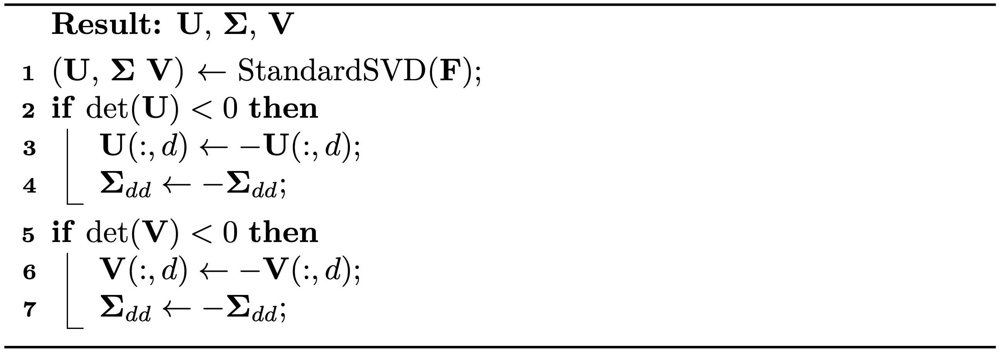

## 极奇异值分解

在讨论[一般滑移边界条件](../../boundary-treatments/slip-dirichlet-boundary-conditions/general_slip_DBC.md)时，我们介绍了奇异值分解（Singular Value Decomposition，SVD）的用法。这里我们采用一种称为**极奇异值分解（SVD）**（Polar 奇异值分解（SVD），{{ref: alg:lec13:polar_SVD}}）的变体来分解 $\mathbf{F}$：
$$
    \mathbf{F} = \mathbf{U} \mathbf{\Sigma} \mathbf{V}^T,
$$
其中 $\mathbf{U}$ 与 $\mathbf{V}$ 都是 $d\times d$ 旋转矩阵，$\mathbf{\Sigma}$ 是 $d \times d$ 对角矩阵。标准奇异值分解（SVD）保证 $\mathbf{\Sigma}_{ii}$ 非负，代价则可能是 $\det(\mathbf{U}) = -1$ 或 $\det(\mathbf{V}) = -1$；与此不同，极奇异值分解（SVD）保持 $\det(\mathbf{U}) = 1$ 与 $\det(\mathbf{V}) = 1$，并在必要时允许 $\mathbf{\Sigma}_{ii}$ 为负。

极奇异值分解（SVD）因其与极分解的关系而得名，其中 $\mathbf{F}$ 表示为 $\mathbf{R}\mathbf{S}$。该分解可通过 $\mathbf{R} = \mathbf{U}\mathbf{V}^T$ 与 $\mathbf{S} = \mathbf{V}\mathbf{\Sigma}\mathbf{V}^T$ 重构，其中 $\mathbf{R}$ 表示最接近 $\mathbf{F}$ 的旋转，$\mathbf{S}$ 是对称的。

<figure>
    

    <b><figcaption>{{alg}}{alg:lec13:polar_SVD}[由标准 SVD 得到极 SVD]</figcaption></b>
    
    

</figure>

$\mathbf{F}$ 的极奇异值分解（SVD）提供了一种更直观的理解变形的方式。若以 $\sigma_i = \mathbf{\Sigma}_{ii}$ 记**主拉伸**，我们可以把 $\mathbf{F}$ 理解为一系列变换的组合：首先是旋转 $\mathbf{V}^T$，接着沿各轴按 $\sigma_i$ 缩放各维度，最后再作一次旋转 $\mathbf{U}$。该分解适用于所有可能的 $\mathbf{F}$。

极奇异值分解（SVD）还使我们能更方便地用 $\sigma_i$ 表达各向同性应变能密度函数。例如，式 {{eqref: eq:lec13:strain_density_intuitive}} 中我们凭直觉给出的公式可以改写为：

$$
\Psi(\mathbf{F}) = \hat{\Psi}(\mathbf{\Sigma}) = \frac{\mu}{4}\sum_{i=1}^d (\sigma_{i}^2 - 1)^2 + \frac{\lambda}{2}\left(\prod_{i=1}^d \sigma_i - 1\right)^2,
$$

其中 $J = \prod_{i=1}^d \sigma_i = \sigma_1 \cdot \sigma_2 \cdot \ldots \cdot \sigma_d$。此外，Neo-Hookean 应变能密度函数（式 {{eqref: eq:lec13:strain_density_NH}}）可改写为：

$$
\Psi_\text{NH}(\mathbf{F}) = \hat{\Psi}_\text{NH}(\mathbf{\Sigma}) = \frac{\mu}{2} \left(\sum_{i=1}^d \sigma_{i}^2 - d\right) -\mu\ln(J)+\frac{\lambda}{2}\ln^2(J).
$$

这两个模型在小变形下都与线弹性一致。

> **{{def}}{def:lec13:consistency_linear_elasticity}[与线弹性的一致性]**
> 要验证应变能密度函数 $\Psi(\mathbf{F})$ 与线弹性的一致性，我们只需检查以下关系是否全部成立：
$$
    \hat{\Psi}(\mathbf{I}) = 0, \quad
    \frac{\partial \hat{\Psi}}{\partial \sigma_i}(\mathbf{I}) = 0, \quad \text{and} \quad 
    \frac{\partial^2 \hat{\Psi}}{\partial \sigma_i \partial \sigma_j}(\mathbf{I}) = 2\mu\delta_{ij} + \lambda.
$$
> 这里 $1 \leq i,j \leq d$，且当 $i=j$ 时 $\delta_{ij} = 1$，否则为 $0$。
