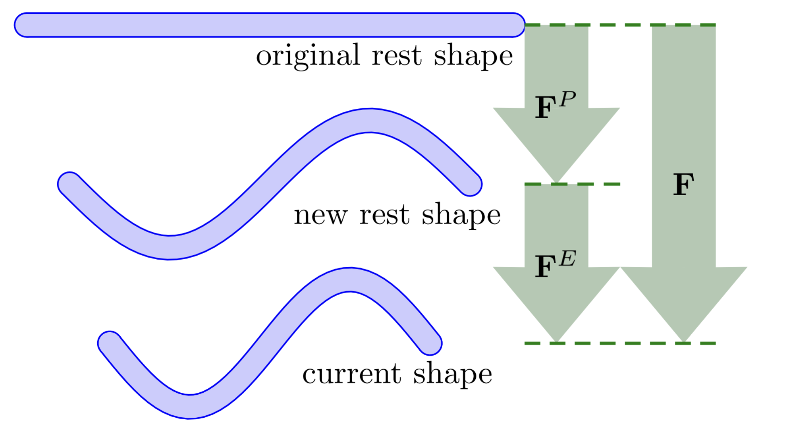

## 塑性流动的离散化

MPM 中引入塑性的方式是：把变形梯度 $\mathbf{F}$ **乘法分解**为弹性部分与塑性部分：

$$
\mathbf{F} = \mathbf{F}_\mathrm{E} \, \mathbf{F}_\mathrm{P}.
$$

其中，$\mathbf{F}_\mathrm{P}$ 表示累积的不可逆变形，$\mathbf{F}_\mathrm{E}$ 则表示相对于塑性变形后构型可恢复的弹性变形。

这一分解把材料行为分成两部分：  
- **塑性部分** $\mathbf{F}_\mathrm{P}$ 存储永久性变化（例如把金属棒弯成弹簧），  
- **弹性部分** $\mathbf{F}_\mathrm{E}$ 存储相对于该形状的当前变形（例如把弹簧稍微压缩一下）。 

<figure>
    

    
    

    <figcaption><b>{{fig}}{fig:lec27:decomposition_of_deformation_gradient}</b> 变形梯度的乘法分解。 </figcaption>
</figure>

应力完全由 $\mathbf{F}_\mathrm{E}$ 通过超弹性本构模型算出。当应力超过材料特定的极限时便触发塑性流动，并更新 $\mathbf{F}_\mathrm{P}$，以保证应力始终处于屈服面之内。

> **{{def}}{def:lec17:yield_surface}[屈服面]**
> 我们在由 $\mathbf{F}_\mathrm{E}$ 导出的 **Kirchhoff 应力** $\boldsymbol{\tau}$ 上定义**屈服条件** $y(\boldsymbol{\tau}) \leq 0$。边界 $y(\boldsymbol{\tau}) = 0$ 称为**屈服面**。当弹性应力超出该曲面时，便触发塑性流动以恢复容许性。

该框架由 $\mathbf{F}_\mathrm{E}$ 计算应力、并在塑性流动下演化 $\mathbf{F}_\mathrm{P}$，从而清晰地区分了可恢复变形与永久变形。
