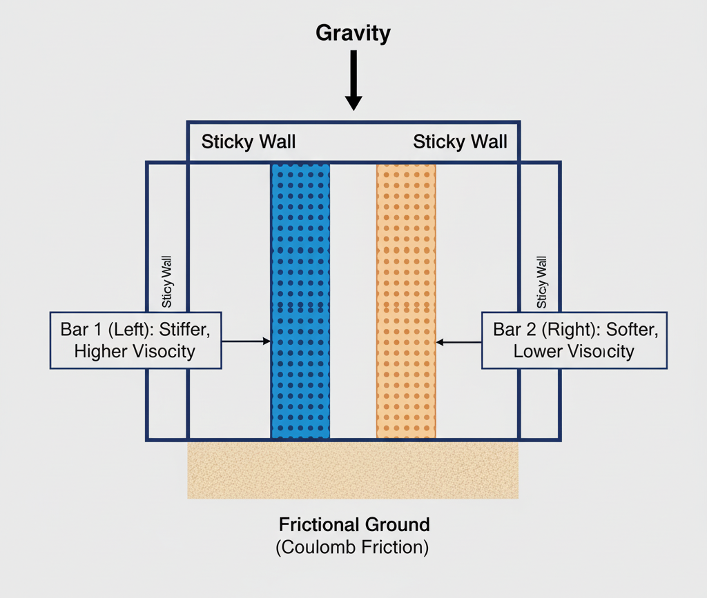
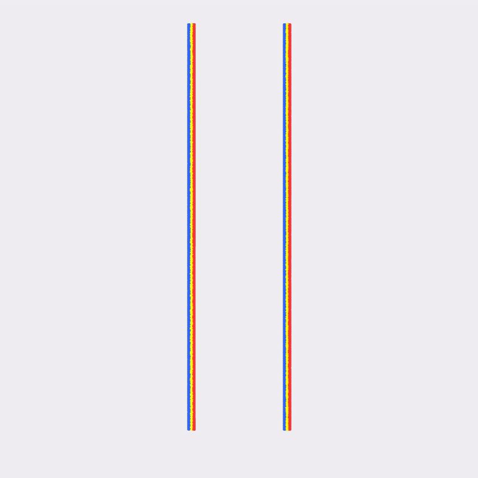

## 二维粘塑性条

**本节作者：[Žiga Kovačič](https://zzigak.github.io)，康奈尔大学*

本章介绍如何使用 St. Venant-Kirchhoff（StVK）弹性模型实现**粘塑性**材料模型。粘塑性模型通过引入**率相关行为**扩展了传统塑性理论：材料对永久变形的抵抗取决于它被变形的快慢。这使它适用于仿真牙膏、黏土或高粘性流体等材料。

与标准的率无关塑性不同，粘塑性材料表现出**随塑性应变率增大的屈服应力**。这意味着材料在较慢的加载下更容易变形，而在快速变形时提供更大的抵抗——这正是粘性类流体行为的特征。

### St. Venant-Kirchhoff 弹性模型

粘塑性模型建立在 <strong>St. Venant-Kirchhoff（StVK）</strong>弹性模型之上，并在**对数（Hencky）应变空间**中表述。StVK 模型利用变形梯度的 SVD 由对数应变计算应力。

给定变形梯度 $\mathbf{F}$ 及其 SVD $\mathbf{F} = \mathbf{U}\boldsymbol{\Sigma}\mathbf{V}^T$，**对数应变**定义为：
$$\boldsymbol{\epsilon} = \log(\boldsymbol{\Sigma})$$

**偏斜对数应变**为：
$$\hat{\boldsymbol{\epsilon}} = \boldsymbol{\epsilon} - \frac{1}{d}\text{tr}(\boldsymbol{\epsilon})\mathbf{I}$$

其中 $d$ 为空间维度，$\text{tr}(\boldsymbol{\epsilon}) = \epsilon_0 + \epsilon_1$ 为对数应变的迹。
直观地说，偏斜部分去掉了对数应变中的**纯体积**分量，只保留**畸变**分量。项 $\frac{1}{d}\text{tr}(\boldsymbol{\epsilon})\mathbf{I}$ 表示各个方向上的等量膨胀或压缩，因为 $\text{tr}(\boldsymbol{\epsilon})$ 度量的是总的对数体积变化。减去这一各向同性部分后，剩下的是一个无迹张量 $\hat{\boldsymbol{\epsilon}}$，它只刻画**形状**的变化，而不含**体积**的变化。

StVK 格式下的**偏斜应力**（柯西应力偏量）为：
$$\hat{\boldsymbol{s}} = 2\mu \hat{\boldsymbol{\epsilon}}$$

其中 $\mu$ 为剪切模量。应力在主坐标系中计算，然后利用 SVD 基旋转回材料坐标系。

### 率相关塑性模型

粘塑性模型与 Drucker-Prager 模型类似，在**对数应变空间**中利用变形梯度的 SVD 来表述。关键区别在于屈服条件现在包含一个率相关项。

**屈服函数**用于检验偏斜应力的模是否超过率相关的屈服应力：
$$y = \|\hat{\boldsymbol{s}}\| - \sqrt{\frac{2}{3}} \sigma_y(\dot{\epsilon}_p)$$

其中屈服应力依赖于塑性应变率：
$$\sigma_y(\dot{\epsilon}_p) = \sigma_0 + \eta_p |\dot{\epsilon}_p|$$

这里 $\sigma_0$ 为静态屈服应力，$\eta_p$ 为塑性粘性系数。

### 粘塑性返回映射

当 $y > 0$ 时材料屈服，我们施加粘塑性返回映射。粘性阻力通过一个依赖于塑性粘性与时间步的**分母项**引入：

$$\text{denom} = 1 + \frac{\eta_p}{2\mu_\text{hat} \Delta t}$$

其中 $\mu_\text{hat} = \mu \frac{b_\text{trial}}{2}$ 是基于试探构型修正后的剪切模量。

修正后的应力模按下式计算：
$$\|\hat{\boldsymbol{s}}^{n+1}\| = \|\hat{\boldsymbol{s}}_\text{trial}\| - \frac{y}{\text{denom}}$$

这实际上按与粘性阻力成比例的因子减小了应力修正量，使材料更难以发生快速变形。

粘塑性返回映射利用 SVD 与对数应变实现：

```python
@ti.func
def viscoplastic_return_mapping_stvk_2d(F_trial, mu_p, lam_p, yield_stress_p, plastic_viscosity_p, dt_val):
    U, sig, V = ti.svd(F_trial)
    sig0 = ti.max(sig[0, 0], 0.01)
    sig1 = ti.max(sig[1, 1], 0.01)
    
    epsilon = ti.Vector([ti.log(sig0), ti.log(sig1)])
    trace_epsilon = epsilon[0] + epsilon[1]
    epsilon_hat = epsilon - ti.Vector([trace_epsilon / 2.0, trace_epsilon / 2.0])
    
    s_trial = 2.0 * mu_p * epsilon_hat
    s_trial_norm = s_trial.norm()
    y = s_trial_norm - ti.sqrt(2.0 / 3.0) * yield_stress_p
    
    F_result = F_trial
    if y > 0:
        b_trial = sig0 * sig0 + sig1 * sig1
        mu_hat = mu_p * b_trial / 2.0
        denom = 1.0 + plastic_viscosity_p / (2.0 * mu_hat * dt_val)
        s_new_norm = s_trial_norm - y / denom
        s_scale = s_new_norm / s_trial_norm if s_trial_norm > 1e-10 else 1.0
        s_new = s_scale * s_trial
        epsilon_new = 1.0 / (2.0 * mu_p) * s_new + ti.Vector([trace_epsilon / 2.0, trace_epsilon / 2.0])
        sig_elastic = ti.Matrix([[ti.exp(epsilon_new[0]), 0.0], [0.0, ti.exp(epsilon_new[1])]])
        F_result = U @ sig_elastic @ V.transpose()
    
    return F_result
```

返回映射由 SVD 计算对数应变，提取其偏斜分量，检验屈服条件；若发生屈服，则施加粘性修正以减小应力更新量。随后对修正后的应变取指数，用来重建弹性变形梯度。

### 双条仿真设置

该仿真并排放置两根材质不同的竖直条，以展示粘塑性行为如何依赖屈服应力与塑性粘性：

```python
# Material parameters for viscoplastic bars
E_toothpaste = 350.0
mu_toothpaste = E_toothpaste / (2 * (1 + nu))
lam_toothpaste = E_toothpaste * nu / ((1 + nu) * (1 - 2 * nu))

# Bar 1 (Left): Higher yield stress and viscosity - stiffer, more resistant
bar1_yield_stress = 1000.0
bar1_plastic_viscosity = 500.0

# Bar 2 (Right): Lower yield stress and viscosity - softer, more fluid-like
bar2_yield_stress = 100.0
bar2_plastic_viscosity = 50.0
```

粘塑性材料通过 `material[p] == 3` 标识，返回映射在粒子更新过程中施加：

```python
if material[p] == 3:
    F[p] = viscoplastic_return_mapping_stvk_2d(
        F_trial, mu_toothpaste, lam_toothpaste, yield_stress[p], plastic_viscosity[p], dt
    )
```

随着仿真在重力作用下推进，率相关行为逐渐显现：较快的变形因粘性项而受到更强的抵抗，而较慢的变形则更容易流动。

粘塑性材料的应力计算采用 StVK 格式：

```python
@ti.func
def stvk_stress_2d(F_elastic, U, V, sig, mu_p, lam_p):
    sig0 = ti.max(sig[0, 0], 0.01)
    sig1 = ti.max(sig[1, 1], 0.01)
    epsilon = ti.Vector([ti.log(sig0), ti.log(sig1)])
    log_sig_sum = ti.log(sig0) + ti.log(sig1)
    ONE = ti.Vector([1.0, 1.0])
    tau = 2.0 * mu_p * epsilon + lam_p * log_sig_sum * ONE
    tau_mat = ti.Matrix([[tau[0], 0.0], [0.0, tau[1]]])
    return U @ tau_mat @ V.transpose() @ F_elastic.transpose()
```

该函数利用 Hencky 应变空间中的 StVK 模型，由弹性变形梯度计算第一类 Piola-Kirchhoff 应力，同时考虑偏斜项与体积项。

<figure>
    <center>
        
        <figcaption><b>{{fig}}{fig:viscoplastic:bars}</b> 两根材质不同的粘塑性条：条 1（左）具有更高的屈服应力与粘性，而条 2（右）更软、更像流体。</figcaption>
    </center>
</figure>

### 仿真结果

完整的粘塑性实现通过基于 StVK 的粘塑性模型展现了逼真的率相关行为。仿真清晰地显示了不同材料属性如何影响变形行为。

<figure>
    <center>
        
    </center>
        <figcaption><b>{{fig}}{fig:viscoplastic:simulation}</b> 在 3.0 秒撤去墙体后，两根粘塑性条在重力作用下坍塌的时间演化。条 1（左，高屈服应力与高粘性）更好地保持了形状、变形更慢，而条 2（右，低屈服应力与低粘性）更容易流动、坍塌更快，展示了粘塑性材料的率相关行为。</figcaption>
</figure>

在仿真中我们观察到：
- <strong>条 1（左）</strong>坍塌得更慢，并更多地保持其竖直形状，因为它的屈服应力（1000.0）与塑性粘性（500.0）更高，表现得像更硬、更接近固体的粘塑性材料。
- <strong>条 2（右）</strong>坍塌得更快，横向铺展也更迅速，因为它的屈服应力（100.0）与塑性粘性（50.0）更低，表现得更像流体状的粘塑性材料。

这些差异凸显了粘塑性材料的率相关行为——粘性更高的材料对快速变形的抵抗更强，而粘性更低的材料在相同加载条件下更容易流动。
