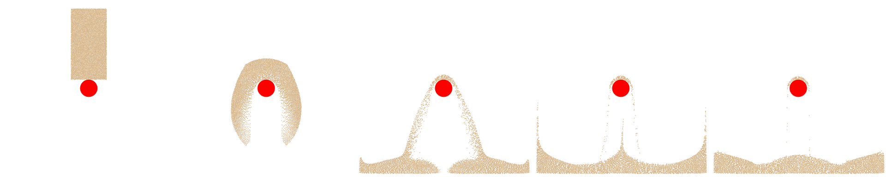

## 仿射质点网格传输

我们按照[仿真设置](../case-study-two-colliding-elastic-blocks-in-2d/simulation_setup.md)定义了物质点数据，并在此基础上扩展了两项内容：APIC 传输格式中使用的仿射速度场 $\mathbf{C}_p$，以及如 [Drucker-Prager 弹塑性](drucker_prager.md)所述、用于体积修正的标量 `log_J_diff`。

在粒子到网格（P2G）传输过程中，我们采用 **APIC 格式** 进行动量交换。我们并不直接传输粒子速度，而是纳入局部仿射速度场 $\mathbf{C}_p$。具体而言，动量以下述形式传输：

{{imp}}{imp:lec30:apic_p2g}[APIC 粒子到网格（P2G）中的仿射传输，simulator.py]
```python
{{#include ../../solid-sim-tutorial/11_mpm_plastic/simulator.py:apic_p2g}}
```

这里，`dpos` 是粒子到网格节点的偏移。

在网格到粒子（G2P）传输过程中，我们从背景网格收集更新后的速度与**仿射速度矩阵 $\mathbf{C}_p$**。仿射矩阵由网格速度与位置偏移的加权外积计算得到。这使每个粒子得以保留局部的速度变化，与 PIC 相比显著减小了数值耗散。

{{imp}}{imp:lec30:apic_g2p}[APIC 网格到粒子（G2P）中的仿射传输，simulator.py]
```python
{{#include ../../solid-sim-tutorial/11_mpm_plastic/simulator.py:apic_g2p}}
```

这里，$D$ 是使用二次 B 样条插值函数时的一个常数因子：

{{imp}}{imp:lec30:D_def}[APIC 所用二次 B 样条的常数 D，simulator.py]
```python
{{#include ../../solid-sim-tutorial/11_mpm_plastic/simulator.py:D_def}}
```

<figure>
    <center>
    
    </center>
    <figcaption><b>{{fig}}{fig:lec30:mpm_sand_simulation_result}</b> 二维沙块落向静态红色球体碰撞体的时间序列。沙子在撞击后发生不可逆变形与飞溅，展示了颗粒流动与摩擦边界响应。 </figcaption>
</figure>
