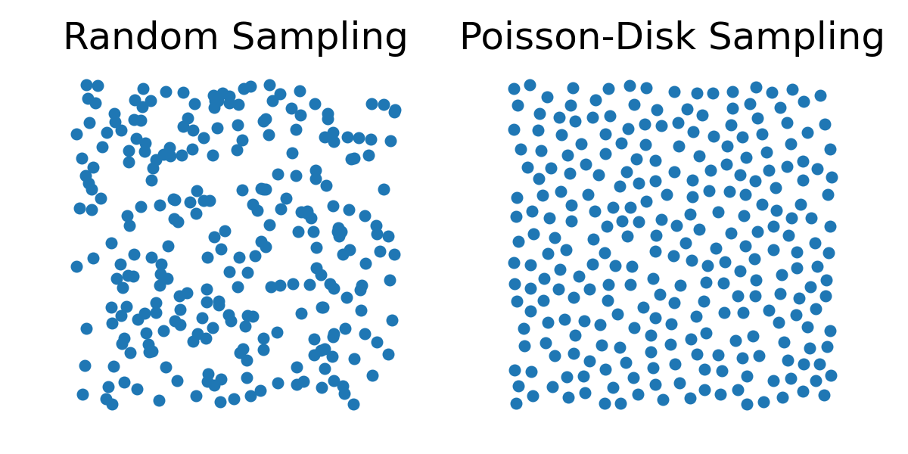

## 物质点

在物质点法（Material Point Method，MPM）中，我们把固体离散为一组有限的物质点（也称为粒子），它们在仿真过程中承载材料的完整状态。这些物质点是物理量的拉格朗日载体，包括：

- $\mathbf{x}_p^n$：粒子 $p$ 的位置（在时刻 $t^n$）

- $\mathbf{v}_p^n$：粒子 $p$ 的速度

- $V_p^n$：粒子 $p$ 的体积

- $m_p$：粒子 $p$ 的质量（不随时间变化）

- $\mathbf{F}_p^n$：粒子 $p$ 处的变形梯度

我们约定所有与粒子相关的量均以下标 $p$ 标记。

<!-- > **{{rem}}{rm:lec26:comp_to_FEM}[与 FEM 的比较]** 
> 在传统 FEM 中，变形体通过定义在固定网格上的分段线性位移场来表示。应变与应力等物理量由这些位移场的梯度导出，而位移场依赖于网格单元的连接关系（参见[分段线性位移场](../../finite-element-method/linear-finite-elements/linear_disp_field.md)）。
> 
> 相比之下，MPM 不依赖网格来存储状态或定义变形。相反，每个粒子独立跟踪自身的变形梯度 $\mathbf{F}_p^n$。 -->

### 采样物质点

要初始化 MPM 仿真，需要把连续固体域采样为有限数目的粒子。采样的质量对数值稳定性与精度有显著影响。

- **均匀网格采样**。该方法以规则间隔把粒子置于笛卡尔网格上。虽然实现简单、计算高效，但它会在仿真中引入与网格对齐的伪影，从而降低真实感与鲁棒性。

- **随机采样**。朴素地把粒子放在随机位置上会造成粒子聚集以及密度的局部大幅波动，从而同时降低仿真精度与数值稳定性。

- **泊松圆盘采样**。因此，人们常用这种方法（Poisson-disk Sampling），因为它保证粒子之间具有最小间距，从而得到更均匀的分布。这提高了插值精度、减少了数值伪影，并带来更稳定的接触行为。

<figure>
    

    
    

    <figcaption><b>{{fig}}{fig:lec26:random_vs_poisson_disk}</b> 在采样点数相同的单位正方形中随机采样与泊松圆盘采样的比较：泊松圆盘采样产生的点间距更均匀。 </figcaption>
</figure>

### 估计粒子体积

由于我们跟踪每个粒子处的变形梯度 $\mathbf{F}_p^n$，可以由其行列式算出体积变化：
$$
V_p^n \approx J_p^n \cdot V_p^0 = \det(\mathbf{F}_p^n) \cdot V_p^0.
$$
这里 $V_p^0$ 是粒子 $p$ 的初始（静止）体积，通常按如下方式计算：
$$
V_p^0 = \frac{V_{\text{grid\_cell}}}{N_{\text{particles\_per\_cell}}},
$$
而 $m_p$ 计算为：
$$
m_p = \rho_0 \cdot V_p^0,
$$
其中 $\rho_0$ 是固体在静止状态下的质量密度。
