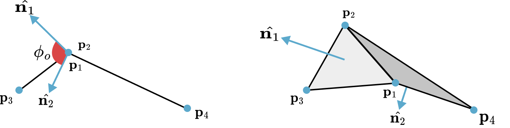

## 二面角弯曲约束

拉伸约束维持了布料网格的结构完整性，却无法阻止其发生不自然的折叠。弯曲阻力决定了布料如何起皱、如何悬垂，可以通过约束相邻三角形之间的夹角来建模。

### 理论：二面角约束形式

该约束定义在一对共享同一条边 $(\bm{p}_1, \bm{p}_2)$ 的三角形 $(\bm{p}_1, \bm{p}_3, \bm{p}_2)$ 与 $(\bm{p}_1, \bm{p}_2, \bm{p}_4)$ 上。弯曲阻力是两个三角形之间**二面角** $\phi$ 的函数，该角即二者各自法向量 $\bm{n}_1$ 与 $\bm{n}_2$ 之间的夹角。约束的目标是把这一夹角恢复到其静止值 $\phi_0$。

<figure><figcaption><b>{{fig}}{fig:bending_constraints}[弯曲约束]</b> 图中给出了 $\mathbb{R}^3$ 中一对三角形的二面角。</figcaption></figure>

> **{{def}}{def:cloth:bending_constraint}[二面角弯曲约束]**
 由四个顶点构成的两个相邻三角形，其弯曲约束函数 $C_{\text{bend}}$ 为：
 $$
 {{numeq}}{eq:cloth:bend_constraint}
 C_{\text{bend}}(\bm{p}_1, \bm{p}_2, \bm{p}_3, \bm{p}_4) = \arccos(\bm{n}_1 \cdot \bm{n}_2) - \phi_0
 $$
 其中法向量按下式计算：
 $$
 \begin{align*}
 \bm{n}_1 &= (\bm{p}_{2,1} \times \bm{p}_{3,1}) / \|\bm{p}_{2,1} \times \bm{p}_{3,1}\|\\
 \bm{n}_2 &= (\bm{p}_{2,1} \times \bm{p}_{4,1}) / \|\bm{p}_{2,1} \times \bm{p}_{4,1}\|.
 \end{align*}
 $$

随后计算该函数关于四个顶点位置 $(\bm{p}_1, \bm{p}_2, \bm{p}_3, \bm{p}_4)$ 的梯度，并采用标准的 PBD 投影机制导出位置修正量。弯曲的刚度由参数 $k_{bend}$ 决定。

这一形式的一个显著优点是它与拉伸相互独立。由于角度由归一化向量定义，该约束不受三角形边长的影响。

### 备选方案：等距弯曲模型

对于近乎不可拉伸的曲面，可以使用等距弯曲模型 {{#cite bergou2006quadratic}}。该模型基于弯曲能量的局部海森矩阵，给出了一种稳健的表述。

该模型对网格的每条内部边 $\bm{e}_0$ 定义一个模板（stencil），由与该边相邻的两个三角形的四个顶点组成，记作 $\bm{p}_0, \bm{p}_1, \bm{p}_2, \bm{p}_3$。该模板的局部弯曲能量定义为一个二次型：

$$
{{numeq}}{eq:cloth:iso_energy}
E_{\text{bend}}(\bm{p}_s) = \frac{1}{2} \sum_{i,j \in \{0,1,2,3\}} Q_{ij} (\bm{p}_i ^\top \bm{p}_j)
$$
其中 $\bm{p}_s = (\bm{p}_0, \bm{p}_1, \bm{p}_2, \bm{p}_3)^T$ 是模板位置向量，$\bm{Q} \in \mathbb{R}^{4\times4}$ 是表示弯曲能量局部海森矩阵的常数矩阵。

弯曲约束直接由该能量定义：$C_{\text{bend}}(\bm{p}_s) = E_{\text{bend}}(\bm{p}_s)$。由于能量关于位置是二次的，其梯度是线性的，计算十分直接：

$$
{{numeq}}{eq:cloth:iso_gradient}
\frac{\partial C_{\text{bend}}}{\partial \bm{p}_i} = \sum_{j \in \{0,1,2,3\}} \bm{Q}_{ij} \bm{p}_j
$$

在希望布料按等距方式（即不发生拉伸）变形的服装仿真中，该模型尤为有效。

### 实现：弯曲约束求解器

```python
@ti.kernel
def solve_bending_constraints(
    compliance: ti.f64, dt: ti.f64, num_bending_constraints: ti.i32,
    pos: ti.template(), bending_ids: ti.template(), bending_lengths: ti.template(),
    inv_mass: ti.template(), lambdas: ti.template()):
    """Solve bending constraints using distance-based approach"""
    alpha = compliance / (dt * dt)
    for i in range(num_bending_constraints):
        id0, id1 = bending_ids[i, 0], bending_ids[i, 1]
        w0, w1 = inv_mass[id0], inv_mass[id1]
        w_sum = w0 + w1
        if w_sum == 0.0: continue
        p0, p1 = pos[id0], pos[id1]
        delta = p0 - p1
        dist = delta.norm()
        if dist == 0.0: continue
        grad = delta / dist
        C = dist - bending_lengths[i]
        dlambda = -(C + alpha * lambdas[i]) / (w_sum + alpha)
        lambdas[i] += dlambda
        pos[id0] += dlambda * w0 * grad
        pos[id1] -= dlambda * w1 * grad
```

这一实现采用简化的基于距离的方案，把弯曲约束当作非相邻顶点之间的距离约束来处理。虽然它无法完整刻画二面角行为，但计算高效，且在许多布料仿真场景中表现良好。

求解约束需要静止长度，因此我们在仿真开始前一次性计算所有静止弯曲长度：

```python
@ti.kernel
def init_physics():
    """Initialize physics state including rest lengths for all constraints"""
    # Initialize stretching constraint rest lengths
    for i in range(num_stretching_constraints):
        id0, id1 = stretching_ids[i, 0], stretching_ids[i, 1]
        stretching_lengths[i] = (pos[id0] - pos[id1]).norm()
    
    # Initialize bending constraint rest lengths
    for i in range(num_bending_constraints):
        id0, id1 = bending_ids[i, 0], bending_ids[i, 1]
        bending_lengths[i] = (pos[id0] - pos[id1]).norm()
```

为确定哪些顶点构成弯曲约束，我们先找出共享一条边的三角形对，再在不属于该共享边的顶点之间建立约束：

```python
def find_constraint_indices(tri_ids_np):
    """Extract both stretching and bending constraints from triangle mesh"""
    edge_to_tri_map = {}
    for i, tri in enumerate(tri_ids_np):
        for j in range(3):
            v0_idx, v1_idx = tri[j], tri[(j + 1) % 3]
            edge = tuple(sorted((v0_idx, v1_idx)))
            if edge not in edge_to_tri_map:
                edge_to_tri_map[edge] = []
            edge_to_tri_map[edge].append(i)
    
    stretching_ids = list(edge_to_tri_map.keys())
    bending_ids = []
    
    # Find bending constraints (non-adjacent vertices in adjacent triangles)
    for edge, tris in edge_to_tri_map.items():
        if len(tris) == 2:
            tri0_idx, tri1_idx = tris[0], tris[1]
            p2 = [v for v in tri_ids_np[tri0_idx] if v not in edge][0]
            p3 = [v for v in tri_ids_np[tri1_idx] if v not in edge][0]
            bending_ids.append([p2, p3])
    
    return np.array(stretching_ids, dtype=np.int32), np.array(bending_ids, dtype=np.int32)
```

这样便通过连接相邻三角形中的非相邻顶点，构造出一个抵抗弯曲变形的约束网络。

```python
stretching_compliance = 0.0  # Very stiff stretching (nearly inextensible)
bending_compliance = 1.0      # Moderate bending resistance
```

拉伸柔度越低，布料越难以被拉伸；弯曲柔度越高，弯曲就越灵活，从而得到更柔软、更易悬垂的布料。
