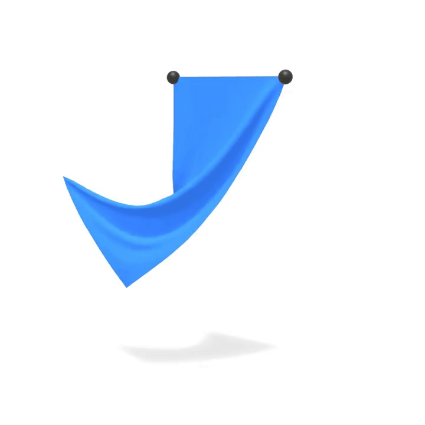

## 完整的布料仿真

现在我们把已实现的拉伸约束与弯曲约束组合起来，构成一个完整的布料仿真。主仿真循环迭代地求解这两类约束，然后更新速度。

```python
def substep(grab_id, grab_x, grab_y, grab_z):
    """Complete cloth simulation integrating all components"""
    pre_solve(sdt)
    for _ in range(solver_iterations):
        solve_stretching_constraints(stretching_compliance, sdt)
        solve_bending_constraints(bending_compliance, sdt)
    apply_grab(grab_id, grab_x, grab_y, grab_z)
    post_solve(sdt)
```

求解器在每次迭代中交替处理拉伸约束与弯曲约束。先求解拉伸约束，因为它提供结构完整性；随后由弯曲约束带来逼真的悬垂行为。

在运行仿真之前，我们需要先设置物理状态。布料仿真需要依据三角形面积仔细分配质量，以保证行为真实：

```python
@ti.kernel
def init_physics():
    """Initialize physics state with proper mass distribution"""
    for i in range(num_particles):
        prev_pos[i] = pos[i]
        vel[i] = ti.Vector([0.0, 0.0, 0.0])
    
    inv_mass.fill(0.0)
    for i in range(num_tris):
        id0, id1, id2 = tri_ids[i * 3], tri_ids[i * 3 + 1], tri_ids[i * 3 + 2]
        p0, p1, p2 = pos[id0], pos[id1], pos[id2]
        area = 0.5 * (p1 - p0).cross(p2 - p0).norm()
        p_inv_mass = 1.0 / (area / 3.0) if area > 0 else 0.0
        inv_mass[id0] += p_inv_mass
        inv_mass[id1] += p_inv_mass
        inv_mass[id2] += p_inv_mass
    
    # Initialize constraint rest lengths
    for i in range(num_stretching_constraints):
        id0, id1 = stretching_ids[i, 0], stretching_ids[i, 1]
        stretching_lengths[i] = (pos[id0] - pos[id1]).norm()
    for i in range(num_bending_constraints):
        id0, id1 = bending_ids[i, 0], bending_ids[i, 1]
        bending_lengths[i] = (pos[id0] - pos[id1]).norm()
    
    for i in range(num_particles):
        original_inv_mass[i] = inv_mass[i]
```

该初始化过程依据三角形面积计算质量分配，使属于较大三角形的顶点获得更大的质量。这样布料的行为更加真实，材料对外力的响应也更为合理。

对于悬挂布料的场景，我们通过把顶部顶点的逆质量设为零来固定它们：

```python
@ti.kernel
def pin_top_vertices():
    """Pin vertices with highest Y values (top of cloth) by setting their inverse mass to zero"""
    max_y = -1e9
    for i in range(num_particles):
        if pos[i].y > max_y:
            max_y = pos[i].y
    for i in range(num_particles):
        if pos[i].y >= max_y - 1e-6:
            inv_mass[i] = 0.0
```

由此构造出「悬挂布料」场景：顶边被固定，布料其余部分在重力作用下自然悬垂。

仿真还包含交互式操控功能：

```python
@ti.kernel
def apply_grab(particle_idx: ti.i32, target_x: ti.f64, target_y: ti.f64, target_z: ti.f64):
    """Apply interactive manipulation to a specific particle"""
    if particle_idx != -1:
        target_pos = ti.Vector([target_x, target_y, target_z])
        pos[particle_idx] = target_pos
        vel[particle_idx] = ti.Vector([0.0, 0.0, 0.0])
        grab_indicator_pos[0] = target_pos
```

这使得用户可以实时与布料交互，抓取并拖拽特定顶点，便于测试材料属性与制作动画。

### 仿真结果

完整的布料实现借助几何约束展现出逼真的织物行为，正确呈现了悬垂、起皱，以及对力和交互操控的响应。

<figure>
    <center>
        
    </center>
        <figcaption><b>{{fig}}{fig:cloth:bending}</b> 布料在重力下的悬垂，拉伸约束与弯曲约束分别约束了边长与曲率。</figcaption>
</figure>
