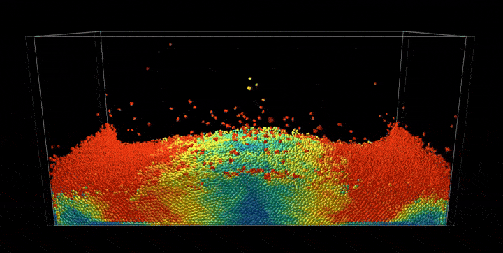
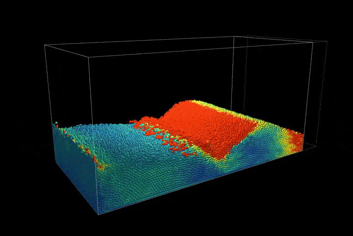

## 完整 PBF 仿真

现在，我们把已实现的密度约束、拉伸不稳定性修正与高级流体效果结合起来，构建一个完整的基于位置的流体仿真。主仿真循环迭代求解密度约束，然后施加流体特有的增强处理。

```python
def substep():
    """Complete PBF simulation integrating all components"""
    if simulation_running[None]:
        # Standard PBD pre-solve: external forces and neighbor search
        pre_solve()           
        
        # Standard PBD constraint solving loop
        for _ in range(pbf_num_iters):
            solve_density_constraints()  # Density constraints with tensile instability correction
        
        # Standard PBD post-solve: velocity updates
        post_solve()          
        
        # Fluid-specific enhancements (beyond standard PBD)
        calculate_vorticity()           
        apply_vorticity_confinement()
        apply_xsph_viscosity()
```

该求解器遵循标准的基于位置的动力学（Position-Based Dynamics，PBD）流程，但额外加入了流体特有的增强处理。密度约束被迭代求解以施加不可压缩性，随后涡量约束与 XSPH 粘性带来逼真的流体行为。

该仿真包含带有移动墙壁的动态边界条件，以支持压缩场景：

```python
@ti.kernel
def move_wall():
    """Move the wall for compression scenario"""
    if wall_moving[None]:
        wall_pos[None] += wall_velocity[None] * dt
        if wall_pos[None] > wall_max_pos[None]:
            wall_pos[None] = wall_max_pos[None]
            wall_velocity[None] = -wall_velocity[None]
        elif wall_pos[None] < wall_min_pos[None]:
            wall_pos[None] = wall_min_pos[None]
            wall_velocity[None] = -wall_velocity[None]
```

这构成一个墙壁往复振荡的压缩场景，展示了该方法处理复杂边界交互的能力。

该仿真使用空间哈希来高效地查找邻居：

```python
@ti.kernel
def build_hash_grid():
    """Build spatial hash grid for neighbor finding"""
    grid_cell_counts.fill(0)
    
    for i in range(num_particles):
        cell = get_grid_cell(pos[i])
        ti.atomic_add(grid_cell_counts[cell], 1)
    
    # Build prefix sum for cell starts
    total_particles = 0
    counts_np = grid_cell_counts.to_numpy()
    starts_np = np.zeros_like(counts_np)
    for i in range(GRID_SIZE):
        for j in range(GRID_SIZE):
            for k in range(GRID_SIZE):
                starts_np[i, j, k] = total_particles
                total_particles += counts_np[i, j, k]
    grid_cell_starts.from_numpy(starts_np)
```

这种空间加速结构使密度约束求解过程中的邻居查找变得高效，从而使仿真可以扩展到大量粒子。

### 仿真结果

完整的基于位置的流体（Position-Based Fluids，PBF）实现通过几何约束展现了逼真的流体行为，呈现出不可压缩流动、表面张力效应以及流体与动态边界之间的复杂交互。


<figure>
    <center>
        
    </center>
        <figcaption><b>{{fig}}{fig:pbf:two_side_fluid}</b> 带移动边界的基于位置的流体（PBF）流体双侧压缩，展示了不可压缩性与表面行为。</figcaption>
</figure>


<figure>
    <center>
        
    </center>
        <figcaption><b>{{fig}}{fig:pbf:one_side_fluid}</b> 基于位置的流体（PBF）流体在移动边界上的单侧压缩，展示了不可压缩性与表面行为。</figcaption>
</figure>
