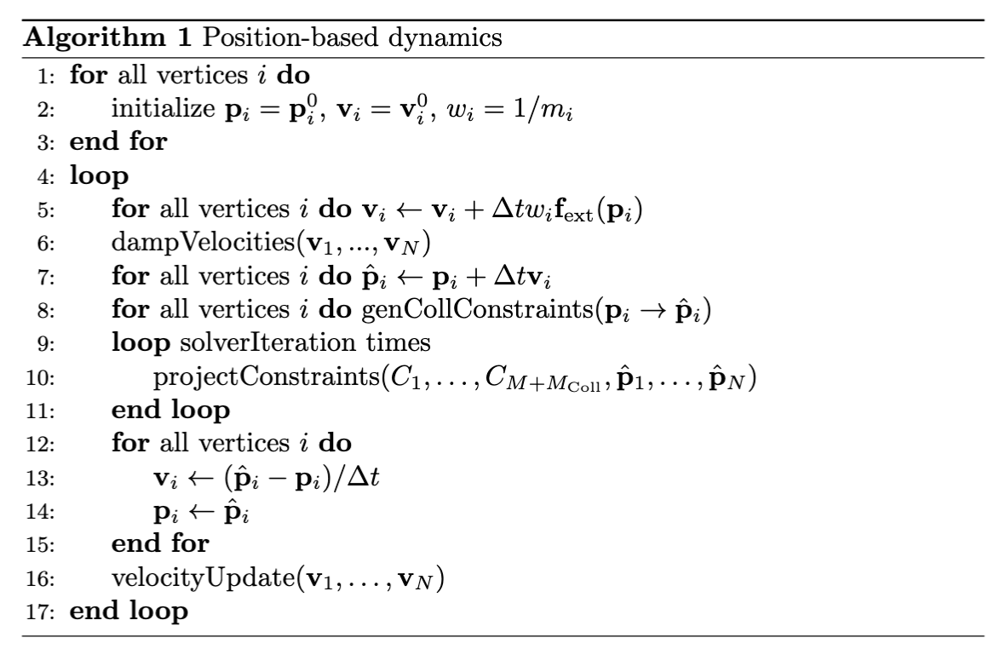

## 核心框架

PBD 框架通过把一个物理物体离散为一组 $N$ 个粒子、并用 $M$ 个几何约束（关系）定义其行为来仿真它。其核心思想是把系统看作一组粒子与一组约束。在每个时间步，首先用显式积分格式预测粒子位置，随后由一个迭代求解器调整这些预测位置，以满足所有几何约束。我们可以形式化地定义这样的系统如下：

> **{{def}}{def:pbd:system}[PBD 系统]**
> PBD 系统是一个元组，由一组 $N$ 个粒子和一组 $M$ 个约束构成。
>
>每个**粒子** $i\in \{1,\dots,N\}$ 由其位置 $\bm{p}_i \in \mathbb{R}^3$、速度 $\bm{v}_i \in \mathbb{R}^3$ 与质量 $m_i$ 刻画。为方便起见，我们定义逆质量 $w_i = 1/m_i$，其中对无穷大质量（即静态或运动学控制的）粒子取 $w_i=0$。
>
> 动力学行为由**一组约束**决定。每个约束 $j\in \{1,\dots M\}$ 由一个标量函数 $C_j(\bm{p}_1, \dots, \bm{p}_{n_j})$ 定义，它作用于 $n_j$ 个粒子的子集。若 $C_j=0$，则称*等式*约束被满足；若 $C_j \ge 0$，则称*不等式*约束被满足。

仿真以时间步长 $\Delta t$ 在离散时间上推进。PBD 算法的核心循环可描述如下。

<figure><figcaption><b>{{fig}}{fig:lec11:pbd_algo}[PBD 主算法]</b> 循环的核心是一个多阶段过程：速度与位置预测、约束构造、约束求解以及状态更新。</figcaption></figure>

注意，由于该算法仿真的是关于 $t$ 的二阶系统，因此在仿真循环开始之前必须同时指定位置与速度。这种循环结构确保速度根据求解器所做的几何修正被隐式更新，从而产生二阶动力学系统应有的正确行为。
