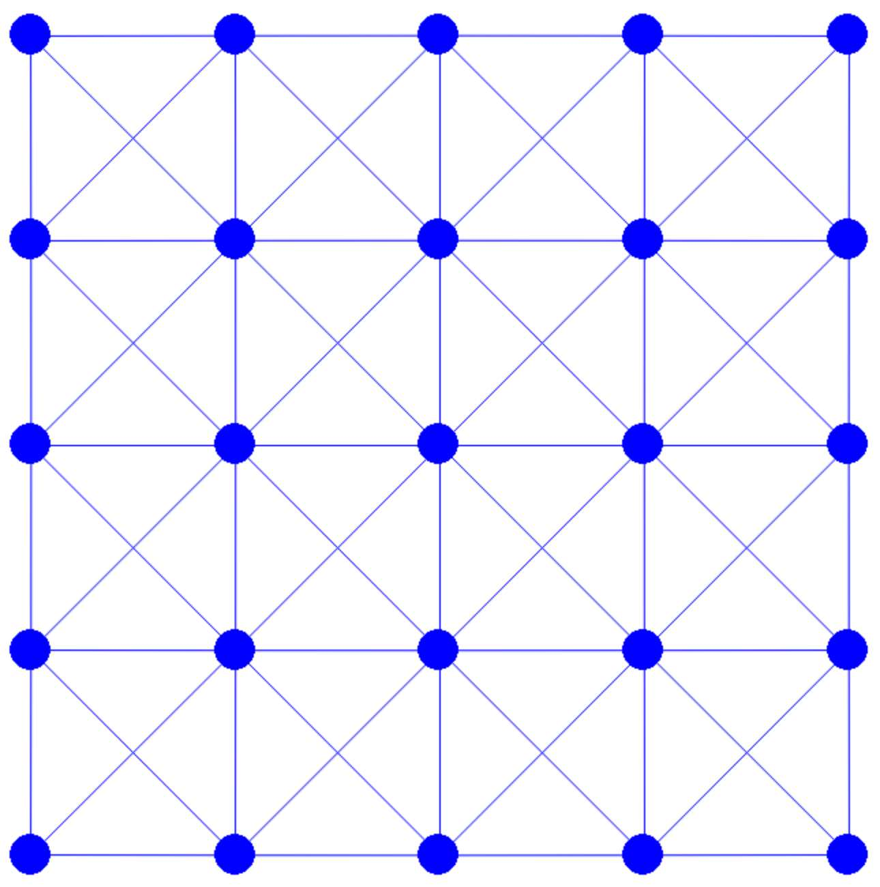

## 空间与时间离散化

在表示固体几何时，我们采用网格结构。进一步用边连接网格上的节点，从而简化这一表示。为便于该过程，尤其是对方形这类几何体，我们可以编写一个网格生成脚本。该生成器允许同时指定方形的边长与所需的网格分辨率。


{{imp}}{imp:lec4:square_mesh}[方形网格生成，square_mesh.py]
```python
{{#include ../../solid-sim-tutorial/1_mass_spring/square_mesh.py:generate}}
```

在代码中，`n_seg` 表示方形每条边上的边数。节点均匀分布于方形之内，并通过水平、竖直与对角边相互连接。例如，调用 `generate(1.0, 4)` 会构造出 {{ref: fig:lec4:square_mesh_4x4}} 所展示的网格。该实现使用了 [Numpy](https://numpy.org/) 库的数组数据结构，它为后续步骤所需的向量代数运算提供了便捷的方法。

<figure>
    <center>
    
    </center>
    <figcaption><b>{{fig}}{fig:lec4:square_mesh_4x4}</b> 调用上文“方形网格生成”脚本中定义的 <code>generate(1.0, 4)</code> 所生成的 $4\times 4$ 方形网格。 </figcaption>
</figure>

在时间离散方面，我们采用的方法是隐式欧拉法。在第 \(n\) 个时间步中需要最小化的增量势能可表示如下：
$$
    E(x) = \frac{1}{2}\|x - (x^n + h v^n)\|_M^2 + h^2 P(x).
    {{numeq}}{eq:lec4:IP}
$$
接下来，我们关注如何实现惯性项与势能 \(P(x)\) 的能量值、梯度与海森矩阵的计算。
