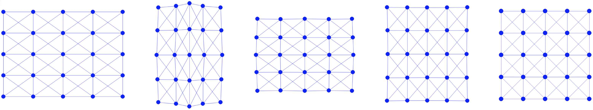

## 带可视化的仿真

在收集齐二维质点-弹簧仿真器所需的全部要素之后，下一步是实现仿真器。该实现将逐步构建，并包含可视化功能，以提升理解与参与感。

{{imp}}{imp:lec4:simulator}[simulator.py]
```python
{{#include ../../solid-sim-tutorial/1_mass_spring/simulator.py}}
```

对于仿真器中的二维可视化，我们使用 [Pygame library](https://www.pygame.org/)。仿真从一个仅含单个方形的场景开始，该方形初始时在水平方向被拉伸。在仿真过程中，方形开始恢复其原始的水平尺寸。随后，由于惯性，它会在竖直方向拉伸，来回振荡，直到最终稳定在其静止形状，如（{{ref: fig:lec4:stretched_square_sim}}）所示。

<figure>
    <center>
    
    </center>
    <figcaption><b>{{fig}}{fig:lec4:stretched_square_sim}</b> 从左至右：初始被拉伸的方形仿真在初始、中间与最终静止时刻的帧。 </figcaption>
</figure>

除存储节点位置 `x` 与边 `e` 之外，我们的仿真还需要为若干其他关键变量分配内存：

- **节点速度（`v`）**：用于追踪每个节点随时间的运动。
- **质量（`m`）**：节点质量通过把方形的总质量均匀分配到每个节点来计算。这是一种初步做法；有限元方法（Finite Element Method，FEM）或物质点法（Material Point Method，MPM）中更细致的节点质量计算方法将在后续章节中探讨。
- **边的静止长度平方（`l2`）**：对计算质点-弹簧系统中的势能很重要。
- **弹簧刚度（`k`）**：影响弹簧动力学的关键参数。

为便于仿真器之外的可视化，我们支持将网格数据导出为 `.obj` 文件。这通过在仿真开始时以及每一帧调用 `write_to_file()` 函数来实现。该功能便于使用其他可视化软件来分析与展示仿真结果。

{{imp}}{imp:lec4:square_mesh_output}[输出方形网格，square_mesh.py]
```python
{{#include ../../solid-sim-tutorial/1_mass_spring/square_mesh.py:write_to_file}}
```

在所有组件都正确设置之后，下一阶段是启动仿真循环。该循环推进时间积分，并在每个时间步可视化结果。要运行该仿真程序，请在终端中使用以下命令：
```python
python3 simulator.py
```

> **{{rem}}{rem:lec4:sim_remarks}[实践考虑]**
> 在仿真器实现就绪之后，我们便能够灵活地试验优化时间积分方案的各种配置。这类测试有助于深入理解每个关键组件的作用与影响。
>
> 举例来说，如果我们不把质点-弹簧的海森矩阵投影为对称正定（Symmetric Positive Definite，SPD）形式，在某些条件下可能会出现异常行为。例如，以 `h=0.02` 的帧率时间步长、`initial_stretch` 为 `0.5` 运行仿真，可能导致线搜索失败。这又会把时间步长压得很小，使优化迟迟无法推进。
>
>虽然线搜索在这个简单的二维示例中似乎多余，但在更复杂的三维弹性动力学仿真中，尤其是涉及大变形的情形，其必要性便显而易见。此时，线搜索对于确保仿真的收敛至关重要。
>
>另一个值得关注的点是传统固体仿真器所采用的停止准则。许多此类仿真器放弃了动态停止准则，而是在预定的迭代次数之后终止优化过程。这种做法虽然简单直接，但在更具挑战性的场景中可能导致数值不稳定或“爆炸”。这凸显了审慎考虑积分方案及其参数以确保仿真稳定与准确的重要性。
