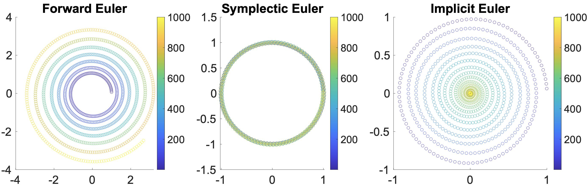

## 显式时间积分

显式时间积分格式提供了一种直接的方法：把已知量代入简单的公式即可算出 \\(x^{n+1},v^{n+1}\\)，正因如此它们被称为*显式*。本节聚焦两种基本的显式格式：前向欧拉法与辛欧拉法。

### 前向欧拉法

为了把连续时间系统转换为离散形式，我们采用前向差分近似。在该近似中，导数 \\((\frac{\mathbf{d} x}{\mathbf{d} t})^n\\) 被估计为 \\(\frac{x^{n+1} - x^n}{\Delta t}\\)，同样地，\\((\frac{\mathbf{d} v}{\mathbf{d} t})^n\\) 被估计为 \\(\frac{v^{n+1} - v^n}{\Delta t}\\)。上标 \\(n\\) 表示第 \\(n\\) 个时间步的状态变量。由此，系统的离散版本可写为：
$$
    \begin{aligned}
    \frac{x^{n+1} - x^n}{\Delta t} & = v^n, \\
    M\frac{v^{n+1} - v^n}{\Delta t} & = f^n.
    \end{aligned}
    {{numeq}}{eq:lec1:governing_discSpace_discTime}
$$
假设质量不随时间变化，这些方程便给出了更新状态变量的明确机制。已知第 \\(n\\) 个时间步的当前值 \\(x^n\\)、\\(v^n\\) 和 \\(f^n\\)，我们就能直接确定它们在下一个时间步 \\(n+1\\) 的值。

> **{{met}}{met:lec1:forward_euler}[牛顿第二定律的前向欧拉时间积分]** 在前向欧拉法中，下一时间步 \\(n+1\\) 的状态变量 \\(x^{n+1}\\) 与 \\(v^{n+1}\\) 由当前值 \\(x^n\\) 和 \\(v^n\\) 计算得到。更新规则为：
$$
\begin{aligned}
    x^{n+1} & = x^n + \Delta t v^n, \\
    v^{n+1} & = v^n + \Delta t M^{-1}f^n.
\end{aligned}
{{numeq}}{eq:lec1:updateRule_explicit}
$$
这里，\\(\Delta t\\) 表示时间步长，\\(M\\) 是质量矩阵，\\(f^n\\) 是当前时间步 \\(n\\) 的力。

前向欧拉法被认为是*无条件不稳定*的：这意味着无论选取多么小的时间步 \\(\Delta t\\)，只要方程中的 \\(f\\) 不是常数，数值解最终都会显著增长（_爆炸_），而精确解却不受影响（参见 {{ref: fig:lec1:time_integrators}} 左图）。

### 辛欧拉法

如果在位置导数的离散中把上标 \\(n+1\\) 加在 \\(v\\) 上，而速度导数保持不变，我们就得到一条新的更新规则：

> **{{met}}{met:lec1:symplectic_euler}[牛顿第二定律的辛欧拉时间积分]**
已知当前状态变量、质量矩阵以及从 \\(t^n\\) 到 \\(t^{n+1}\\) 的时间步长，
$$
\begin{aligned}
    x^{n+1} & = x^n + \Delta t v^{n+1} \\
    v^{n+1} & = v^n + \Delta t M^{-1}f^n,
\end{aligned}
{{numeq}}{eq:lec1:updateRule_symplectic}
$$
其中 \\(n=0,1,2,\dots\\)。

只需稍作改动，积分就变为**条件稳定**的。这意味着只要 \\(\Delta t\\) 保持在特定问题的上限之内，我们就能有效地把解的数值误差限制住。此外，辛欧拉法还具有保持系统能量的良好特性，如下图中间所示。

<figure><figcaption><b>{{fig}}{fig:lec1:time_integrators}[时间积分器的稳定性]</b> 所给插图展示了一个做匀速圆周运动的粒子，从左至右依次使用前向欧拉法、辛欧拉法和隐式欧拉法进行仿真。插图中不断变化的颜色代表时间的推进。值得注意的是，各方法在仿真中表现出截然不同的特征：前向欧拉法的仿真最终出现不稳定的发散，辛欧拉法紧密贴合理论轨迹，而隐式欧拉法虽然保持稳定，却使运动逐渐停止。</figcaption></figure>
