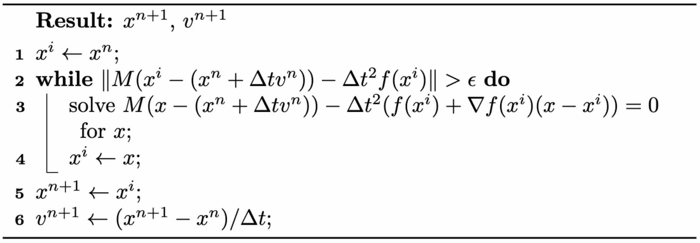

## 隐式时间积分

与显式时间积分相反，隐式时间积分需要求解一个方程组才能确定 \\(x^{n+1}\\) 和 \\(v^{n+1}\\) 的值。这种方法的一个显著优势是它有可能大幅提升稳定性。最简单的隐式积分形式——后向欧拉法——介绍如下。

> **{{met}}{met:lec1:backward_euler}[后向欧拉时间积分在牛顿第二定律中的应用]**
已知当前状态变量、质量矩阵以及从 \\(t^n\\) 到 \\(t^{n+1}\\) 的时间区间，更新规则如下：
$$
\begin{aligned}
x^{n+1} & = x^n + \Delta t v^{n+1}, \\
v^{n+1} & = v^n + \Delta t M^{-1}f^{n+1},
\end{aligned}
{{numeq}}{eq:lec1:updateRule_implicit}
$$
其中 \\(n\\) 取值为 \\(0,1,2,\dots\\)。

在本书讨论的许多情形中，力由位置向量 \\(x\\) 导出。因此我们可以记 \\(f^{n+1} = f(x^{n+1})\\)。必须认识到，\\(x^{n+1}\\) 的更新依赖于已知的 \\(v^{n+1}\\)，而 \\(v^{n+1}\\) 的计算又取决于 \\(x^{n+1}\\)。这种相互依赖形成了循环依赖，因此必须求解一个方程组才能准确求出 \\(x^{n+1}\\) 与 \\(v^{n+1}\\)。令 \\(v^{n+1} = (x^{n+1} - x^n) / \Delta t\\)，方程 {{eqref:eq:lec1:updateRule_implicit}} 可改写为：
$$
M (x^{n+1} - (x^n + \Delta t v^n)) - \Delta t^2 f(x^{n+1}) = 0. {{numeq}}{eq:lec1:system_IE}
$$
由于力 \\(f\\) 相对于位置 \\(x\\) 往往呈现非线性，方程 {{eqref:eq:lec1:system_IE}} 通常也是非线性的，需要借助**牛顿法**之类的非线性求根技术来求解。

> **{{met}}{met:lec1:newton_backward_euler}[将牛顿法应用于后向欧拉时间积分]**
如下方算法所述，牛顿法是一种迭代技术，从解的初始估计 \\(x^i\\) 出发。在当前迭代点 \\(x^i\\) 处，它对 \\(f(x^{n+1}) \approx f(x^i) + (x^{n+1}-x^i) \nabla f(x^i)\\) 做线性近似，然后求解一个线性系统并更新迭代。这一过程反复进行，直至达到令人满意的收敛程度。<figure>
<b><figcaption>{{alg}}{alg:lec1:newton_method_IE}[后向欧拉时间积分的牛顿法]</figcaption></b>
</figure>

虽然后向欧拉法即使在 \\(\Delta t\\) 取很大值时也能保证**无条件稳定**，但必须认识到，增大 \\(\Delta t\\) 可能导致系统条件数变差。条件数变差会使线性系统的求解更加困难。此外还需要牢记，力的线性化只是一种近似。如果解的初始估计与真实解相距较远，标准的牛顿迭代可能不收敛，甚至可能发散。

在后文的讨论中，我们将介绍一种改进的牛顿法。这一改进旨在针对特定类型的问题保证收敛，而不论初始估计如何、\\(\Delta t\\) 取多大。

