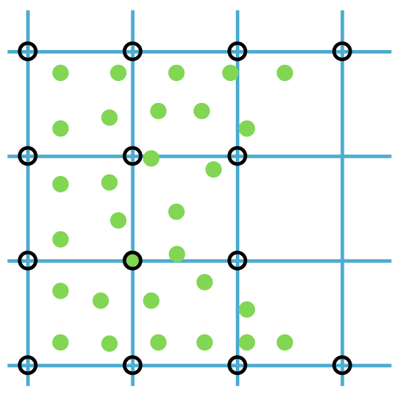

## 固体几何的表示

在日常生活中，固体对象被感知为连续的。然而在计算机的数字世界里，我们用离散的数字进行表示，于是涌现出一系列有趣的方法。

一种方法是**参数化**。考虑一个三维球体，它可以描述为 $ \{\mathbf{x} \in \mathbb{R}^{3} \ | \ \|\mathbf{x} - \mathbf{c}\|\le r, \ \mathbf{c}\in \mathbb{R}^{3}, \ r > 0 \} $，即以点 \\( \mathbf{c} \\) 为球心、\\( r \\) 为半径的球。这一思路不限于球体，还可涵盖半空间、盒子、椭球、环面等形状，它们借助有符号距离等函数用其_内部_来刻画。然而，参数化在处理现实场景中经常遇到的复杂几何时会面临困难。这一局限的一个新兴例外是采用神经网络的先进神经表示。这些较新的方法有望有效地表示更为复杂的几何形态。

另一种方法是**用采样来表示**。这需要在物体表面及其内部选取点。但仅有这些点还不够；我们通常还需要建立点之间的连接关系，以便为渲染、3D 打印等应用定义物体的边界。跟踪一簇点随时间的位置变化，也有助于度量变形。

在连续介质力学中，物体被视为具有连续的密度场。在数字表示中，这种连续性必须被离散地表示，通常的方式是定义固体几何的**连接关系**。

> **{{rem}}{rem:lec1:other_solid_rep}[其他固体表示方式]**
还有其他表示固体几何的方法，例如基于体素的方法。这类方法把空间划分为由小盒子（即体素）组成的三维网格，每个体素表示物体的一部分，类似于二维图像中的像素。基于体素的方法有多方面的优势。首先，它们可以作为离散的水平集表示，既能建模复杂几何，又能追踪其随时间的演化。每个体素都包含其相对于物体表面的位置信息，从而给出连续水平集函数的一种高效离散近似。这对于涉及表面演化、形状优化和碰撞检测的算法很有裨益。其次，基于体素的方法便于进行构造实体几何（Constructive Solid Geometry，CSG）运算。实体建模中的这一技术利用布尔运算符把较简单的形状组合成复杂的三维模型。体素化框架使得并、交、差等运算可以在体素网格上直接而高效地执行。这便于创建和修改复杂的形状。

> **{{exp}}{exp:lec1:mesh}[网格]**
用边或三角形直接连接点来创建**网格**，是计算几何中一种常用的技术。这一概念如配图所示，其中左图与中图展示了两个不同的网格。值得注意的是，尽管这两个网格使用了相同的采样点（或节点），它们的连接关系不同，因而形状也不同。图中最右侧的网格演示了从一个形状到另一个形状的变换。该网格表示中图网格的一种变形，其做法是把它上半部分沿竖直方向压缩。<figure>
<figcaption><b>{{fig}}{fig:lec1:mesh}</b> 网格</figcaption>
</figure>

> **{{exp}}{exp:lec1:particle_grid}[粒子与网格]**
在我们的空间表示中引入均匀网格结构，我们会在每个节点位置记录固体物质的多少。这使我们能够利用采样点计算每个网格节点处的固体密度。该方法有助于量化固体在网格内的分布，也有助于在原始采样点之间建立连接网络。这一概念的直观演示见配图。图中采样点用绿色圆点表示。记录固体密度的网格节点用黑色圆圈表示。这些节点通过网格相连，以蓝色线条表示。<figure>
<figcaption><b>{{fig}}{fig:lec1:particle_grid}</b> 粒子与网格</figcaption>
</figure>

在现代固体仿真领域，上述定义连接关系的方法至关重要。第一种方法通过由边或三角形构成的网格建立连接，是有限元方法（Finite Element Method，FEM）仿真器的基础。第二种方法利用均匀网格计算固体密度并建立连接，是物质点法（Material Point Method，MPM）仿真器不可或缺的组成部分 @@jiang2016material。本书主要关注前一种方法，深入探讨 FEM 的细节。FEM 基于网格的结构把复杂区域分解为较简单的单元，因而在处理复杂区域时尤为有效。这使 FEM 成为可变形固体研究与仿真的核心工具，理解其精微之处对从事该领域研究的人至关重要。

乍看之下，MPM 中同时使用两种固体几何表示似乎冗余。然而这一双重途径赋予了 MPM 显著的优势，尤其是在仿真固体断裂这类动态事件时。在这类情形下，FEM 若要准确刻画损伤，就必须细致地修改定义原始连接关系的边与单元。相比之下，MPM 能高效处理这些情形。均匀网格天然地容纳了断裂中物体各部分的分开：断裂节点处没有物质，相邻网格节点便自动断开连接。这一特性使 MPM 在应对固体拓扑变化方面表现出色。

不过，就仿真精度控制而言，有限元方法（FEM）更胜一筹。FEM 直接在网格上运算，无需不断进行信息传递，因而能保证更高的精度。这种精度使 FEM 成为精确仿真可变形固体的宝贵资源，而这正是本书的重点所在。

在连接关系固定的前提下，把每个采样点的坐标合并为一个扩展向量（记作 \\( x\in\mathbb{R}^{dn} \\)，见下图），是描述某一具体几何构型的有效手段。在这个表示中，\\(d\\) 表示空间维度（1、2 或 3），\\(n\\) 表示点的总数。同样地，每个采样点上的速度、加速度和力等属性也可以合并为相应的扩展向量，分别记作 \\(v\\)、\\(a\\) 和 \\(f\\)。这种条理化的数据呈现方式不仅有助于全面理解各项参数及其相互关系，也使仿真过程的数学表述更加简洁。

<figure>
<figcaption><b>{{fig}}{fig:lec1:stacked_var}</b> 堆叠的位置向量
</figcaption></figure>
