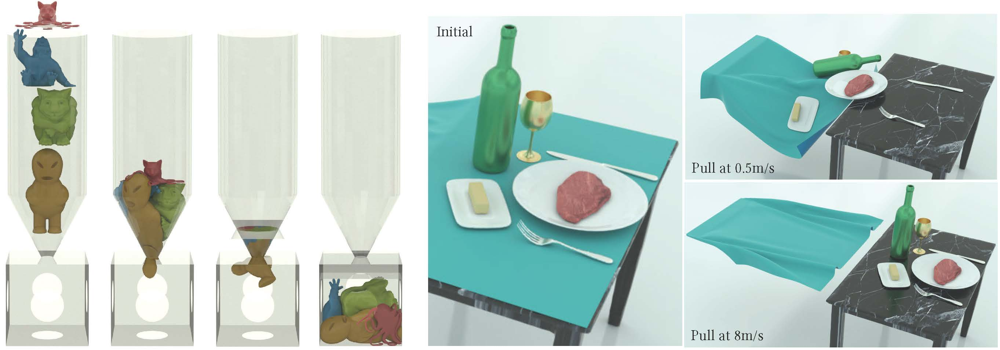

## 接触

要准确地仿真固体，就必须确保它们不发生相互穿透，如下图所示（左侧）。一种有效的方法是对时间步长施加 **CFL**（Courant-Friedrichs-Lewy 条件）上限，这在 MPM 之类的方法中尤为重要。在有限元方法（FEM）中，这要求对接触力进行精确建模。然而，精确地建模接触并非易事。接触本质上是一个非光滑过程，它在固体相互接触的瞬间突然发生。目前并不存在能够准确刻画这一现象的势能形式。

<figure>
    
    <figcaption><b>{{fig}}{fig:lec2:contact_and_friction}[接触与摩擦的仿真示例]</b> 左图展示了一个有趣的仿真：四个角色坠入漏斗，随后被一块运动的平面挤出。整个过程执行得完美无瑕，在这场复杂的相互作用中没有任何相互穿透，凸显了所用模型的精确性。右图则是经典的“桌布戏法”仿真，以不同的速度执行。随着桌布被抽走而桌上的摆设纹丝不动，仿真的真实感——尤其是对摩擦的准确刻画——变得一目了然，这与人们在现实生活中的预期完全一致。这些仿真展示了当代计算模型在模拟接触方面惊人的能力与精度，让抽象的物理概念变得生动而引人入胜。 </figcaption>
</figure>

在实际应用中，判断两个物体是否发生碰撞，通常依靠视觉与思维上对它们接近程度的评估。当它们之间的距离不为零时，说明仍存在空隙，尚未发生碰撞。在计算语境下建模物体间的相互作用时，这一概念至关重要。

为避免碰撞或穿透，我们可以保证运动物体表面之间的距离始终不降为零。这一思路在计算仿真的时间积分问题中尤为有用。我们用不等式约束来建模这一情形，这些约束与边界条件相结合，便将时间积分问题表述为：
$$
\begin{aligned}
    \min_x E(x) \quad s.t. \quad Ax = b \ \text{and} \ \forall k, \ c_k(x) \geq \epsilon.
\end{aligned}
{{numeq}}{eq:lec2:IC}
$$
这里，\\(c_k\\) 度量固体表面上特定区域对之间的距离，而 \\(\\epsilon \\rightarrow 0\\) 是一个很小的正值，用以确保 \\(c_k(x)\\) 保持严格为正。

在式 {{eqref:eq:lec2:IC}} 所示问题的局部极小点处，需满足 Karush-Kuhn-Tucker（KKT）条件，如下：
$$
\begin{aligned}
    \nabla E(x) - A^T \lambda - \sum_k \gamma_k \nabla c_k(x) = 0, \\
    A x = b, \\
    \forall k, \ c_k(x) - \epsilon \geq 0, \ \gamma_k \geq 0, \ \gamma_k (c_k(x) - \epsilon) = 0.
\end{aligned}
{{numeq}}{eq:lec2:IC_KKT}
$$
在该条件中，\\(\\gamma_k\\) 是约束 \\(c_k(x) \\geq \\epsilon\\) 的拉格朗日乘子。具体来说，\\(\\nabla c_k(x)\\) 指向接触对 \\(k\\) 的接触力方向。这一方向与由 \\(\\gamma_k\\) 表示的幅值相结合，便给出该点处实际的接触力。

> **{{rem}}{rem:lec2:complementarity_slack}[互补松弛条件]**
互补松弛条件 \\(\\gamma_k (c_k(x) - \\epsilon) = 0\\) 起着关键作用：它保证只有当固体相互接触（\\(c_k(x) = \\epsilon\\)）时才会存在接触力（\\(\\gamma_k \\neq 0\\)）。反之，当固体未接触（\\(c_k(x) > \\epsilon\\)）时，不应存在接触力（\\(\\gamma_k = 0\\)）。

> **{{def}}{def:lec2:active_set}[活跃集]**
对于带有如下定义的不等式约束的优化问题
\\[
    \\forall k, \\ c_k(x) \\geq 0,
\\]
<strong>活跃集（active set）</strong>定义为
\\[ 
    \\{ l \ | \ c_l(x^\*) = 0 \\}. 
\\]
这里，\\(x^\*\\) 是该问题的局部最优解。

> **{{rem}}{rem:lec2:comb_diffcult}[组合困难]**
互补松弛条件表明，在解处只有活跃集内的约束才具有非零的拉格朗日乘子 \\(\\gamma_k\\)。这意味着，与等式约束不同，不等式约束不仅需要求解拉格朗日乘子的取值，还要求判定哪些 \\(\\gamma_k\\) 应被置为 \\(0\\)。这就带来了组合上的困难。

处理带不等式约束的优化问题有大量可用技术。每种方法都引入了不同的思路，针对问题的不同侧面。

- **原始-对偶方法：** 这一类方法同时处理原始问题（即原优化问题）与其对偶问题。对偶问题往往能为原始问题的解提供有价值的洞见，因此这一思路颇具吸引力。这类方法是迭代式的，利用原始问题与对偶问题之间的关系来逐步改进初始解。然而，原始-对偶算法的设计与实现可能相当繁复，需要在两类问题之间小心权衡。这些方法虽然有效，但对于复杂的高维问题可能并不高效或直接。

- **投影最速下降法：** 这类方法是对经典最速下降法的修正，用以处理约束。每次迭代中，算法沿最速下降方向移动，若因约束而偏离可行集，则再投影回可行集。该方法简单直接，因而广受欢迎，但面对收敛缓慢的病态问题，或面对难以投影的约束时，可能力不从心。

- **内点法：** 又称障碍函数法，这类技术引入一个对不可行解施加惩罚的障碍函数，从而把解引导向可行域的内部。该思路有效地将约束问题转化为无约束问题，可用常规技术求解。然而，障碍函数的选择会显著影响方法的表现。这类方法对某些类型的问题很高效，但若可行域难以定义或缺乏简单的内部，则可能难以奏效。

尽管上述各种方法各有优劣，我们的主要关注点将是一种鲁棒而准确的接触建模方法，即**增量势接触（Incremental Potential Contact，IPC）**。IPC 的独特之处在于用一个光滑的势能来近似接触过程。这一变换有效地把问题转化为无约束问题，便于应用各种高效且鲁棒的优化技术。IPC 的一个关键特性是，它能够把相对于非光滑形式的近似误差控制在预先确定的界内。这一特性进一步提升了方法的鲁棒性与可靠性，使其成为解决接触问题的一条颇具前景的途径。
