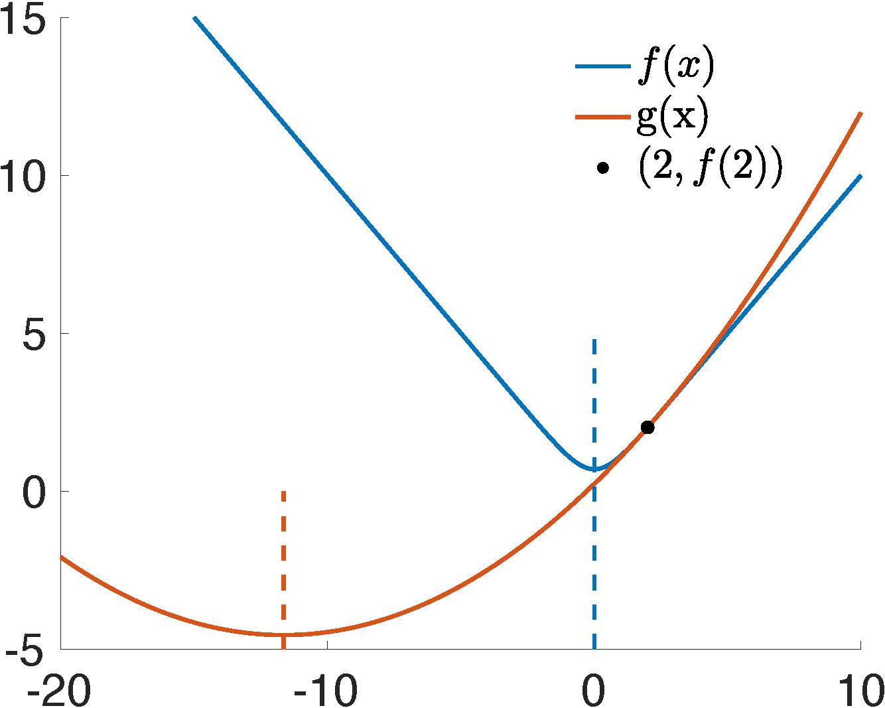

## 牛顿法的收敛性问题

在处理隐式欧拉时间积分所给出的最小化问题（参见式 {{eqref: eq:lec2:optimization_IE}}）时，对由此得到的非线性方程组采用牛顿法（见 {{ref: alg:lec1:newton_method_IE}}）是一种可行的策略。这需要令增量势能的梯度为零：

$$
\nabla E(x) = 0.
$$

然而，将该方法应用于非线性弹性等情形（尤其是新胡克模型）时，并不总能保证收敛。截断误差的存在——尤其是在时间步较大或变形显著的场景中——会妨碍收敛。

> {{exp}}{exp:lec3:newton_conv_issue}[牛顿法收敛问题的图示]
为说明牛顿法不收敛的问题，我们考察一个以一维目标函数为特征的极小化问题：
$$
f(x) = \ln\left(e^{-x}+e^{x}\right).
$$
可以在 $x=2$ 处计算该函数，并用二次能量 $g(x)$ 对其作近似，其定义为：
$$
g(x) = f(2) + f'(2)(x-2) + \frac{1}{2}f''(2)(x-2)^2.
$$
$f(x)$ 与 $g(x)$ 的联合绘图（{{ref: fig:lec3:newton_issue_plot}}）清楚地显示，下一次迭代会越过真实目标，落在距真实解 $x=0$ 更远的点（$x=-11.645$）上。随后的迭代不断放大这一偏差，导致轨迹发散。值得注意的是，这一演示涉及的还是一个凸函数 $f(x) = \ln\left(e^{-x}+e^{x}\right)$。当把牛顿法用于非凸的弹性能时，问题会变得更加复杂。 <figure>
    

    
    

    <figcaption><b>{{fig}}{fig:lec3:newton_issue_plot}</b> 在 $x=2$ 处对 $\min_x E(x) = \ln\left(e^{-x}+e^{x}\right)$ 执行牛顿法的一次迭代。 </figcaption>
</figure>

> **{{rem}}{rem:lec3:convexity}[能量的凸性]** 凸函数的特征是其在整个定义域上的二阶导数对称正定（SPD）。相反，计算机图形学中使用的大多数非线性弹性模型的能量具有旋转不变性。这意味着无论物体或单元处于何种旋转朝向，能量值都保持不变。这种旋转不变性导致了**非凸性**，使优化过程更加复杂。

> {{def}}{def:lec3:spd}[对称正定性]
> 方阵 $A \in \mathbb{R}^{n\times n}$ 是对称正定的，当且仅当 
> - $A = A^T$，且
> - 对任意 $v \in \mathbb{R}^n, v \neq 0$，都有 $v^TAv > 0$。

与直接求解非线性方程不同，最小化问题提供了能量度量，使我们能够借助一种称为线搜索的技术来保证全局收敛。
