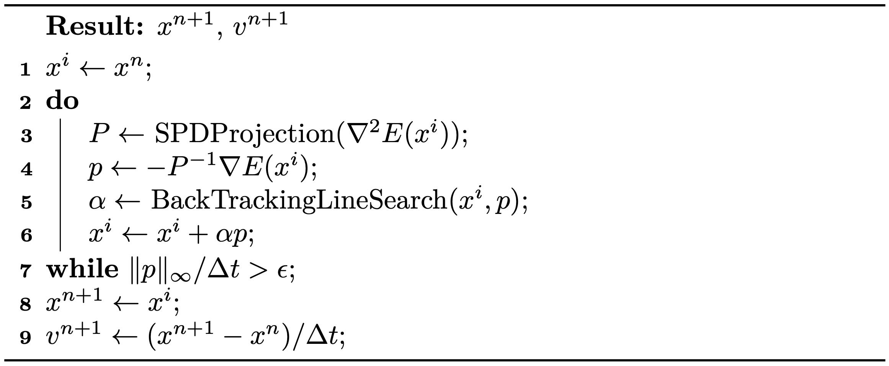

## 基于梯度的优化

标准牛顿法的搜索方向通过最小化目标能量的局部二次近似来计算：
$$
    p = \text{arg}\min_{\Delta x} (E(x^i) + \Delta x^T \nabla E(x^i) + \frac{1}{2} \Delta x^T P \Delta x )
    {{numeq}}{eq:lec3:search_direction}
$$
其中 \\(P = \nabla^2 E(x^i)\\)。在一般的基于梯度的优化方法中，\\(p\\) 可以用任意代理矩阵 \\(P\\) 通过式 {{eqref: eq:lec3:search_direction}} 计算得到。取 \\(P = I\\) 便得到 \\(p = -\nabla E(x^i)\\)，这正是标准梯度下降法所采用的。由于能量近似是低阶的，该方法的收敛速度比牛顿法更慢。代理矩阵 \\(P\\) 越接近海森矩阵 \\(\nabla^2 E(x^i)\\)，收敛就越快。因此，用海森矩阵的 SPD 近似作为代理，既能保证搜索方向始终为下降方向，又能保持接近二次的收敛速度。这类似于用凸的能量代理在局部近似非凸能量。

获得这种 SPD 近似的一种直接方法是：先通过求解
$$
    \min_P \| P - \nabla^2 E(x^i)\|_\text{F} \quad s.t. \quad v^T P v \geq 0 \ \ \forall v \neq 0,
$$
把 \\(\nabla^2 E(x^i)\\) 投影到其最接近的半正定矩阵上，然后引入扰动以确保 \\(P\\) 可逆。此时解为 \\(P = Q \hat{\Lambda} Q^{-1}\\)，其中 \\(P = Q \Lambda Q^{-1}\\) 是特征分解，且当 \\(\Lambda_{ij} > 0\\) 时 $\hat{\Lambda}_{ij} = \Lambda_{ij}$，否则 \\(\hat{\Lambda}_{ij} = 0\\)。直观地说，\\(P\\) 就是把 \\(\nabla^2 E(x^i)\\) 的所有负特征值置零后得到的矩阵。

> **{{def}}{def:lec3:eigendecomposition}[特征分解]** 方阵 \\(A \in \mathbb{R}^{n \times n}\\) 的特征分解为
> $$ A = Q\Lambda Q^{-1} $$
> 其中 \\(Q = [q_1, q_2, ..., q_n]\\) 由 \\(A\\) 的特征向量 \\(q_i\\) 组成，$\|q_i\| = 1$；\\(\Lambda = [\lambda_1, \lambda_2, ..., \lambda_n]\\)，其中 \\(\lambda_1 \geq \lambda_2 \geq ..., \lambda_n\\) 是 \\(A\\) 的特征值；且 \\(Aq_i = \lambda_i q_i\\)。

然而在仿真中，\\(\nabla^2 E(x^i)\\) 通常是大型稀疏矩阵，对其进行特征分解的代价将高得难以承受。幸运的是，我们将在本书后文发现，固体仿真中的增量势可以表示为定义在局部模板上的能量之和，例如二维有限元方法（FEM）网格中的一个三角形：
$$
    E(x) = \sum_j E_j(\mathbf{x}_{j1}, \mathbf{x}_{j2}, ...),
$$
其中 \\(\mathbf{x}_{jk}\\) 是与能量 \\(E_j\\) 相关联的节点。因此，我们只需对定义在少量节点上的每个 \\(\nabla^2 E_i\\) 将其负特征值置零再加以汇总，便可方便地获得一个相当好的 SPD 近似。

> **{{exp}}{exp:lec3:local_projection}[局部投影方法]** 要在具有 10,201 个节点和 20,000 个三角形的三角形网格上仿真二维弹性，海森矩阵 \\(\nabla^2 E(x)\\) 的规模为 \\(20,402 \times 20,402\\)。对于上述局部投影方法，需要对 \\(6 \times 6\\) 矩阵执行 20,000 次特征分解。考虑到对 \\(n \times n\\) 矩阵做特征分解的计算复杂度比 \\(O(n^2)\\) 更差，这一粗略估计已经表明，对于这个中等规模的问题，采用局部投影方法可带来超过 \\(500\times\\) 的加速。

此外，由于 \\(\nabla^2 E(x^i)\\) 中的质量矩阵是对称正定（SPD）的，而 SPD 矩阵之和仍为 SPD，因此在投影其他矩阵时无需引入扰动。下面我们在 {{ref: alg:lec3:PN_method_IE}} 中总结用于后向欧拉时间积分的全局收敛投影牛顿法。

<figure>
    

    <b><figcaption>{{alg}}{alg:lec3:PN_method_IE}[后向欧拉时间积分的投影牛顿法]</figcaption></b>
    
    

</figure>

> **{{rem}}{rem:lec3:stopping_criteria}[停止准则]** 由式 {{eqref: eq:lec3:search_direction}} 可知，$\|p\|$ 可解释为当前估计 \\(x^i\\) 到最优解之间距离的二次近似。因此我们采用 $\|p\|_\infty / \Delta t$ 作为更直观的停止准则度量。该做法把它转换为速度单位，并取所有节点上的最大幅值。
