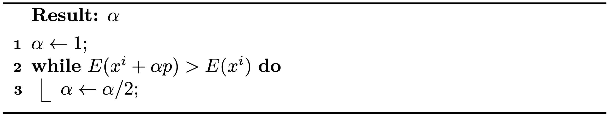

## 线搜索

在迭代最小化方法中，线搜索在每次迭代中只取步长的一部分，以保证目标能量在新点处下降。

具体来说，对于牛顿法，{{ref: alg:lec1:newton_method_IE}} 中的第 4 行由 \\(x^i \leftarrow x\\) 改为 \\(x^i \leftarrow x^i + \alpha (x - x^i)\\)，其中 \\(\alpha \in (0,1]\\) 是步长，它对能量的下降至关重要。这引出了两个关键问题：这样的 \\(\alpha\\) 总是存在吗？\\(\alpha\\) 是如何计算的？

> **{{rem}}{rem:lec3:line_search_existence}[α 的存在性]** 设目标能量 \\(E(x)\\) 在 \\(x^i\\) 处光滑且 \\(\nabla E(x^i) \neq 0\\)，若搜索方向 \\(p=x-x^i\\) 为下降方向，即 \\(p^T \nabla E(x^i) < 0\\)，则存在 \\(\alpha > 0\\) 使得 \\(E(x^i + \alpha p) < E(x^i)\\)。

> **{{met}}{met:lec3:backtracking}[回溯线搜索]** 给定一个下降方向，我们可以从 \\(1\\) 开始不断将其折半，直到新位置处的能量小于当前能量，从而找到一个合理较大的 \\(\alpha\\)（见 {{ref: alg:lec3:line_search}}）。<figure>
    

    <b><figcaption>{{alg}}{alg:lec3:line_search}[回溯线搜索算法]</figcaption></b>
    
    

</figure>

> **{{rem}}{rem:lec3:other_line_search}[其他线搜索方法]**
还有一些其他的线搜索方法，它们试图利用多项式插值来寻找一个 \\(\alpha\\)，使新位置处的能量更接近线段 \\(x^i + s p\\)（\\(s\in(0,1]\\)）上的局部极小值。然而，这类方法通常会带来更高的计算开销，而且未必能改善优化的整体实际耗时。

现在，有了线搜索，如果牛顿法始终能产生下降的搜索方向，那么对于任意初始构型、任意具有下界的光滑能量，该方法都保证收敛。我们知道在第 \\(i\\) 次迭代中，\\(p = -(\nabla^2 E(x^i))^{-1} \nabla E(x^i)\\)，因此 \\(p^T \nabla E(x^i)\\) 等于 \\(-\nabla E(x^i)^T (\nabla^2 E(x^i))^{-T} \nabla E(x^i)\\)。对于凸能量，\\(\nabla^2 E(x^i)\\) 总是对称正定（Symmetric Positive Definite，SPD）的，\\((\nabla^2 E(x^i))^{-T}\\) 亦然，因此 \\(p\\) 始终是下降方向。然而，对于非凸能量，这一保证并不总是成立。解决该问题的一种方法是使用凸能量代理在局部近似能量。
