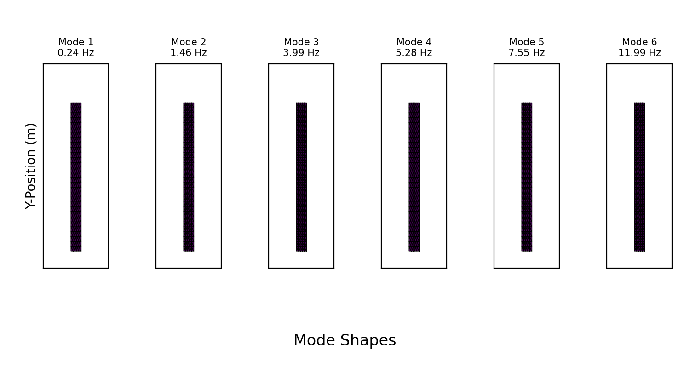
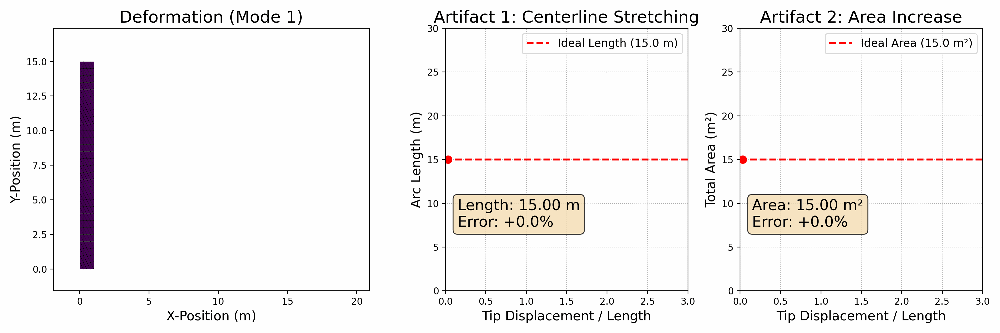

## 线性模态分析演示*

我们为二维悬臂梁实现了线性模态分析流程，代码见 [solid-sim-tutorial/9_reduced_DOF/linear.py](https://github.com/phys-sim-book/solid-sim-tutorial/blob/main/9_reduced_DOF/linear.py)。

###  模态形状的可视化

按照方法部分给出的预计算步骤，我们用有限元方法组装了全局质量矩阵（$\mathbf{M}$）与刚度矩阵（$\mathbf{K}$）。对梁的一端施加固定边界条件后，我们求解广义特征值问题（$\mathbf{K}\mathbf{x} = \lambda\mathbf{M}\mathbf{x}$），以得到最低频的模态形状（$\mathbf{\psi}_i$）及其对应频率（$\omega_i = \sqrt{\lambda_i}$）。

所得模态通过按 $\mathbf{\psi}_i\sin(\omega_i t)$ 对梁的变形做动画来可视化。下面的动画展示了在以下参数取值下的前六个模态：

```py 
E = 5e7   # Young's modulus
nu = 0.3  # Poisson's ratio
rho = 500 # Density
# Height : length ratio = 1 : 15
```

<br>

<figure>
    <center>
        
        <figcaption><b>{{fig}}{fig:lec25:modes_1-6}</b> 计算得到的前六个振动模态的可视化。这些模态按频率从低（左）到高（右）排列，呈现出越来越复杂的变形形态，从简单弯曲到 S 形曲线以及压缩形状。</figcaption>
    </center>
</figure>

<br>

### 大变形引起的伪影

线性模态分析的主要局限在于：当发生大变形时，它会产生肉眼可见的伪影。为说明这一点，我们设计了第二个实验，专门考察第一阶弯曲模态。

在该实验中，我们让梁从静止状态变形到大幅挠曲状态并播放动画。在变形的梁旁边，我们实时绘制两个关键指标：
1.  **中心线弧长：** 对于真实的不可伸长物体，其中心线长度在纯弯曲过程中应保持不变。
2.  **总面积（二维体积）：** 对于近乎不可压缩的材料，总面积也应保持不变。

随着端点位移增大，线性模型会错误地预测：**(1) 梁的中心线显著伸长**，以及 **(2) 其总面积显著增大。**。

<br>

<figure>
    <center>
        
    </center>
    <figcaption><b>{{fig}}{fig:lec25:linear_model_artifacts}</b> 演示线性模型伪影的动画。（左）梁按第一阶线性模态变形。（中）曲线记录了中心线长度随端点位移的错误增长。（右）曲线记录了总面积的错误减小。</figcaption>
</figure>

<br>

这些伪影产生的原因是：线性模型无法计入大转动所引起的几何非线性。这一失效正是下一节所述方法的主要动机——那些方法专门为克服这些局限、准确仿真大幅度且物理上合理的运动而设计。
