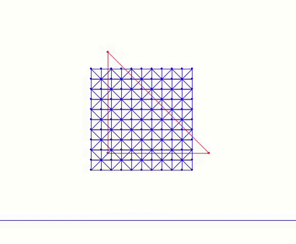

## 案例研究：ABD 方块下落*

现在我们在二维中实现仿射体动力学（ABD），用于[方块下落](../../boundary-treatments/filter-line-search/square_drop.md)仿真的新胡克（neo-Hookean）版本。这只需对标准增量势能接触（Incremental Potential Contact，IPC）仿真代码做少量修改。完整实现见我们的[固体仿真教程](https://github.com/phys-sim-book/solid-sim-tutorial)中的 `9_reduced_DOF` 文件夹。

我们首先引入一个计算约化基的函数。在仿射体动力学（ABD）中，我们只考虑仿射变形。因此，我们用 `method=1`（多项式基）与 `order=1`（线性基）来提取线性基：

{{imp}}{imp:lec25:compute_reduced_basis}[计算约化基，utils.py]
```python
{{#include ../../solid-sim-tutorial/9_reduced_DOF/utils.py:compute_reduced_basis}}
```

这里，`method=0` 指全空间仿真，它会立即返回、不计算任何基。  
`method=1` 计算多项式基，包括线性、二次与三次函数。对每个基向量，各节点处的位移分量被表示为该节点材料空间坐标的多项式函数。 
`method=2` 通过线性模态分析计算基，即求解弹性海森矩阵的特征系统，并提取对应于能量增长最少的变形模态的位移场。这将在[下一讲](../modal-reductions/modal_reductions.md)中更详细地讨论。

计算完基之后，我们通过投影海森矩阵与梯度向量，把仿真限制在相应的子空间中。这一投影遵循链式法则，如公式 {{eqref: eq:lec25:newton_chain_rules}} 所述。相关实现为：

{{imp}}{imp:lec25:search_dir}[计算约化搜索方向，time_integrator.py]
```python
{{#include ../../solid-sim-tutorial/9_reduced_DOF/time_integrator.py:search_dir}}
```

这些改动使我们能够运行仿射体动力学（ABD）版本的方块下落仿真：

<figure>
    <center>
        
        <figcaption><b>{{fig}}{fig:lec25:abd_sim}</b> 方块下落到地面上的仿射体动力学（ABD）仿真。</figcaption>
    </center>
</figure>

在这个例子中，我们调低了刚度参数，使物体更软，以突出仿射体动力学（ABD）与标准增量势能接触（IPC）之间的差异。蓝色网格是原始网格（同时也用于碰撞），而红色三角形可视化了约化的自由度。
