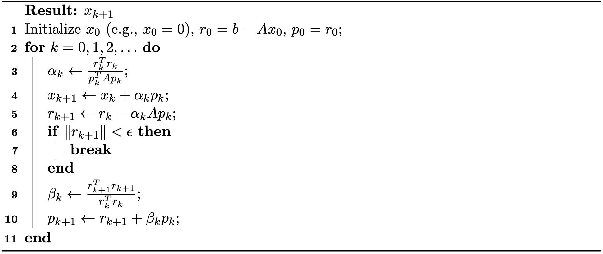

## 共轭梯度法

共轭梯度（Conjugate Gradient，CG）法是求解 $Ax = b$ 形式大型稀疏线性系统的一种强有力迭代算法，其中 $A$ 为对称正定（Symmetric Positive Definite，SPD）矩阵。与 Jacobi、Gauss-Seidel 等一般迭代法不同，CG 专为 SPD 矩阵设计，已成为科学计算与数值仿真中的基础算法。

### 表述为二次优化问题

共轭梯度法也可以看作一种优化算法，用来最小化二次函数：
$$
    f(x) = \frac{1}{2} x^T A x - b^T x,
    {{numeq}}{eq: lec31:cg_optimization}
$$
其中 $A$ 为 SPD 矩阵。$f(x)$ 的唯一全局极小点正是 $Ax = b$ 的解。

经典最速下降法沿负梯度方向 $-\nabla f(x) = b - Ax$ 更新 $x$，但该方法可能收敛缓慢，尤其是当 $A$ 病态时。CG 法克服了这一局限：它沿一列精心选取的方向 $p^{(k)}$ 搜索，这些方向是 $A$-共轭的（或称 $A$-正交的），即对 $i \neq j$ 有 ${p^{(i)}}^T A p^{(j)} = 0$。这一共轭性质保证沿某个方向取得的进展不会被后续步骤抵消，且沿各方向的极小化相互独立。

### 线搜索

给定共轭方向序列 $p^{(0)}, p^{(1)}, p^{(2)}, \ldots$，最小化二次函数的问题就归结为寻找最优步长 $\alpha^{(i)}$，使 $\sum_{i=0}^{n-1} \alpha^{(i)} p^{(i)}$ 充分逼近解 $x^*$。

最直接的做法是**贪心线搜索**：从初始点 $x^{(0)}$ 出发，选取搜索方向 $p^{(0)}$，然后关于 $\alpha^{(0)}$ 最小化 $f(x^{(0)} + \alpha^{(0)} p^{(0)})$。对于二次函数，该优化问题具有无需矩阵求逆的简单闭式解：
$$
    \alpha^{(0)} = \frac{{p^{(0)}}^T (b - A x^{(0)})}{{p^{(0)}}^T A p^{(0)}}.
$$
其直观含义是清楚的：从 $x^{(0)}$ 出发，选定方向 $p^{(0)}$，沿该方向移动直至目标函数达到极小。虽然这样一步未必到达全局极小，但它保证朝着最优解取得进展。

随后该过程迭代重复：在新点 $x^{(1)} = x^{(0)} + \alpha^{(0)} p^{(0)}$ 处，选取下一个方向 $p^{(1)}$，计算相应步长 $\alpha^{(1)}$，如此继续。

一般迭代过程可概括为：
$$
\begin{aligned}
\alpha^{(i)} &= \frac{{p^{(i)}}^T r^{(i)}}{{p^{(i)}}^T A p^{(i)}},\\
x^{(i+1)} &= x^{(i)} + \alpha^{(i)} p^{(i)},\\
r^{(i+1)} &= r^{(i)} - \alpha^{(i)} A p^{(i)}
\end{aligned}
{{numeq}}{eq: lec31:step_size}
$$
其中 $p^{(0)}, p^{(1)}, p^{(2)}, \ldots$ 为搜索方向，$r^{(i)} = b - Ax^{(i)}$ 为第 $i$ 步的残差。注意残差可以更新，而不必从头重算 $Ax^{(i+1)}$：$r^{(i+1)} = b - A x^{(i+1)} = b - A (x^{(i)} + \alpha^{(i)} p^{(i)}) = r^{(i)} - \alpha^{(i)} A p^{(i)}$。实际中，当 $\|r^{(i+1)}\|$ 变得足够小（通常低于给定容差）时，可提前终止迭代过程，以提高计算效率。

### 共轭方向

搜索方向的选取对方法性能至关重要。若方向 $p^{(0)}, p^{(1)}, p^{(2)}, \ldots$ 选取不当，收敛将会缓慢。特别地，梯度下降（使用最速下降方向）在矩阵 $A$ 病态时表现出缓慢收敛。

相反，若我们选取的方向两两 $A$-共轭：
$$
    {p^{(i)}}^T A p^{(j)} = 0, \quad \forall i \neq j,
{{numeq}}{eq:lec31:A-conjugate}
$$
则算法效率会显著提升：不再出现“锯齿”行为，并且至多 $n$ 步即可得到精确解，其中 $n$ 为系统的维数：

不失一般性，假设 $x^{(0)} = 0$，并令 $p^{(0)}$ 取为初始残差。由于 $x^{(0)} = 0$，$x^{(0)}$ 处的梯度为 $Ax^{(0)} - b = -b$，因此令 $p^{(0)} = b$。其余方向将被构造为与所有先前方向 $A$-共轭。

记 $r^{(k)}$ 为第 $k$ 步的残差：
$$
    r^{(k)} = b - A x^{(k)}.
{{numeq}}{eq:lec31:residual}
$$
注意 $r^{(k)}$ 等于 $f$ 在 $x^{(k)}$ 处的负梯度，因此标准梯度下降将沿方向 $r^{(k)}$ 移动。

为构造共轭方向，我们要求每个新搜索方向 $p^{(k)}$ 由当前残差 $r^{(k)}$ 构造，同时与所有先前的搜索方向 $A$-共轭。我们从负梯度 $r^{(k)}$ 出发，用 Gram–Schmidt 过程使其关于 $A$ 与所有先前搜索方向 $p^{(0)}, p^{(1)}, \ldots, p^{(k-1)}$ 正交：
$$
    p^{(k)} = r^{(k)} - \sum_{i=0}^{k-1} \frac{{p^{(i)}}^T A r^{(k)}}{{p^{(i)}}^T A p^{(i)}} p^{(i)}.
{{numeq}}{eq:lec31:conjugate_direction}
$$

### 算法化简

上述表达式可以大幅简化，从而得到共轭梯度算法简洁的最终形式。关键在于证明两个基本的正交关系。

**正交性质。** 我们首先确立如下正交关系成立：
$$
    {p^{(i)}}^T r^{(j)} = 0, \quad \forall i < j,
{{numeq}}{eq:lec31:lemma}
$$
$$
    {r^{(i)}}^T r^{(j)} = 0, \quad \forall i \neq j.
    {{numeq}}{eq:lec31:lemma2}
$$

**证明概要。** 由残差更新公式（公式 {{eqref:eq:lec31:residual}}），可递推地写出：
$$ 
    r_{j} = r^{(j-1)} - \alpha^{(j-1)} A p^{(j-1)} = r^{(i)} - \sum_{k=i}^{j-1} \alpha^{(k)} A p^{(k)}.
$$
两边与 $p^{(i)}$ 作点积：
$$
    {p^{(i)}}^T r^{(j)} = {p^{(i)}}^T r^{(i)} - \sum_{k=i}^{j-1} \alpha_{k} {p_{i}}^T A p_{k}.
$$
由 $A$-共轭性质（公式 {{eqref:eq:lec31:A-conjugate}}）与步长公式 $\alpha^{(i)} = \frac{{p^{(i)}}^T r^{(i)}}{{p^{(i)}}^T A p^{(i)}}$，可验证对 $i < j$ 有 ${p^{(i)}}^T r^{(j)} = 0$。

第二个正交关系 ${r^{(i)}}^T r^{(j)} = 0$ 可由如下事实推出：按构造方式，每个残差 $r^{(j)}$ 都位于搜索方向 $\{p^{(0)}, p^{(1)}, \ldots, p^{(j-1)}\}$ 的张成空间中，而这些方向又由先前的残差构造而来。

**简化公式。** 利用这些正交性质，共轭方向公式（公式 {{eqref:eq:lec31:conjugate_direction}}）可大幅简化。由于对 $i < k$ 有 ${p^{(i)}}^T r^{(k)} = 0$，我们有：
$$
    {p^{(k)}}^T r^{(k)} = {r^{(k)}}^T r^{(k)}.
$$

这使我们可以简化步长计算：
$$
    \alpha^{(k)} = \frac{{r^{(k)}}^T r^{(k)}}{{p^{(k)}}^T A p^{(k)}}.
    {{numeq}}{eq:lec31:simple_step_size}
$$

对于共轭方向更新，可以证明只有最近的方向才有影响。利用残差更新公式与正交性质：
$$
\begin{aligned}
    p^{(k+1)} &= r^{(k+1)} - \sum_{i=0}^{k} \frac{{p^{(i)}}^T A r^{(k+1)}}{{p^{(i)}}^T A p^{(i)}} p^{(i)} \\
            &= r^{(k+1)} - \sum_{i=0}^{k}\frac{{r^{(k+1)}}^T A p^{(i)}}{{p^{(i)}}^T A p^{(i)}} p^{(i)} \\
            &= r^{(k+1)} - \sum_{i=0}^{k} \frac{{r^{(k+1)}}^T (r^{(i)} - r^{(i+1)})}{\alpha^{(i)} {p^{(i)}}^T A p^{(i)}} p^{(i)}.
\end{aligned}
$$

代入正交关系（公式 {{eqref:eq:lec31:lemma2}} 与 {{eqref:eq:lec31:simple_step_size}}），上式化简为：
$$
\begin{aligned}
    p^{(k+1)} &= r^{(k+1)} + \sum_{i=0}^{k} \frac{{r^{(k+1)}}^T  r^{(i+1)}}{\alpha^{(i)} {p^{(i)}}^T A p^{(i)}} p^{(i)} \\
            &= r^{(k+1)} + \sum_{i=0}^{k} \frac{{r^{(k+1)}}^T  r^{(i+1)}}{{r^{(i)}}^T r^{(i)}} p^{(i)} \\
            &= r^{(k+1)} + \frac{{r^{(k+1)}}^T  r^{(k+1)}}{{r^{(k)}}^T r^{(k)}} p^{(k)}.
\end{aligned}
$$

这一显著简化表明：只需保留最近的搜索方向 $p^{(k)}$ 即可计算下一个方向 $p^{(k+1)}$。

**最终算法。** 简化后的 CG 算法总结于 {{ref: alg:lec31:cg}}：
<figure>
    

    <b><figcaption>{{alg}}{alg:lec31:cg}[共轭梯度法]</figcaption></b>
    
    

</figure>

### 预条件

共轭梯度法的收敛速率本质上由矩阵 $A$ 的条件数决定。当 $A$ 病态（即条件数很大）时，CG 可能收敛缓慢，需要许多次迭代才能达到可接受的精度。

**预条件**是一项关键技术，它通过将原系统变换为具有更有利谱性质的等价系统来加速收敛。其思路是求解修改后的系统：
$$
M^{-1} A x = M^{-1} b,
$$
其中 $M$ 是精心选取的**预条件子**矩阵，它逼近 $A$ 但求逆容易得多。

一种简单而有效的选择是**对角（Jacobi）预条件子**，即 $M = \text{diag}(A)$，只包含 $A$ 的对角元素。预条件 CG 算法在求解变换后系统的同时，保持原算法的基本结构。

实际中，预条件相当于在每次迭代时用 $M^{-1}$ 对残差进行缩放；当 $M$ 为对角矩阵时，这一操作计算代价很低。预条件 CG 算法沿用与标准 CG 相同的迭代结构，但作用在预条件后的残差上，对于病态问题往往能显著加快收敛。
