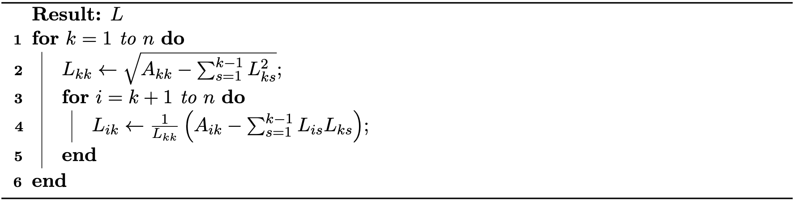

## 直接求解器

直接求解器是一类算法，旨在通过有限步运算得到线性系统的精确解（在数值精度范围内）。在优化与仿真的背景下，系数矩阵 $A$ 通常是对称正定（Symmetric Positive Definite，SPD）的，这使得直接求解器对中等规模问题既稳健又高效。

### 三角矩阵的前向与回代替换

当 $A$ 为三角矩阵时，求解 $A x = b$ 尤为直接。若 $A$ 为下三角矩阵，即
$$
\begin{bmatrix}
  a_{11} & 0      & \cdots & 0 \\
  a_{21} & a_{22} & \cdots & 0 \\
  \vdots & \vdots & \ddots & 0 \\
  a_{n1} & a_{n2} & \cdots & a_{nn}
\end{bmatrix}
\begin{bmatrix} x_1 \\ x_2 \\ \vdots \\ x_n \end{bmatrix} = \begin{bmatrix} b_1 \\ b_2 \\ \vdots \\ b_n \end{bmatrix}.
{{numeq}}{eq: lec31:tri_system}
$$
则该系统可用前向替换求解。第 $i$ 个变量的解为：
$$
x_i = \frac{1}{a_{ii}} \left( b_i - \sum_{j=1}^{i-1} a_{ij} x_j \right), \quad i = 1, \ldots, n.
{{numeq}}{eq: lec31:forward_substitution}
$$
该过程从 $i=1$ 推进到 $n$，使用已求得的、索引 $j<i$ 的 $x_j$。

若 $A$ 为上三角矩阵，则系统用回代替换求解：
$$
x_i = \frac{1}{a_{ii}} \left( b_i - \sum_{j=i+1}^{n} a_{ij} x_j \right), \quad i = n, n-1, \ldots, 1.
{{numeq}}{eq: lec31:backward_substitution}
$$
该过程从 $i=n$ 递减到 $1$，使用已求得的、索引 $j>i$ 的 $x_j$。

### Cholesky 分解

对于一般的 SPD 矩阵，我们可以借助 Cholesky 分解把问题化归为三角系统。给定 SPD 矩阵 $A$，可将其分解为 $A = LL^T$，其中 $L$ 为下三角矩阵。

> **{{met}}[Cholesky 分解]** 给定对称正定矩阵 $A$，Cholesky 分解计算一个下三角矩阵 $L$，使得 $A = LL^T$。算法如下： <figure>
    

    <b><figcaption>{{alg}}{alg:lec31:choleskly}[Cholesky 分解算法]</figcaption></b>
    
    

</figure>

一旦完成分解，求解 $A x = b$ 就化为求解两个三角系统：

1. **前向替换：** 求解 $L y = b$ 得到 $y$。
2. **回代替换：** 求解 $L^T x = y$ 得到 $x$。

Cholesky 分解利用了 $A$ 的对称性与正定性，相比 LU 分解等通用方法，同时降低了计算开销与内存占用。当系统规模不太大，或对病态系统需要高精度时，直接求解器被广泛采用。对于规模极大或高度稀疏的系统，则可能更倾向于迭代求解器，这将在下一节讨论。
